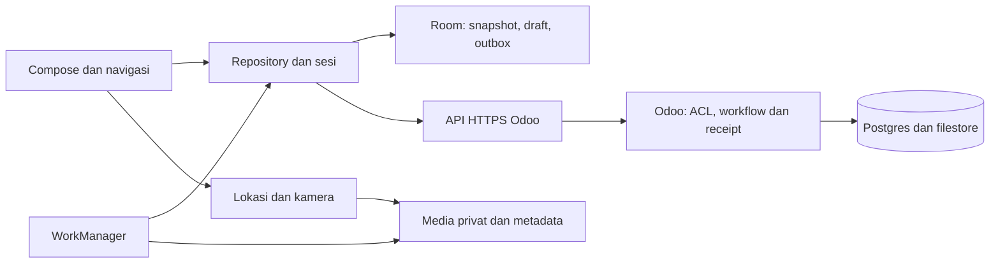

# Odooca Field Android — arsitektur dan rencana induk

Baseline engineering v2, 19 November 2026 WIB. Blueprint disintesis dari main `e28e655`; baseline bersama diselaraskan dengan main `39172de` dan mandat pemilik terbaru. Pemilik produk menetapkan cakupan dan menerima perubahan perilaku. Lead Android memelihara dokumen ini, urutan integrasi, dan bukti penerimaan. Status milestone diperbarui bersama bukti pada SHA yang diperiksa.

Dokumen ini menjadi acuan Android untuk requirement, milestone, dan dependency. [Blueprint v0.1](../blueprints/native_android_architecture_blueprint.md) adalah riwayat keputusan engineering. [SCOPE](../SCOPE.md) dan [Playbook](../PLAYBOOK_DISTRIBUTOR_FMCG.md) menetapkan domain, [rancangan API/PWA](../blueprints/mobile_api_and_pwa_plan.md) menjelaskan evolusi kontrak, [rekonsiliasi DS](../ui/DS_RECONCILIATION.md) memetakan desain PWA, dan [README Android](../../android/README.md) menjelaskan build yang tersedia. Instruksi terbaru pemilik berlaku jika ada perbedaan. Perilaku API diperiksa dari controller, model, tes, dan runtime target. Draft OpenAPI dan Figma perlu dicocokkan dengan bukti tersebut.

## Riwayat yang memengaruhi baseline

| Waktu | Keputusan atau bukti |
|---|---|
| 23–30 Oktober | Satu aplikasi lapangan dengan peran bertumpuk, PWA untuk demo, Android native sebagai kelanjutan. PJP, order per prinsipal, delivery dan bukti dibentuk dalam scope M6/M7 dan agenda MOB-00–06. API baca, foto privat dan penugasan WITA masuk melalui PR #38, #40–42, #44. |
| 1–4 November | PR #64, #68, #70, #76, #77 dan #82 membangun sesi Odoo, PJP, dispatcher, rollover dan pengiriman SO resmi dari PWA. PWA terautentikasi masih punya jalur simulasi Delivery. |
| 8–14 November | PR #100, #109, #127 memberi desain dan model order/penagihan dengan capability. PR #129 menggabungkan blueprint Kotlin/Compose N0–N7 dengan 62 layar dan baseline Redmi 4X/POCO M3. |
| 19 November | PR #159 memasukkan foundation Android, tes, lint dan APK CI. PR #163 mencatat verdict merge. PR #160 mencatat waktu berdetik dan keputusan awal PJP kosong. PR #170 memperbarui PJP menjadi opsi C serta mencatat keputusan approval dan dependensi server. |

## Arsitektur

Compose dan navigasi di `android/app` menampilkan state aplikasi dan mengelola lifecycle/izin perangkat. `core/designsystem` memetakan token semantik dari `pwa/design/tokens.json`. `core/domain` berisi aturan client yang dapat diuji di JVM, termasuk geofence, bukti, kualifikasi GPS dan perencanaan antrean. `core/data` menghubungkan repository ke Room, OkHttp, sesi terenkripsi dan WorkManager. Penambahan modul mengikuti batas tanggung jawab yang terbukti di kode.

Alur sinkron: login → bootstrap identitas → snapshot tervalidasi owner/company/hari → draft lokal → simpan evidence dan dependensi command secara atomik → kirim dengan sesi owner yang sama → rekonsiliasi receipt. Masa berlaku snapshot, format dan otorisasi divalidasi server. Retry mempertahankan UUID. HTTP sukses tanpa receipt yang cocok tidak mengubah status menjadi diterima. Pergantian akun mengisolasi snapshot, draft, foto dan antrean, termasuk ketika worker aktif. Rincian siklus recovery berada di spesifikasi dev.

## Requirements dan kriteria penerimaan

| ID | Requirement | Bukti penerimaan |
|---|---|---|
| R01 | Satu aplikasi dengan peran dari server, termasuk role bertumpuk bila tersedia. Bahasa Indonesia dan istilah FMCG konsisten. | Scope akun/peran diuji dan state tanpa hak atau tanpa penugasan tampil jelas. |
| R02 | Login, expiry, logout dan pergantian akun aman. Lease owner/generation melindungi pengiriman. | Dua akun, 401 pada item pertama, recovery akun yang sama, dan pergantian sesi di antara request. |
| R03 | Snapshot membawa versi, owner/company/gudang dan hari bisnis WITA. PJP kosong yang dinyatakan sah membuka aplikasi. Default tanpa sesi PJP. Opsi C mengizinkan carry-over hanya melalui keputusan Supervisor per salesman dan tanggal yang tercatat. Extra call/NOO dan carry-over mengikuti capability server. | Hari berganti, scope salah, PJP kosong sah, dan snapshot rusak diuji terpisah. |
| R04 | Foto privat, lokasi segar, provenance dan hash mengikat evidence ke workflow. Kualitas GPS dan integritas dinilai terpisah. | Izin ditolak/dicabut, GPS usang/akurasi rendah, retake, hash salah, dan receipt lintas outlet ditolak. |
| R05 | Draft dan outbox diisolasi, durable, dan dipulihkan setelah app berhenti. Retry menjaga UUID dan urutan evidence → command. | Putus jaringan saat kirim, process death/reboot, 401, retry dan receipt mismatch. Satu intent menghasilkan satu hasil server. |
| R06 | Kunjungan, penjualan, Delivery dan HRIS mengikuti workflow/capability Odoo. Preview harga diberi status estimasi, approval dan pembukuan tetap di server. | Satu alur terverifikasi sampai receipt; pending approval dan rejected terlihat berbeda. Fitur tanpa backend menampilkan ketidaktersediaan. |
| R07 | Adaptif untuk ukuran layar, font scale, keyboard, kontrol sistem dan aksesibilitas. Waktu kejadian `HH.mm.ss` WITA; jam rencana tetap mengikuti keputusan pemilik. | Bukti Compose/emulator dan perangkat kecil; semua state punya teks yang dapat dibaca dan aksi yang dapat dijangkau. |
| R08 | Data demo persisten terjaga; kredensial, lokasi presisi, foto dan informasi payroll dihindari di log/artifact publik. | Akun/assignment TEST terpisah, validasi target sebelum write, laporan field yang disanitasi. |

## Milestone, backlog, dan potongan integrasi

| ID | Potongan yang direncanakan | Gerbang keluar |
|---|---|---|
| N0 | SSOT; inventaris layar dan state; baseline token dan alur pertama. | Figma/frame yang disetujui tertaut ke requirement, capability, pemilik dan tes. Semua 62 layar terpetakan sebelum cakupan penuh dinyatakan selesai. |
| N1 | Foundation Kotlin/Compose, Room, outbox dan CI. | Terintegrasi melalui #159, 72 tes domain, tiga tes Room/sesi, lint, APK dan review PASS. |
| N2a | Harness emulator API 24/35 dan smoke Login/Beranda/Kalibrasi. | Boot, install, cold start, aksesibilitas dasar dan state izin terbukti; log dan screenshot terlacak ke SHA/API. |
| N2b | Login/snapshot di Odoo disposable; uji Redmi 4X/POCO M3; kontrak identity/qualification. | OS/RAM/API perangkat tercatat, expiry/switch-account diuji, decision record auth dan policy perangkat tersedia sebelum aktivasi resmi. |
| N3 | Offline/recovery: snapshot, draft, evidence, Room migration, retry dan diagnostics. | Process death, reboot, konflik, auth dan replay diuji. Antrean pending serta histori dijaga saat akun berubah atau app upgrade. |
| N4 | Check-in/out dengan kamera dan evidence, receipt, lalu absensi/sesi pagi resmi. | Satu workflow menghasilkan receipt resmi pada backend uji. Absensi resmi mengikuti kesiapan B04 dan scope PJP B03. |
| N5 | SO yang didukung → order v2 → Delivery/POD → penagihan/kas/biaya sesuai capability. | Harga dan approval direkonsiliasi di Odoo. Delivery menarik manifest resmi dan diuji partial/reject/close. Settlement direkonsiliasi ke faktur/payment. |
| N6 | HRIS, activity, diagnostics, polish dan aksesibilitas. | ACL self-service, privasi, review UI dan performa perangkat minimum terbukti. |
| N7 | Pilot, signing, versi, distribusi, observabilitas, upgrade dan rollback. | Acceptance perangkat dan bukti rilis pada SHA yang disetujui pemilik. |

N2a, desain N0, dan validasi domain N3 dapat maju paralel. N2b digunakan untuk membuktikan login/snapshot sebelum kerja transaksi. Saat absensi resmi masih terblokir, tes SO bisa memakai assignment disposable yang disiapkan eksplisit untuk membuktikan transport dan receipt; ini memberi bukti terbatas untuk N5.

## Register dependency endpoint, backend dan DB

[BACKEND_REGISTER](BACKEND_REGISTER.md) adalah register normatif B01–B09. Isinya endpoint aktual, gap per area, exit criteria, fallback client serta matriks target DB. P0 memblokir acceptance scope tertentu. Rancangan UI, emulator smoke dan pekerjaan domain yang independen dapat berjalan paralel.

## Boundaries dan state lintas tim

| Boundary | Invariant | Bukti minimum |
|---|---|---|
| Bootstrap → snapshot | Account, company, gudang, versi dan hari WITA cocok dengan scope server. Cache lama punya identitas dan status umur yang jelas. | Data layer menolak scope salah dan fixture Odoo membuktikan account ganda, hari berganti dan PJP kosong sah. |
| Draft → outbox | Owner, UUID, payload, evidence dan dependency tersimpan atomik. Lifecycle media mengikuti command dan policy retensi. | Room migration, process death, retry dan bukti bahwa akun lain tidak bisa mengirim atau membaca item. |
| Evidence → command | Privasi dan konteks foto dijaga, lokasi dinilai untuk kualitas secara terpisah dari integritas. Server memeriksa evidence sebelum menerima aksi resmi. | Uji izin, hash, geofence, salah outlet, salah owner, format serta storage gagal. |
| Receipt → UI | HTTP, status lokal dan keputusan server punya state berbeda. Approval, accepted dan rejected berasal dari receipt yang valid. | State matrix Design dan uji Compose harus cocok dengan wire contract, termasuk 401, retry dan penolakan bisnis. |
| Feature → capability | Server menentukan operasi yang tersedia. Perubahan capability saat resume menutup aksi yang tak lagi sah dan melindungi draf. | Tes capability on/off dan pencabutan role sebelum command dikirim. |
| Token → UI | Nama semantik terhubung ke token bersama. Perubahan token atau komponen membawa review dan bukti di Figma dan Compose. | Generator zero-diff, screenshot state yang terdampak dan review Design. |

Alur state dari draf sampai transaksi resmi secara konseptual: **draf lokal → menunggu bukti/jaringan → mengirim → receipt**. Sesi kedaluwarsa menahan antrean dan memerlukan akun asal. Timeout dengan hasil ambigu ditangani dengan replay UUID yang sama menurut kontrak. Receipt `needs_approval` tidak disamakan dengan `accepted`. Mapping akhir ke enum dan API mengikuti [spesifikasi Dev](DEV_SPEC.md).

## Keputusan lintas tim yang masih terbuka

| ID | Keputusan | Bukti dan pihak penerima |
|---|---|---|
| DEC-01 | File/versi Figma acuan, publish Library, kebutuhan Penpoint. | Pemilik menetapkan file dan jalur feedback. Design menyertakan inventory dan mapping ke [Design System](DESIGN_SYSTEM.md). |
| DEC-02 | OS perangkat aktual, `minSdk` final, GPS, dan qualification. | Lead, Dev dan backend meninjau matriks emulator/fisik serta kebijakan perangkat. |
| DEC-03 | Auth/revoke/retensi, capability role bertumpuk dan kebijakan cache offline. | Lead dan maintainer backend menyetujui kontrak dan jalur recovery. Pemilik meninjau dampak kebijakan pengguna. |
| DEC-04 | Target Odoo Android disposable dan akses runner. | Catat PIC, repo/backend SHA, fixture, target DB dan hasil cleanup. |
| DEC-05 | Format jam rencana, scope tema awal, target performa Redmi 4X, pilot dan rilis. | Pemilik meninjau usulan. Ukur startup, frame, memori dan performa sinkronisasi sebelum menetapkan budget. |

## Lingkungan dan bukti

GitHub Android gate telah menjalankan domain, OpenAPI, Robolectric, lint dan APK debug dengan base URL `https://ci.invalid`. Odoo CI menguji addon dengan Postgres disposable. Emulator dan koneksi APK ke backend masih N2. Cloud diperiksa tanpa Android SDK terkonfigurasi atau KVM yang terlihat. Mulai emulator pada runner yang akselerasinya terbukti, lalu ukur durasi dan stabilitas sebelum menjadikannya required context. Matriks awal API 24/35 melengkapi, dan pengujian fisik menetapkan kompatibilitas Redmi 4X serta POCO M3.

Evidence per potongan: SHA basis/head, requirement dan dependency, konfigurasi suite/target, hasil dan tautan artifact, daftar yang belum diuji. Pisahkan bukti domain, JVM/Room, emulator, Odoo disposable, dan fisik. Detail penyerahan: [operasi integrasi](INTEGRATION.md), [spec design](DESIGN_SPEC.md), [spec dev](DEV_SPEC.md).
