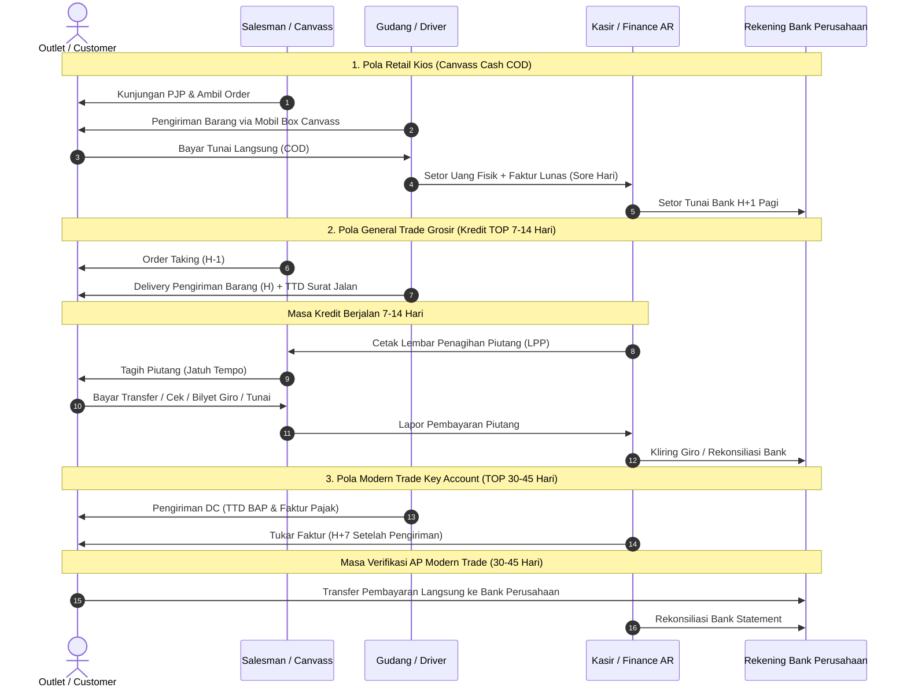

# Cetak Biru Simulasi Transaksi Historis FMCG Manado
**Entitas:** PT Manado Distribusi Utama (Fiktif)  
**Periode Simulasi:** 1 Juli 2026 s/d 24 Oktober 2026 (98 Hari Kerja Operasional)  
**Konteks Finansial:** Semua nilai moneter dinyatakan **DILUAR PPN (DPP Net)**  

---

## 1. Narasi Makro & Kurva Kausalitas Bulanan

```mermaid
graph TD
    subgraph Juli ["JULI 2026: Krisis Overstok & Push Order"]
        J1["Stok Awal 10 BIO (2B + PO Juni 5.7B)<br>Gudang Okupansi 105% Data / 2x Visual"] --> J2["Krisis Cashflow: AP Jatuh Tempo 9.5B<br>(4B JT Juli + 5.5B 50:50 Juli/Agt)"]
        J2 --> J3["Under Coverage 50% (272 Outlet)<br>Push Order Ekstrem ke Pareto MT & GT"]
        J3 --> J4["Suntikan Diskon Taktis hingga 5%<br>Overtime Gudang & Logistik Membengkak"]
        J4 --> J5["Omset Tercapai Rp 5.500.000.000<br>Tetapi Net Margin Anjlok ke 0.9%"]
    end

    subgraph Agustus ["AGUSTUS 2026: The Hangover & Flushing Stok"]
        J5 --> A1["Market Kejenuhan & Konsumen Minus Cash<br>Omset Drop -23% ke Rp 4.235.000.000"]
        A1 --> A2["Zero Inbound & Tahan AP Baru<br>Fokus Flushing Sisa Stok Gudang"]
        A2 --> A3["Disiplin Diskon Normal & OPEX Turun 8%<br>Buka Coverage Baru +6% (+16 Outlet)"]
        A3 --> A4["Net Margin Melega ke 2.5%<br>PO Release Week 3 Agt (Lead Time Jawa)"]
    end

    subgraph September ["SEPTEMBER 2026: Konsolidasi & Sehat"]
        A4 --> S1["Omset Melandai -6.5% ke Rp 3.960.000.000<br>Coverage Tumbuh +8% (+25 Outlet)"]
        S1 --> S2["Inbound Kapal Kontainer Tiba di Bitung<br>Gudang Mulai Rapi, FEFO Berjalan"]
        S2 --> S3["Struktur Biaya Efisien & Diskon Terkontrol<br>Net Margin Meluas ke 3.7%"]
    end

    subgraph Oktober ["OKTOBER 2026 (MTD 24 Okt): Rebound & Rekor"]
        S3 --> O1["Daya Beli Pulih, PJP Matang & Presisi<br>354 Outlet Aktif (Coverage 65%)"]
        O1 --> O2["Omset MTD Menembus Rp 5.300.000.000<br>Utilisasi Armada Capai 89% (Kapasitas Kritis)"]
        O2 --> O3["Potensi Closing Net Margin 5.0%<br>Sinyal Jelas: Butuh Tambah Armada Q4"]
    end
```

---

## 2. Matriks Laba Rugi Komparatif (P&L Bulanan - Diluar PPN)

| Indikator Finansial | Juli 2026 (Krisis Push) | Agustus 2026 (Hangover) | September 2026 (Konsolidasi) | Oktober MTD (1-24 Okt) | Total Kumulatif MTD |
| :--- | :--- | :--- | :--- | :--- | :--- |
| **Hari Kerja Operasional** | 26 Hari | 25 Hari | 25 Hari | 22 Hari (s/d 24 Okt) | **98 Hari Kerja** |
| **Active Outlets** | 272 Outlet (50.0%) | 288 Outlet (52.8%) | 313 Outlet (57.4%) | 354 Outlet (65.0%) | **354 Outlet Aktif** |
| **Gross Sales (Sebelum Diskon)** | Rp 5.789.473.684 | Rp 4.343.589.744 | Rp 4.040.816.327 | Rp 5.408.163.265 | Rp 19.582.043.020 |
| **Rata-rata Diskon (Reg + Taktis)** | **5.00%** (Suntikan Taktis) | **2.50%** (Normalisasi) | **2.00%** (Disiplin Pricelist) | **2.00%** (Ketat & Sehat) | **2.88%** (Rata-rata) |
| **Net Revenue (Omset DPP)** | **Rp 5.500.000.000** | **Rp 4.235.000.000** (-23.0%) | **Rp 3.960.000.000** (-6.5%) | **Rp 5.300.000.000** (+33.8% MTD) | **Rp 18.995.000.000** |
| **HPP / COGS (Rata-rata 89.2%)** | Rp 4.906.000.000 (89.20%) | Rp 3.760.680.000 (88.80%) | Rp 3.504.600.000 (88.50%) | Rp 4.637.500.000 (87.50%) | Rp 16.808.780.000 (88.49%) |
| **Gross Margin** | Rp 594.000.000 (10.80%) | Rp 474.320.000 (11.20%) | Rp 455.400.000 (11.50%) | Rp 662.500.000 (12.50%) | Rp 2.186.220.000 (11.51%) |
| **Gaji Pokok & Tunjangan (24 Org)** | Rp 185.000.000 | Rp 185.000.000 | Rp 185.000.000 | Rp 165.000.000 (Pradana) | Rp 720.000.000 |
| **Lembur Gudang & Logistik** | **Rp 68.500.000** (Ekstrem) | **Rp 18.200.000** (-73.4%) | **Rp 14.500.000** | **Rp 19.800.000** (Volume MTD) | Rp 121.000.000 |
| **BBM, Tol, & Ekspedisi Luar Kota** | **Rp 92.400.000** (Ritase padat) | **Rp 62.800.000** (-32.0%) | **Rp 56.400.000** | **Rp 78.200.000** (Density baik) | Rp 289.800.000 |
| **Biaya Pemeliharaan Armada (9 Unit)**| Rp 34.600.000 (Kerja rodi) | Rp 18.500.000 | Rp 16.200.000 | Rp 22.400.000 | Rp 91.700.000 |
| **Biaya Operasional Lain (Sewa, Listrik, Depr)** | Rp 164.000.000 | Rp 83.945.000 | Rp 36.680.000 | Rp 112.100.000 | Rp 396.725.000 |
| **Total Beban Operasional (OPEX)** | **Rp 544.500.000** (9.90%) | **Rp 368.445.000** (-32.3%) | **Rp 308.780.000** (-16.2%) | **Rp 397.500.000** (7.50%) | Rp 1.619.225.000 (8.52%) |
| **Nett Profit / (Loss)** | **Rp 49.500.000** | **Rp 105.875.000** | **Rp 146.620.000** | **Rp 265.000.000** | **Rp 566.995.000** |
| **Nett Profit Margin (%)** | **0.90%** (Kritis Tertekan) | **2.50%** (Melega) | **3.70%** (Sehat & Matang) | **5.00%** (Optimal) | **2.98%** (Rata-rata) |

---

## 3. Dinamika Awal Juli 2026: Anatomi Krisis & Inefisiensi Sengaja

### A. Komposisi Persediaan Awal (Total Rp 10.000.000.000):
1. **Stok Sisa Akhir Juni (Carry-Over):** Rp 2.050.000.000.
2. **Inbound PO Juni Masif (Masuk 28 Juni - 3 Juli):** Rp 5.750.000.000 (14 Kontainer 20ft via Pelabuhan Bitung).
3. **Total Nilai Barang di Gudang per 3 Juli:** Rp 7.800.000.000 s/d Rp 10.000.000.000 (mengakumulasi penerimaan parsial awal Juli).

### B. Kondisi Fisik Gudang & Okupansi Ruang:
- **Kapasitas Resmi Rak & Palet (Rated Capacity):** 1.200 Palet Standar (120×100 cm) atau 1.800 m³ volume bersih penyimpanan.
- **Kapasitas Terdata di Sistem (WMS):** 1.260 Palet (**105% Rated Capacity** — Over 5%).
- **Kondisi Visual Riil (Operational Ground Reality):**
  - Staging area inbound dan dock receiving penuh sesak.
  - Seluruh lorong utama (main aisle) selebar 3 meter terisi tumpukan palet darurat (*double stacked block stacking*).
  - Akses forklift sempit, hanya tersisa 1 jalur manual pallet jack.
  - Barang fast-moving baru menutupi barang slow-moving lama di rak bawah (FEFO lumpuh total).
  - Secara visual, gudang terlihat menampung **hampir 2x lipat kapasitas normal** (kesan sesak dan amburadul).

### C. Beban Utang Dagang (High Payables - Cash Crunch):
- **Jatuh Tempo Juli (Total Rp 4.000.000.000):**
  - Wings Food (TOP 21 Hari - PO Juni Awal): Rp 1.850.000.000 (JT 10-18 Juli).
  - Kapal Api / Santos (TOP 28 Hari - PO Juni Awal): Rp 1.450.000.000 (JT 15-24 Juli).
  - Mayora (TOP 30 Hari - Sisa Mei/Juni): Rp 700.000.000 (JT 25 Juli).
- **Jatuh Tempo Split 50:50 Juli & Awal Agustus (Total Rp 5.500.000.000):**
  - **Rp 2.750.000.000** jatuh tempo di akhir Juli (25-31 Juli).
  - **Rp 2.750.000.000** jatuh tempo di awal Agustus (1-10 Agustus).
  - Komposisi: Unilever (TOP 35 Hari - Rp 2.900.000.000), Mayora (TOP 30 Hari - Rp 2.600.000.000).
- **Total Kewajiban Bayar Juli:** Rp 4.000.000.000 + Rp 2.750.000.000 = **Rp 6.750.000.000**.
- **Konsekuensi Kebijakan:** Manajemen tidak punya pilihan selain memaksa arus kas masuk (cash-in) secepat mungkin melalui diskon tunai dan push order masif.

### D. Manuver Sales: Push Order ke Pareto Outlet & Diskon Taktis:
- Karena coverage baru mencakup **272 outlet (50% dari 545 universe)**, target Rp 5,5 BIO dibebankan secara agresif ke segmen Pareto:
  - **Modern Trade (12 Key Accounts):** Dijejali stok sebesar **Rp 2.450.000.000 (44.5%)**. Indomaret DC dan Alfamidi DC menerima pengiriman tronton berulang kali.
  - **General Trade (Grosir Besar Pasar 45, Calaca, Bersehati):** Dijejali stok sebesar **Rp 2.400.000.000 (43.6%)**. Diberi iming-iming termin longgar (TOP 21 hari) dan diskon tunai kombinasi.
  - **Retail Kios Canvass & Horeka:** Hanya menyumbang Rp 650.000.000 (11.9%).
- **Suntikan Diskon:**
  - Diskon standar katalog: 1.5% - 2.0%.
  - Diskon taktis akhir bulan (Week 4 Juli): Tambahan 3.0% - 3.5% untuk pelunasan tunai / order kartonan masif. Total diskon efektif menyentuh **5.0%**.

### E. Implikasi Logistik & Tolakan (Picking & Delivery Under Stress):
- Waktu picking di gudang melonjak 2.5x lipat karena petugas WMS harus membongkar tumpukan palet di lorong untuk mencari SKU tertentu.
- Pengiriman terburu-buru menyebabkan **Tingkat Tolakan Juli sebesar 3.8%**:
  - *Kasus 1:* Toko Grosir Pasar 45 menolak 30 karton Kopi Kapal Api karena lorong tokonya sendiri sudah tidak muat menampung.
  - *Kasus 2:* Kios di Malalayang menolak nota karena retur biskuit melempem bulan lalu belum dipotong pada faktur tagihan.
  - *Kasus 3:* Miss-picking (tertukar varian rasa/gramatur) sehingga outlet meminta barang dibawa kembali ke gudang.

---

## 4. Pola Recovery & Normalisasi Berantai (Agustus s/d Oktober 2026)

### A. Agustus 2026: Hangover & Flushing Sisa Stok
1. **Daya Beli Melemah (Cash-Dry Market):** Konsumen Manado fokus melunasi uang sekolah dan kebutuhan dasar, grosir mengalami stagnasi perputaran (*slow-moving stock*).
2. **Omset Drop -23% (Rp 4.235.000.000):**
   - MT turun ke Rp 1.650.000.000.
   - GT Grosir turun ke Rp 1.850.000.000.
   - Canvass bertahan di Rp 610.000.000.
   - Horeka Rp 125.000.000.
3. **Zero Inbound (Flushing Mode):** Tidak ada kontainer baru masuk selama 1-20 Agustus. Tim gudang fokus merapikan tata letak (*re-layout*) dan membersihkan lorong.
4. **PO Release Week 3 Agustus:**
   - Diterbitkan PO baru ke Mayora & Wings pada 18 Agustus (total Rp 3.200.000.000) untuk mengisi SKU fast-moving yang mulai menipis.
5. **Ekspansi Coverage (+6%):** Salesman mulai menyisir 16 outlet baru di pinggiran kota (Mapanget, Paal Dua, Minahasa Utara).
6. **Margin Melega ke 2.5%:** Diskon taktis dihentikan (diskon kembali ke 2.5%), lembur dipangkas 73%, biaya operasional turun drastis.

### B. September 2026: Konsolidasi & Disiplin FEFO
1. **Omset Stabil Melandai -6.5% (Rp 3.960.000.000):**
   - Penjualan berbasis tarikan pasar riil (*sell-out demand*), bukan pemaksaan stok.
2. **Kedatangan Inbound Terjadwal:**
   - Kontainer PO 18 Agustus tiba di Bitung pada 3-5 September (lead time 14-16 hari).
   - Penerimaan barang langsung masuk ke bin lokasi pallet racking, tidak ada lagi barang tercecer di lorong.
3. **Ekspansi Coverage (+8%):** Menembus 313 outlet (57.4% coverage). Rute luar kota (Tomohon & Kawangkoan) mulai menunjukkan produktivitas order stabil.
4. **Disiplin FEFO:** Sistem batch/lot Odoo berjalan efektif. Produk dengan kadaluarsa terdekat dipick terlebih dahulu secara konsisten.
5. **Margin Meluas ke 3.7%:** Penurunan retur dan tolakan (tolakan turun ke 1.8%), tidak ada demurrage pelabuhan, efisiensi rute PJP.

### C. Oktober 2026 (MTD 24 Okt): Rebound Sempurna & Sinyal Kapasitas Kritis
1. **Omset MTD 24 Oktober Menembus Rp 5.300.000.000:**
   - Pertumbuhan masif didukung pemulihan daya beli dan persiapan stok awal festival akhir tahun.
   - Proyeksi closing akhir Oktober melampaui Rp 6,3 Miliar.
2. **Coverage 65% (354 Outlet Aktif):** Seluruh 18 kecamatan kunci terlayani dengan jadwal PJP berulang yang teratur.
3. **Utilisasi Logistik Kritis (Rata-rata 89%):**
   - Rata-rata ritase harian: 9 armada beroperasi penuh dengan utilisasi kubikasi 88-92% per trip.
   - Total karton per hari: ~1.750 karton (mendekati batas kapasitas aman armada 1.900 karton).
   - **Sinyal Kebutuhan Armada:** Pengiriman luar kota (Minsel & Bitung) seringkali memerlukan trip kedua (second trip) yang mepet dengan jam operasional. Manajemen merekomendasikan penambahan 2 unit armada (1 CDD dan 1 Gran Max Box) di Q1 2027.
4. **Profitabilitas Puncak (Net Margin 5.0%):**
   - Laba bersih MTD mencapai Rp 265.000.000.
   - Zero stockout pada fast-moving item, tolakan terendah (0.8%), perputaran kas (cash conversion cycle) sangat sehat.

---

## 5. Kalender Kerja, Lead Time Maritim, & Logika Operasional

### A. Kalender Operasional Distributor (Senin - Sabtu):
- **Jam Kantor:** 08:00 - 17:00 (Sabtu 08:00 - 14:00).
- **Jam Operasional Gudang & Logistik:** 07:30 - 16:30.
- **Hari Libur:** Minggu & Hari Libur Nasional (Tutup operasional).
- **Total Hari Kerja:**
  - Juli 2026: 26 Hari Kerja (1 hari libur Tahun Baru Islam).
  - Agustus 2026: 25 Hari Kerja (1 hari libur HUT RI 17 Agustus).
  - September 2026: 25 Hari Kerja (1 hari libur Maulid Nabi).
  - Oktober 2026 (s/d tgl 24): 22 Hari Kerja.

### B. Lead Time Maritim Prinsipal (Pabrik Jawa -> Gudang Manado):
Pengiriman menggunakan kontainer peti kemas (FCL 20ft & 40ft) via kapal kargo reguler:

| Principal | Lokasi Pabrik / Gudang Asal | Pelabuhan Muat | Waktu Berlayar ke Bitung | Port Clearance & Trucking Bitung-Manado | Total Lead Time Operasional |
| :--- | :--- | :--- | :--- | :--- | :--- |
| **Santos / Kapal Api** | Sidoarjo / Surabaya, Jawa Timur | Tanjung Perak, Surabaya | 8 - 10 Hari | 2 Hari Kerja | **10 - 12 Hari Kerja** |
| **Wings Food** | Gresik / Surabaya, Jawa Timur | Tanjung Perak, Surabaya | 8 - 10 Hari | 2 Hari Kerja | **10 - 12 Hari Kerja** |
| **Mayora Indah** | Tangerang / Cikupa, Banten | Tanjung Priok, Jakarta | 11 - 13 Hari | 2 Hari Kerja | **13 - 15 Hari Kerja** |
| **Unilever Indonesia** | Cikarang, Jawa Barat | Tanjung Priok, Jakarta | 12 - 14 Hari | 2 Hari Kerja | **14 - 16 Hari Kerja** |

*Catatan Causal:* PO yang dirilis tanggal 18 Agustus (Santos & Mayora) tiba di Bitung pada tanggal 1-4 September 2026, tepat saat stok gudang mulai menipis pasca pembersihan Agustus.

---

## 6. Model Penagihan Piutang (AR) & Arus Kas (Cashflow)

---

## 7. Model Tolakan Pengiriman (Delivery Rejection) yang Realistis

Tolakan tidak terjadi karena kerusakan data teknis, melainkan dinamika operasional lapangan FMCG yang disimulasikan secara sengaja:

1. **Juli 2026 (Tingkat Tolakan 3.8% — Rp 209 Juta Terdistribusi):**
   - *Penyebab Utama:* Gudang penuh sesak memicu picking error (salah varian rasa/gramatur), toko grosir menolak karena ruangan gudang toko sudah luber, salesman memaksa order fiktif parsial untuk mengejar target bonus.
2. **Agustus 2026 (Tingkat Tolakan 2.4% — Rp 101 Juta):**
   - *Penyebab Utama:* Kios tidak memiliki uang tunai saat armada datang (cash shortage), toko tutup sementara karena ada kedukaan/acara keluarga Minahasa.
3. **September 2026 (Tingkat Tolakan 1.8% — Rp 71 Juta):**
   - *Penyebab Utama:* Retur lama produk kadaluarsa belum dikreditkan oleh salesman, toko menunda penerimaan hingga nota kredit terbit.
4. **Oktober 2026 (Tingkat Tolakan 0.8% — Rp 42 Juta MTD):**
   - *Penyebab Utama:* Minor kerusakan kemasan karton saat handling di medan bergelombang Manado-Amurang (1-2 karton ditolak).

---

## 8. Rencana Implementasi Script Generator Transaksi Historis

Untuk merealisasikan narasi presisi ini ke dalam sistem tanpa merusak integritas database Odoo:
1. Skrip `scripts/generate_historical_simulation.py` akan dibuat untuk memproduksi dataset transaksi:
   - `inbound_po_historical.csv`: 22 Kontainer Inbound PO dengan tanggal order, tanggal sampai, batch/lot FEFO, dan status pembayaran AP.
   - `sales_transactions_historical.csv`: ~4.200 transaksi Sales Orders & Invoices dengan pemetaan salesman, outlet, diskon bertingkat (5% di Juli -> 2% di Oktober), tanggal invoice, tanggal jatuh tempo, dan tanggal pelunasan bank.
   - `inventory_ledger_historical.csv`: Pergerakan stok masuk/keluar harian dengan kalkulasi okupansi gudang dan utilisasi armada.
   - `financial_pl_cashflow_historical.csv`: Jurnal rekonsiliasi P&L dan arus kas mingguan.
2. Skrip loader `scripts/load_historical_simulation.py` akan disiapkan untuk menginjeksi data ini ke modul Odoo (`purchase.order`, `stock.picking`, `sale.order`, `account.move`, `account.payment`).
