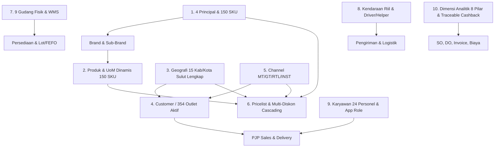

# 📦 Mapping Master Data & Rencana Seed Data Distributor FMCG (Manado)

> **Acuan Dokumen:** `docs/PLAYBOOK_DISTRIBUTOR_FMCG.md` (v0.4) · `docs/SCOPE.md` (v0.6) · `docs/GLOSSARY.md`  
> **Konteks Demo:** Distributor FMCG Multi-Principal di **Manado & Sulawesi Utara** (PT Manado Distribusi Utama - fiktif).  
> **Target Omset Operasional:** **Rp 5.500.000.000 / Bulan (5.5 BIO IDR)**.  
> **Tujuan:** Menyediakan blueprint master data yang realistis, presisi perpajakan (Coretax), akurat rantai pasok (UoM dinamis, multi-diskon, WMS fisik), dan siap mendukung demo end-to-end (PJP, Taking Order, Canvassing, FEFO Batch Picking, Coretax e-Faktur, Approval Limit Kredit, Diskon Bertingkat, dan Rekonsiliasi Kas).

---

## 1. Narasi Bisnis, Target Omset & Universe Outlet

* **Nama Perusahaan:** PT Manado Distribusi Utama (MDU)
* **Status Pajak:** PKP (Pengusaha Kena Pajak), NPWP 16 digit, KPP Pratama Manado, NITKU 22 digit.
* **Gudang Pusat:** Gudang Utama Interchange Maumbi / Jl. AA Maramis, Manado.
* **Target Omset Bulanan:** **Rp 5.500.000.000 / bulan (5.5 BIO IDR)**.
* **Model Penetrasi Pasar (Universe vs Active Coverage 65%):**
  - **Total Outlet Universe (Wilayah Operasional):** 545 outlet terdata di master plan.
  - **Active Coverage (65%):** **354 outlet aktif** yang rutin dikunjungi dan bertransaksi.
  - **Unserved / Opportunity Gap (35%):** **191 outlet potensial** belum terlayani (cerita demo: peluang ekspansi omset dari 65% ke 85% coverage melalui optimasi rute PJP dan penambahan armada).
* **Komposisi Kontribusi Omset per Channel (Target Rp 5,5 BIO):**
  1. **Modern Trade (MT):** **12 Key Accounts** (pusat jaringan supermarket/DC) = **Rp 2.100.000.000 (38.2%)**
     *(Omset tinggi per account: Indomaret DC Rp 650 jt, Alfamidi DC Rp 450 jt, FreshMart Group Rp 420 jt, MultiMart Group Rp 360 jt, Swalayan Rp 220 jt).*
  2. **General Trade (GT / Grosir):** **72 outlet aktif** @ rata-rata Rp 34,7 jt/bln = **Rp 2.500.000.000 (45.5%)**
  3. **Retail (RTL / Warung-Kios Canvass):** **260 outlet aktif** @ rata-rata Rp 2,5 jt/bln = **Rp 650.000.000 (11.8%)**
  4. **Institusional (INST / Horeka & RS):** **10 outlet aktif** @ rata-rata Rp 25 jt/bln = **Rp 250.000.000 (4.5%)**
  * **Total Omset Bulanan:** **Rp 5.500.000.000 (Tepat 5.5 BIO IDR)**.

---

## 2. Pemetaan 10 Domain Master Data ke Odoo 19 CE & OCA

---

### Domain 1: 4 Principal Nasional FMCG

Struktur hierarki principal FMCG memisahkan divisi produk principal secara tegas:  
`Principal` ➔ **`Kategori Divisi (Food, RTD, Home Care, Personal Care, Confectionery)`** ➔ `Brand` ➔ `Sub-Brand` ➔ `Master SKU`.

| Kode Principal | Nama Entitas Principal | Alamat Pabrikan / Kantor Pusat | NPWP 16 Digit | Divisi Kategori Utama | Total SKU Dikelola | Akun Klaim Promosi (`claim_account_id`) |
|---|---|---|---|---|---|---|
| **PRIN-MAYORA** | PT Mayora Indah Tbk | Daan Mogot KM 18, Jakarta Barat | `01.325.876.4-054.000` | Food, RTD Minuman Kopi, Confectionery | **44 SKU** | `110410` (Piutang Klaim Promosi Mayora) |
| **PRIN-SANTOS** | PT Santos Jaya Abadi (Kapal Api Group) | Jl. Raya Gilang 159, Sidoarjo, Jawa Timur | `01.312.456.8-641.000` | Food (Kopi Bubuk), RTD (Minuman Siap Minum) | **32 SKU** | `110420` (Piutang Klaim Promosi Santos) |
| **PRIN-UNILEVER** | PT Unilever Indonesia Tbk | BSD City Kav 3, Tangerang, Banten | `01.310.234.9-054.000` | Home Care, Personal Care, Food / Bumbu Dapur | **42 SKU** | `110430` (Piutang Klaim Promosi Unilever) |
| **PRIN-WINGFOOD** | Wings Food (PT Sayap Mas Utama) | Cakung Industri Kav 18, Jakarta Timur | `01.309.876.5-007.000` | Food (Mi Instan & Minuman Serbuk), RTD Botol | **32 SKU** | `110440` (Piutang Klaim Promosi Wings) |
| **TOTAL** | **4 Principal Nasional** | | | **5 Kategori Divisi** | **150 SKU** | |

---

### Domain 2: Master SKU, Sebaran 150 Produk & Arsitektur Multi-UoM Dinamis

Total katalog produk dirancang sebanyak **150 SKU representatif** dengan sebaran merata di masing-masing principal, kategori divisi, brand, dan sub-brand:

#### A. Rekapitulasi Sebaran 150 SKU per Kategori & Principal:

| Principal | Food | RTD / Beverage | Home Care | Personal Care | Confectionery | Total SKU |
|---|---|---|---|---|---|---|
| **PT Mayora Indah Tbk** | 18 SKU | 16 SKU | - | - | 10 SKU | **44 SKU** |
| **PT Santos Jaya Abadi (Kapal Api)** | 24 SKU | 8 SKU | - | - | - | **32 SKU** |
| **PT Unilever Indonesia Tbk** | 6 SKU | - | 16 SKU | 20 SKU | - | **42 SKU** |
| **Wings Food (Sayap Mas Utama)** | 22 SKU | 10 SKU | - | - | - | **32 SKU** |
| **TOTAL KESELURUHAN** | **70 SKU** | **34 SKU** | **16 SKU** | **20 SKU** | **10 SKU** | **150 SKU** |

#### B. Matriks Sebaran Brand & Sub-Brand Terperinci:

##### 1. PT Mayora Indah Tbk (44 SKU):
* **Food (18 SKU):**
  * Brand *Roma* (10 SKU): Roma Kelapa 300g, Roma Marie Susu 115g, Roma Sandwich Cokelat 216g, Roma Sandwich Peanut 216g, Roma Sari Gandum 149g, Roma Sari Gandum Cokelat 115g, Roma Malkist Keju Manis 120g, Roma Malkist Abon 135g, Roma Malkist Crackers 135g, Roma Malkist Cokelat 120g.
  * Brand *Better* (2 SKU): Better Vanilla Sandwich 22g (Inner Box 20 pcs, Karton 160 pcs), Better Cokelat 120g.
  * Brand *Slai O’lai* (2 SKU): Slai O’lai Strawberry 128g, Slai O’lai Blueberry 128g.
  * Brand *Beng-Beng* (4 SKU): Beng-Beng Reguler 20g (Inner 20 pcs, Ctn 160 pcs), Beng-Beng Maxx 32g, Beng-Beng Share It Pouch 100g, Beng-Beng White 22g.
* **RTD / Beverage (16 SKU):**
  * Brand *Torabika* (10 SKU): Torabika Duo 25g (Renceng 10s, Ctn 120s), Torabika Duo Susu Full Cream, Torabika Cappuccino 25g (Ctn 120s), Torabika Gilus Mix Gula Aren 23g, Torabika Gilus Mix Pandan, Torabika Creamy Latte 25g, Torabika Kopi Susu Espresso, Torabika Moka, Torabika Natacinno, Torabika Jahe Susu.
  * Brand *Kopiko RTD* (4 SKU): Kopiko Lucky Day Kopi Botol 250ml, Kopiko 78C Coffee Latte 240ml, Kopiko Macchiato 240ml, Kopiko Calorie Low 240ml.
  * Brand *Energen* (2 SKU): Energen Sereal Cokelat 30g (Renceng 10s), Energen Sereal Vanila 30g.
* **Confectionery (10 SKU):**
  * Brand *Kopiko Candy* (3 SKU): Kopiko Coffee Candy Sak 150g, Kopiko Blister Pack 32g, Kopiko Cappuccino 150g.
  * Brand *Kis* (4 SKU): Kis Mint Cherry Sak 125g, Kis Mint Barley 125g, Kis Mint Apple Peach 125g, Kis Grape Mint 125g.
  * Brand *Tamarin* (3 SKU): Tamarin Permen Asam Sak 135g, Tamarin Bag 50g, Tamarin Roll Pack.

##### 2. PT Santos Jaya Abadi / Kapal Api Group (32 SKU):
* **Food / Kopi Bubuk (24 SKU):**
  * Brand *Kapal Api* (12 SKU): Kapal Api Special Merah 65g, Special Merah 165g, Special Merah 380g, Kapal Api Special Mix 24g (Renceng 10s, Ctn 120s), Kapal Api Kopi Susu Mantap 31g, Kapal Api White Koffie 20g, Kapal Api Grande 20g, Kapal Api Signature Original 65g, Kapal Api Easy Drip Blend 50g, Kapal Api Mantap 75g, Kapal Api Krim Cafe 500g, Kapal Api Gula Aren 23g.
  * Brand *Kopi ABC* (6 SKU): ABC Kopi Susu 31g (Ctn 120s), ABC Kopi Moka 31g, ABC Plus Gula 25g, ABC Brownies Kopi 27g, ABC White Coffee 20g, ABC Kopi Klepon 25g.
  * Brand *Kopi Ya!* (2 SKU): Kopi Ya! Susu Sachet 25g, Kopi Ya! Hitam Manis 20g.
  * Brand *Kopi Kapten* (4 SKU): Kopi Kapten Hitam 60g, Kapten Kopi Murni 150g, Kapten Plus Gula 25g, Kapten Kopi Susu 28g.
* **RTD / Siap Minum (8 SKU):**
  * Brand *Kapal Api RTD* (4 SKU): Kapal Api Signature Black Coffee Botol 200ml, White Coffee Botol 200ml, Kopi Susu Can 240ml, Cold Brew Can 240ml.
  * Brand *ABC RTD* (4 SKU): ABC Choco Malt Tetra Pack 200ml, ABC Coffee Latte Tetra 200ml, ABC Kopi Moka Botol 250ml, ABC Kopi Susu Botol 250ml.

##### 3. PT Unilever Indonesia Tbk (42 SKU):
* **Home Care (16 SKU):**
  * Brand *Sunlight* (6 SKU): Sunlight Jeruk Nipis Refill Pouch 650ml (Ctn 24s), Jeruk Nipis 210ml, Sunlight Habbatussauda 650ml, Sunlight Ekstra Higienis 650ml, Sunlight Sabun Cuci Piring Botol 750ml, Sunlight Biocare 650ml.
  * Brand *Rinso* (6 SKU): Rinso Anti Noda Bubuk 770g, Rinso Molto Rose Fresh 770g, Rinso Cair Konsentrat Refill 750ml, Rinso Matic Front Load Cair 1.6L, Rinso Matic Top Load 1.6L, Rinso Japanese Peach Cair 700ml.
  * Brand *Molto* (4 SKU): Molto All-in-1 Blue Refill 720ml, Molto All-in-1 Pink 720ml, Molto Pewangi Floral Bliss 780ml, Molto Pure Softener 720ml.
* **Personal Care (20 SKU):**
  * Brand *Lifebuoy* (8 SKU): Lifebuoy Sabun Batang Total 10 110g, Lemon Fresh 110g, Mild Care 110g, Bodywash Refill 450ml Total 10, Bodywash Refill 450ml Lemon, Shampoo Rambut Kuat 170ml, Shampoo Anti Dandruff 170ml, Hand Sanitizer 50ml.
  * Brand *Pepsodent* (6 SKU): Pepsodent Pencegah Gigi Berlubang 190g, 120g, 75g, Pepsodent Herbal 190g, Pepsodent Complete 8 150g, Pepsodent White Action 190g.
  * Brand *Clear* (4 SKU): Clear Shampoo Ice Cool Menthol 160ml, Complete Soft Care 160ml, Clear Men Cool Sport 160ml, Clear Men Anti Hairfall 160ml.
  * Brand *Rexona* (2 SKU): Rexona Men Roll On Invisible Dry 45ml, Rexona Women Brightening 45ml.
* **Food & Bumbu Dapur (6 SKU):**
  * Brand *Royco* (4 SKU): Royco Bumbu Pelezat Rasa Ayam 230g, Rasa Sapi 230g, Royco Kaldu Spesial Jamur 100g, Royco Bumbu Kuah Bakso 100g.
  * Brand *Bango* (2 SKU): Bango Kecap Manis Pouch Refill 550ml, Bango Kecap Manis Pouch Refill 220ml.

##### 4. Wings Food / PT Sayap Mas Utama (32 SKU):
* **Food (22 SKU):**
  * Brand *Mie Sedaap* (12 SKU): Mie Sedaap Goreng 90g (Ctn 40s), Kuah Rasa Soto 75g, Ayam Bawang 70g, Kari Spesial 72g, Korean Spicy Chicken 87g, Korean Spicy Soup 75g, Singapore Spicy Laksa 83g, Rawon Asli Jawa Timur 80g, Mie Sedaap Cup Goreng 85g, Cup Soto 81g, Cup Rawon, Sambal Goreng 88g.
  * Brand *Jasjus* (4 SKU): Jasjus Jeruk Renceng 10s (Ctn 120s), Jasjus Mangga 10s, Jasjus Anggur 10s, Jasjus Melon 10s.
  * Brand *Segar Dingin* (2 SKU): Segar Dingin Madu Lemon Sachet (Box 24s), Segar Dingin Sirsak.
  * Brand *Top Kopi* (4 SKU): Top Kopi Gula Aren 25g (Renceng 10s), Top Kopi Susu 31g, Top Kopi Moka 31g, Top Kopi Barista Tubruk 25g.
* **RTD / Minuman Botol (10 SKU):**
  * Brand *Floridina* (3 SKU): Floridina Orange Pulpy 350ml Pet (Ctn 24s), Floridina Lemon Coco 350ml, Floridina Apple 350ml.
  * Brand *Teh Javana* (3 SKU): Teh Javana Gula Batu 350ml Pet (Ctn 24s), Teh Javana Melati 350ml, Teh Javana Less Sugar 350ml.
  * Brand *Golda Coffee* (4 SKU): Golda Coffee Dolce Latte 200ml Pet (Ctn 24s), Golda Cappuccino 200ml, Golda Classic Black 200ml, Golda White Mocha 200ml.

---

### Domain 3: 15 Kabupaten / Kota Resmi di Provinsi Sulawesi Utara (BPS Lengkap Tanpa Sampling)

Distributor FMCG MDU mencatat seluruh **15 Daerah Administrasi Tingkat II (4 Kota dan 11 Kabupaten)** di Sulawesi Utara:

| No | Kode BPS | Nama Kabupaten / Kota | Ibukota Administrasi | Tipe Wilayah | Klasifikasi Operasional Distributor | Jumlah Kecamatan | Status Coverage Distributor |
|---|---|---|---|---|---|---|---|
| **1** | **7171** | **Kota Manado** | Tikala | Kota | **Core Coverage (Urban Pusat)** | 11 Kecamatan | **Direct Sales & Delivery (Harian)** |
| **2** | **7172** | **Kota Bitung** | Bitung (Maesa) | Kota | **Core Coverage (Port & Urban Bitung)** | 8 Kecamatan | **Direct Sales & Delivery (H+1 Truk CDD)** |
| **3** | **7173** | **Kota Tomohon** | Kolongan | Kota | **Core Coverage (Hinterland Dataran Tinggi)** | 5 Kecamatan | **Direct Sales & Delivery (H+1 Truk CDE)** |
| **4** | **7102** | **Kabupaten Minahasa** | Tondano | Kabupaten | **Core Coverage (Tondano & Kawangkoan)** | 25 Kecamatan | **Direct Sales & Delivery (H+1 Truk CDE)** |
| **5** | **7106** | **Kabupaten Minahasa Utara** | Airmadidi | Kabupaten | **Core Coverage (Minut Industri & Penyangga)** | 10 Kecamatan | **Direct Sales & Delivery (H+1 Truk L300/Van)** |
| **6** | **7105** | **Kabupaten Minahasa Selatan** | Amurang | Kabupaten | **Core Coverage (Minsel Pesisir Selatan)** | 17 Kecamatan | **Direct Sales & Delivery (H+1 Truk CDEL)** |
| **7** | **7174** | **Kota Kotamobagu** | Kotamobagu | Kota | **Secondary (Cross-Docking Depo BMR)** | 4 Kecamatan | **Buffer Sub-Distributor / Direct Grosir** |
| **8** | **7109** | **Kabupaten Minahasa Tenggara** | Ratahan | Kabupaten | **Secondary (Penyangga Minahasa Raya)** | 12 Kecamatan | **Direct Grosir Parete / Mitra Toko** |
| **9** | **7101** | **Kabupaten Bolaang Mongondow** | Lolak | Kabupaten | **Secondary (Cross-Docking Depo BMR)** | 15 Kecamatan | **Pengiriman Ekspedisi Darat Rutin** |
| **10** | **7108** | **Kabupaten Bolaang Mongondow Utara** | Boroko | Kabupaten | **Secondary (Perbatasan Gorontalo)** | 6 Kecamatan | **Pengiriman Ekspedisi Darat Rutin** |
| **11** | **7111** | **Kabupaten Bolaang Mongondow Selatan** | Bolaang Uki | Kabupaten | **Secondary (Pesisir Teluk Tomini)** | 7 Kecamatan | **Pengiriman Ekspedisi Darat Rutin** |
| **12** | **7110** | **Kabupaten Bolaang Mongondow Timur** | Tutuyan | Kabupaten | **Secondary (Dataran Tinggi Moat)** | 7 Kecamatan | **Pengiriman Ekspedisi Darat Rutin** |
| **13** | **7103** | **Kabupaten Kepulauan Sangihe** | Tahuna | Kabupaten | **Outlying Islands (Kepulauan Perbatasan)** | 15 Kecamatan | **Ekspedisi Kapal Laut Pelabuhan Manado** |
| **14** | **7107** | **Kab. Kep. Siau Tagulandang Biaro (Sitaro)** | Ondong Siau | Kabupaten | **Outlying Islands (Kepulauan Vulkanik)** | 10 Kecamatan | **Ekspedisi Kapal Laut Pelabuhan Manado** |
| **15** | **7104** | **Kabupaten Kepulauan Talaud** | Melonguane | Kabupaten | **Outlying Islands (Gugusan Terluar Miangas)** | 19 Kecamatan | **Ekspedisi Kapal Laut Pelabuhan Bitung** |
| **TOTAL** | **Prov. Sulut** | **15 Daerah Administrasi** | | | | **171 Kecamatan** | **100% Tercakup Resmi** |

---

### Domain 4: Customer / Outlet (Rekalibrasi Modern Trade & Penetrasi Pasar)

Sesuai arahan operasional: **Jumlah outlet MT disusutkan menjadi 12 Key Accounts (Central Nodes / Group Billing)** dengan **omset per account yang dinaikkan signifikan**, sehingga transaksi grosir dan DC memiliki rasio bisnis yang sangat realistis:

| Channel | Populasi Universe | Active Coverage (65%) | Target Omset / Bulan | Nilai Omset Rata-rata per Account / Toko | Karakteristik Bisnis & Term | Contoh Outlet di Sulawesi Utara |
|---|---|---|---|---|---|---|
| **Modern Trade (MT)** | 18 Key Accounts | **12 Key Accounts** | **Rp 2.100.000.000 (38.2%)** | **Rp 175.000.000 – Rp 650.000.000** | Kontrak nasional/regional terpusat, drop kartonan volume besar ke DC / Superstore, TOP 30-45 hari, wajib faktur pajak Coretax. | **Indomaret DC Manado** (Rp 650 jt), **Alfamidi DC Manado** (Rp 450 jt), **FreshMart Group** (Bahu, Paniki, Tikala - Rp 420 jt), **MultiMart Group** (Megamas, Samrat, Tomohon - Rp 360 jt), **Golden Swalayan Pasar 45** (Rp 120 jt), **Jumbo Swalayan Group** (Manado & Bitung - Rp 100 jt). |
| **General Trade (GT)** | 110 outlet | **72 outlet aktif** | **Rp 2.500.000.000 (45.5%)** | **Rp 34.720.000** | Toko grosir & sembako pasar, volume kartonan menengah-besar, TOP 7-14 hari atau tunai, Limit kredit Rp 20 - 75 Juta. | Toko Sembako Berkat Pasar 45, Toko Harapan Bersehati, Grosir Bintang Matuari Maesa Bitung, Toko Berkat Kawangkoan, Toko Jaya Sejahtera Tomohon, Grosir Krida Bahu. |
| **Retail (RTL)** | 400 kios | **260 warung aktif** | **Rp 650.000.000 (11.8%)** | **Rp 2.500.000** | Kios kelontong pemukiman, warung kecil. Beli eceran renceng/pack/karton kecil, tunai langsung serah terima (COD Canvassing Van). | Kios Tante Tin Tuminting, Warung Marlina Tikala, Kios Om Utu Malalayang, Toko Rapi Kawangkoan, Kios Sejahtera Kauditan. |
| **Institusional (INST)** | 17 outlet | **10 outlet aktif** | **Rp 250.000.000 (4.5%)** | **Rp 25.000.000** | Rumah sakit, hotel bintang 4-5, katering. Dikelola langsung BM / Sales SPV, PO terjadwal, TOP 14-30 hari. | RSUP Prof. Kandou Malalayang, Four Points by Sheraton Manado, Hotel Sintesa Peninsula, Katering Minahasa Indah. |
| **Total** | **545 outlet** | **354 outlet aktif** | **Rp 5.500.000.000 (100%)** | | *Active Coverage: 65.0% · Opportunity Gap: 35.0% (191 outlet)* | |

---

### Domain 5: Struktur Harga, Multi-Diskon Cascading & Traceable Cashback

#### A. Multi-Diskon Baris Faktur (Slot Diskon Principal > 1):
Diskon baris dihitung secara **Cascading / Berantai**:
$$\text{Net Price} = \text{Subtotal} \times (1 - d_1) \times (1 - d_2) \times (1 - d_3) \times (1 - d_4)$$

1. **Diskon 1 (Reguler Principal):** 3% – 5% (Diskon dasar perjanjian dagang principal).
2. **Diskon 2 (Program Taktis Principal):** 2% – 3% (Promo tematik, kuartalan, atau launching varian baru).
3. **Diskon 3 (Volume Diskon Principal):** 1.5% jika order mencapai kuota karton tertentu.
4. **Diskon 4 (Distributor Local Push):** 1% promo inisiatif distributor untuk menghabiskan stok menjelang tutup buku.

#### B. Footer Discount & Traceable Cashback Promosi:
* **Diskon Tunai (COD Discount):** 1% di footer faktur untuk pembayaran tunai saat pengiriman barang.
* **Cashback Promosi Traceable:**
  Setiap nilai promosi dan cashback wajib memiliki field **`promo_budget_source`** (`principal`, `distributor`, atau `joint_50_50`) yang terhubung langsung ke akun analitik dan akun perantara klaim (`claim_account_id` pada `id.principal`). Ini memastikan distributor dapat menghasilkan **Claim Report (Debit Note)** resmi ke Principal secara transparan tanpa merugikan kas perusahaan.

---

### Domain 6: Gudang & Lokasi Stok Fisik (9 Lokasi Fisik WMS FMCG)

1. `GD-MND/UTAMA`: Gudang Pallet & Good Stock Kartonan Besar dari inbound pabrikan.
2. `GD-MND/EACHES`: Area eceran / pick face karton terbuka (pengambilan renceng, pack, sachet, pcs).
3. `GD-MND/RETURN-STAGING`: Area karantina penerimaan retur toko atau gagal kirim driver sebelum disortir.
4. `GD-MND/BAD-STOCK`: Gudang barang rusak, pecah, bocor, atau kadaluarsa (BS siap klaim/pemusnahan).
5. `GD-MND/PROMO`: Gudang penyimpanan POSM, spanduk, hadiah piring/mangkok, merchandise, dan tester.
6. `GD-MND/PREMIUM`: Gudang khusus terkunci untuk produk high-value / rentan pencurian (kosmetik/parfum).
7. `GD-MND/COLD`: Ruangan berpendingin (AC/chiller) untuk cokelat, keju, margarin, dan produk dairy.
8. `GD-MND/DOCK`: Area loading dock bongkar muat kontainer inbound dan staging muat truk outbound.
9. `GD-MND/IN-TRANSIT`: Stok dalam perjalanan (Stock on Truck delivery TO atau mutasi antar-depo).

---

### Domain 7: Armada Logistik, Dimensi/Kubikasi Riil, Data STNK & KIR

| No. Polisi | Tipe Operasional | Model Kendaraan Riil | Dimensi Box Kargo (P × L × T) | Kubikasi Riil | Tonase Riil | Penugasan Rute & Delivery | Driver & Helper | Masa Berlaku STNK & KIR |
|---|---|---|---|---|---|---|---|---|
| **DB 8123 QA** | **GM BV** | Daihatsu Gran Max BV 1.3 | 2.07m × 1.39m × 1.25m | **3.6 m³** | **0.75 Ton** | Canvassing Retail Urban Manado (gang sempit) | Novry Mandagi | STNK: 14/05/2027 (Pjk: 14/05/2026) KIR: 18/11/2026 |
| **DB 8234 QX** | **GM BOX** | Daihatsu Gran Max Box 1.5 | 2.37m × 1.55m × 1.29m | **4.7 m³** | **1.0 Ton** | Canvassing Retail Pinggiran / Mapanget | Steven Lumenta | STNK: 22/08/2028 (Pjk: 22/08/2026) KIR: 05/12/2026 |
| **DB 8345 PL** | **GM OPEN** | Daihatsu Gran Max Pick-Up 1.5 | 2.35m × 1.58m × 0.30m (bak) | **3.5 m³** | **1.0 Ton** | Staging Cepat & Logistik Darurat Antar-Gudang | Boyke Tendean | STNK: 10/11/2026 (Pjk: 10/11/2026) KIR: 28/10/2026 |
| **DB 8456 FB** | **L300** | Mitsubishi L300 Box Euro 4 | 2.43m × 1.60m × 1.40m | **5.4 m³** | **1.5 Ton** | Delivery TO Urban (Wenang, Sario, Malalayang) | Eko Prasetyo + Utu | STNK: 19/03/2027 (Pjk: 19/03/2026) KIR: 15/09/2026 |
| **DB 8567 TR** | **TRAGA** | Isuzu Traga Box Euro 4 | 2.81m × 1.62m × 1.35m | **6.1 m³** | **1.8 Ton** | Delivery TO Urban (Tikala, Paal Dua, Tuminting) | Frits Wenas + Dani | STNK: 04/07/2028 (Pjk: 04/07/2026) KIR: 12/01/2027 |
| **DB 8910 TK** | **CDE (4 RODA STD)** | Isuzu Elf NLR 55 TX 4-Roda Box | 3.10m × 1.80m × 1.80m | **10.0 m³** | **3.5 Ton** | Delivery Luar Kota (Tomohon, Tondano, Kawangkoan) | Stenly Rompas + Maxi | STNK: 11/09/2027 (Pjk: 11/09/2026) KIR: 20/10/2026 |
| **DB 8890 EL** | **CDEL (4 RODA LONG)** | Hino Dutro 110 SDBL 4-Roda Long | 4.30m × 1.80m × 1.85m | **14.3 m³** | **4.0 Ton** | Delivery Luar Kota (Minahasa Selatan & Amurang) | David Kalalo + Noldi | STNK: 16/12/2028 (Pjk: 16/12/2026) KIR: 08/02/2027 |
| **DB 8345 MK** | **CDD (6 RODA STD)** | Canter FE 74 HD 6-Roda Double | 4.30m × 2.00m × 2.00m | **17.2 m³** | **6.0 Ton** | Pengiriman Grosir & Modern Trade Bitung / Maesa | Johan Rori + Roy | STNK: 25/01/2027 (Pjk: 25/01/2026) KIR: 14/08/2026 |
| **DB 8765 DL** | **CDDL (6 RODA LONG)** | Hino Ranger FG 235 JJ 6-Roda Long | 6.50m × 2.30m × 2.30m | **34.4 m³** | **8.5 Ton** | Inbound Pelabuhan Bitung & Buffer Gudang Utama | Agus Supit + Jerry | STNK: 30/10/2027 (Pjk: 30/10/2026) KIR: 19/11/2026 |

---

### Domain 8: Struktur Organisasi & 24 Karyawan Roster

Roster tetap mengacu pada 24 personel yang telah disahkan: 2 Management (Owner, BM), 4 Finance/Tax (Lead, Accounting, Tax, Kasir), 3 Sales Management & Admin (SPV, 2 Admin), 3 Gudang/WMS (Lead, Staging, Picker), 6 Sales Lapangan (1 MT, 3 TO, 2 Canvass), dan 6 Logistik (4 Driver, 2 Helper).

---

### Domain 9: Rute PJP & Pemodelan Outlet

* **Christian Wowor (Salesman Key Account MT):** Mengelola 12 Key Accounts terpusat dengan jadwal audit intensif 2-3 kunjungan per hari (F1 mingguan), fokus pada koordinasi purchase order, listing varian baru, cek pajangan rak, retur BS, dan rekonsiliasi faktur pajak.
* **Salesman TO Urban 1 & 2 (Andre & Meidy):** 20–22 call / hari melayani 72 toko grosir sembako (GT).
* **Salesman Canvass 1 & 2 (Novry & Steven):** 25–30 call / hari menyisir 260 kios kelontong tunai (RTL).
* **Direct Selling Horeka:** Dikelola langsung oleh Branch Manager & Sales SPV untuk 10 outlet institusional.

---

### Domain 10: Dimensi Akuntansi Analitik 8 Pilar

1. Produk (Principal & Kategori Divisi) · 2. Customer (Partner Outlet) · 3. Channel (MT, GT, RTL, INST) · 4. Area (15 Kab/Kota) · 5. Departemen · 6. Cost Center Armada · 7. Salesman · 8. Gudang/Armada · 9. Traceable Budget Source (Principal Claimable vs Distributor Expense).
