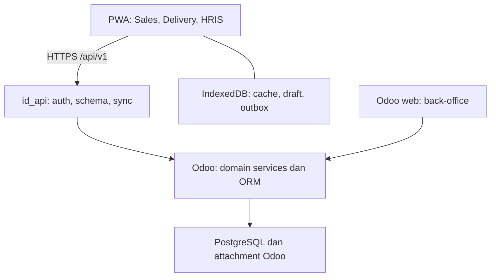
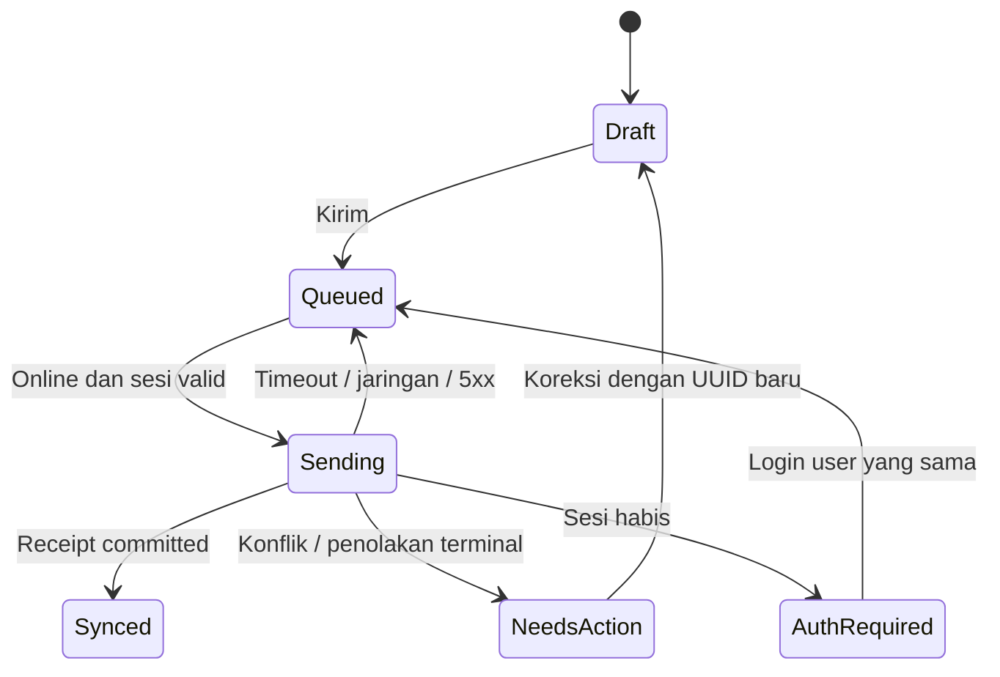
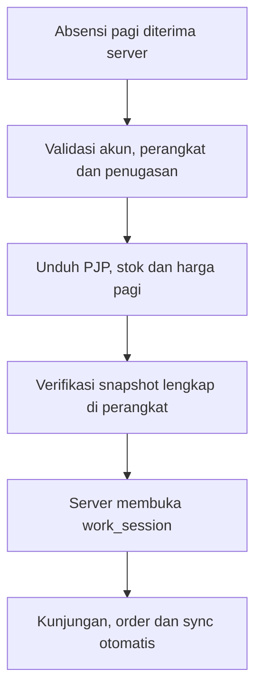

# Rancangan API Backend dan PWA Lapangan / Personal HRIS

Versi: 0.4 · 26 Oktober 2026 · Status: rancangan implementasi, belum menjadi fitur runtime.
Basis source: main `69a7ef6`; keputusan pemilik: hybrid, Odoo web penuh untuk back-office,
PWA sendiri untuk lapangan dan personal HRIS.

Rujukan: SCOPE §4A/4C/12, Playbook §5.2–5.3, SPIKE_API_OFFLINE,
MOBILE_SCAN_2026-10-26. [F] = keputusan/bukti existing; [R] = rancangan yang
ditetapkan dokumen ini sebagai baseline kerja; [BU] = perlu bukti implementasi.
Kontrak endpoint dan nama model di bawah adalah usulan, bukan API yang sudah tersedia.
Revisi 0.2 memasukkan mandat pemilik: pencegahan titip aktivitas, perangkat terdaftar,
sesi pagi, extra call, approval diskon/HPP, petty cash/BBM/biaya perjalanan,
bukti foto berpeta, geofence ketat, jejak lokasi dan UX bottom navigation.
Ketentuan rinci §9–14 melengkapi bagian awal; tidak mengganti aturan domain lain.
Revisi 0.3: readiness/gap aktual di `../reviews/MOBILE_READINESS_GAP_2026-10-26.md`;
Phosphor duotone, font Inter Variable dan palette mobile selaras UI web (§14.5).
Revisi 0.4: mandat scope mobile-only; pelaksanaan frontend-first dengan mock adapter,
kontrak bertahap dan integrasi backend setelah siap (§1.1/7.1). Pekerjaan agent lain
tidak diambil alih. Bagian backend tetap menjadi spesifikasi kebutuhan/handoff.

## 1. Hasil yang dituju dan batas sistem

Dua pekerjaan berjalan dalam satu kontrak: backend menyediakan operasi bisnis aman
dan sinkronisasi; PWA menyediakan pengalaman kerja lapangan dan penyimpanan sementara.
Odoo tetap sumber kebenaran untuk dokumen yang diterima, harga, stok, kredit,
approval, piutang, absensi resmi dan payroll. PWA menyimpan draft dan bukti yang
belum diterima. Tersimpan di perangkat tidak sama dengan tersimpan di server.

| Lingkup | Back-office Odoo | PWA |
|---|---|---|
| Administrasi | Master, konfigurasi role/policy, penugasan, koreksi | Lihat data yang diizinkan; pengajuan perubahan profil |
| Sales | Harga/diskon/kredit, approval, pemrosesan SO | PJP, kunjungan, input order, penagihan |
| Delivery | Perencanaan DO, picking, FEFO, posting stok, closing dan biaya | Penugasan, realisasi barang, foto/POD, penerimaan uang, biaya per DO/trip |
| HRIS | Administrasi HR, approval cuti, payroll, publikasi slip | Absensi, jadwal, cuti, slip gaji sendiri, pengumuman |
| Akuntansi | Validasi pembayaran, petty cash, limit/approval, rekonsiliasi dan jurnal | Permintaan uang muka, realisasi biaya, bukti penerimaan, saldo uang muka sendiri |

[F] Role dapat bertumpuk, mobile selalu menulis ke Odoo pada primary/secondary,
ekspor ke legacy manual. [R] Baseline mobile-origin memakai kontrol penuh server;
pengecualian per distributor harus eksplisit, diaudit, dan tidak menjadi bypass umum.
Face recognition, native app, background tracking kontinu, optimasi rute otomatis,
transfer payroll, dan admin/approval back-office di PWA di luar tahap awal.

### 1.1 Mandat pelaksanaan: frontend-first, scope agent mobile

[F] Pemilik meminta agent ini fokus menyiapkan PWA dan tidak masuk ke pekerjaan
yang sedang dijalankan agent lain. [R] Backend belum siap tidak menghalangi UI,
alur kerja, local state, draft/outbox, evidence capture dan pengujian client.
Gap backend menjadi dependency integrasi, bukan daftar perbaikan yang dikerjakan
agent mobile. Tidak mengubah seed/loader, modul domain, deploy atau branch agent lain.

Urutan kerja: UI dan skenario -> alur/state machine client -> kontrak data/API
yang diformalkan -> HTTP adapter/integrasi setelah backend tersedia. Minimum
model data dan interface draft dibuat sejak layar pertama, lalu disempurnakan
bersama alur; kontrak tidak ditunda sampai seluruh UI terlanjur hardcoded.

| Logika PWA yang dikerjakan sekarang | Keputusan resmi yang tetap milik backend |
|---|---|
| Validasi field, draft, kalkulasi estimasi yang diberi label | Harga/diskon/HPP resmi, kredit, stok tersedia dan approval |
| Navigasi role simulasi, alur sesi/check-in, capture foto/lokasi | Auth/ACL, role sebenarnya, binding perangkat dan legitimasi absensi |
| Lifecycle antrean, UUID, retry, cache terisolasi dan konflik | Idempotensi server, penerimaan command, posting dokumen/jurnal |
| Preview geofence dan peringatan accuracy | Validasi geofence dan risk decision server |
| Form biaya, estimasi dan visual approval tier | Approval, pencairan, pengakuan beban dan settlement |

Rumus/policy bisnis server tidak disalin menjadi mesin keputusan kedua di klien.
Mock adapter memberi respons skenario, bukan otoritas produksi. Semua demo mock
memiliki indikator Simulation; hasilnya tidak disebut absensi sah, approved atau
SO Odoo nyata. Mock provider dimatikan pada build produksi; konfigurasi tidak boleh
diam-diam fallback ke mock jika API nyata gagal. Fake role/login selector hanya
tersedia pada development/demo terisolasi, tidak pada mode live.

### 1.2 Susunan dokumen dan sumber rujukan

| Dokumen existing | Fungsi |
|---|---|
| SCOPE.md | Scope/milestone proyek tingkat atas; cukup menunjuk plan mobile saat integrasi dokumentasi bersama |
| PLAYBOOK_DISTRIBUTOR_FMCG.md | Requirement bisnis; tidak digandakan seluruhnya ke dokumen teknis |
| Dokumen ini | Satu rujukan desain mobile, sequence frontend, dependency backend dan kriteria penerimaan |
| MOBILE_READINESS_GAP_2026-10-26.md | Snapshot audit berdasarkan SHA/tanggal; bukti historis, bukan roadmap paralel |
| HANDOFF.md / agent-log | Status kerja dan serah terima; tidak menjadi tempat menyalin seluruh spesifikasi |
| SPIKE_API_OFFLINE.md | Eksperimen API yang existing; hasil backend nanti ditautkan ke kontrak mobile |

[R] Pertahankan plan terpisah sebagai rincian teknis yang sudah masuk struktur
docs/blueprints, dengan ringkasan dependency di §7.1. Audit gap tetap terpisah agar
bukti SHA tidak berubah setiap roadmap berubah. Saat penyelarasan bersama, tambahkan
tautan/ringkasan singkat pada SCOPE/DEVELOPMENT, tanpa membuat dokumen induk baru.
Perubahan shared tersebut dikoordinasikan; sesi ini hanya memperbarui dokumen mobile
dan entri handoff/log sendiri, tidak menulis ulang dokumen kerja agent lain.

## 2. Arsitektur



[R] PWA memakai Preact + TypeScript + Vite; app shell di-cache service worker;
data bisnis di IndexedDB; tipe klien dihasilkan dari OpenAPI. Library penyimpanan,
service worker dan versi dependency dikunci setelah spike dan audit ukuran bundle.
Tidak membuat backend bisnis kedua, tidak mengakses PostgreSQL dari klien,
dan tidak mengekspos endpoint generic model/method RPC ke PWA.

[R] Produksi disarankan satu origin HTTPS: `/field/` untuk PWA, `/api/v1/` untuk
API, `/web` dan `/odoo` untuk backend existing. Reverse proxy melayani aset statis
dan meneruskan API ke Odoo. Service worker hanya berscope `/field/`, tidak boleh
mengambil alih backend atau menyimpan respons API sensitif ke CacheStorage.
Origin terpisah hanya jika deployment memerlukannya; CORS allowlist dan mekanisme
cookie harus diuji. Pilihan host/proxy belum diterapkan dan tidak memicu deploy.

Transport backend diputuskan melalui spike existing: OCA FastAPI bila instal,
auth, transaksi dan kontrak terbukti; bila gagal, controller Odoo dengan OpenAPI
yang sama. Rancangan ini tidak mengasumsikan FastAPI sudah siap produksi.

## 3. Jalur A — backend

### 3.1 Pembagian modul

| Modul | Tanggung jawab | Batas |
|---|---|---|
| id_app | Role bertumpuk pada employee, hubungan identitas, perangkat terdaftar, sesi kerja, capabilities, konfigurasi tab, policy offline | Role bisnis bukan sekadar jabatan atau nama tab |
| id_api | Transport, auth/session, schema, error, idempotensi, sync, upload, audit teknis | Tidak menjadi tempat formula harga atau posting jurnal |
| id_distribusi | PJP, visit, penugasan delivery, canvass, bukti dan closing | Memakai proses stock/sale/account existing |
| id_hris_ext | Bukti absensi, geofence, pengajuan dan personal HRIS | Payroll dan approval tetap di domain masing-masing |
| id_pricing / id_discount / id_credit / id_approval | Perhitungan dan keputusan bisnis | Dipanggil melalui service Odoo, berlaku juga untuk input back-office |
| id_payroll | Publikasi slip dan domain payroll | API hanya membaca slip milik employee yang sudah dipublikasikan |
| id_field_expense (addon usulan) | Uang muka lapangan, biaya DO/trip, realisasi BBM/insidental, alokasi dan settlement | Reuse hr.expense/account/fleet sesuai hasil spike model; tidak membuat mesin jurnal baru |

Core id_api/id_app tidak bergantung pada semua fitur sekaligus. Adapter sales,
delivery dan HRIS dimuat ketika addon domain tersedia. Capability yang belum
tersedia tidak dikirim bootstrap; endpoint terkait gagal jelas, bukan sukses palsu.
Perluasan id_app, id_api dan domain dapat memakai addon penghubung jika dependency
Odoo membutuhkannya; hindari import opsional yang menutupi modul hilang.

### 3.2 Identitas dan keamanan

- [R] Setiap employee aktif memiliki hubungan eksplisit dengan user Odoo; pemetaan
  tidak diambil dari employee_id yang dikirim klien. Tipe akun dan group minimal
  dibuktikan pada spike: jangan memberikan base.group_user luas hanya agar API bekerja.
- [R] Baseline PWA browser: session opaque pada cookie Secure/HttpOnly, SameSite
  sesuai topologi; autentikasi memakai fasilitas identitas Odoo yang diverifikasi.
  Endpoint mutasi memakai CSRF dan validasi Origin. Token tidak disimpan localStorage.
  Desain session harus menguji bahwa akun mobile tidak mendapat akses backend/RPC luas.
- [R] Jika session Odoo tidak memenuhi pembatasan akun mobile, gunakan session API
  terpisah yang mengacu identitas Odoo. Jangan mengimplementasikan password hashing sendiri.
  Token native masa depan memerlukan flow khusus; tidak memaksakan cookie browser ke native.
- [R] Tiap operasi memeriksa user aktif, employee aktif, role, company, record scope,
  capability dan status penugasan. ORM ACL/record rules tetap berlaku. Jika akses
  terbatas memerlukan elevasi, hanya pada service kecil setelah pemeriksaan eksplisit,
  dengan field allowlist dan audit; tidak ada env sudo bersama untuk seluruh request.
- [R] Pembatasan login, ukuran payload, jumlah batch dan upload; pesan error tidak
  memuat stack trace, secret atau data user lain. Lampiran memakai akses server,
  tidak memakai URL publik permanen untuk slip/foto personal.

| Capability contoh | Record yang boleh diakses |
|---|---|
| sales.visit / sales.order | Outlet dan jadwal yang ditugaskan pada user; pengecualian off-route melalui policy |
| delivery.execute | DO dan kendaraan/trip yang ditugaskan pada petugas |
| collection.capture | Invoice yang sah dalam scope outlet/trip; kewenangan terima uang terpisah dari posting |
| hris.self | Data employee sendiri; slip hanya yang dipublikasikan |
| hris.request | Membuat pengajuan sendiri; tidak approve sendiri lewat perubahan payload |
| field_expense.request / realize | Advance/biaya sendiri dalam tugas yang sah; supervisor/finance mendapat scope review sesuai hierarki, bukan seluruh employee |
| tracking.capture | Lokasi sendiri pada work_session aktif; supervisor hanya scope tim/trip berwenang |

Role menentukan capability, capability menentukan aksi, record scope menentukan
objek. Menyembunyikan tab tidak menggantikan tiga pemeriksaan tersebut.

### 3.3 Kelompok endpoint v1

| Kelompok | Endpoint usulan | Fungsi |
|---|---|---|
| Session | POST /auth/login; POST /auth/logout; GET /auth/session | Login online, logout, expiry dan identitas |
| Bootstrap | GET /me/bootstrap | Role, capability, tab, policy version, waktu/zona waktu server, versi API |
| Master | GET /sync/snapshot; GET /sync/changes | Master/penugasan terbatas dan pembaruan incremental |
| Commands | POST /sync/commands; GET /sync/commands/{client_uuid} | Pengiriman batch dan recovery hasil setelah timeout |
| Sales | GET /sales/pjp; GET /sales/outlets/{id}; GET /sales/orders/{id} | Tugas dan hasil order dalam scope |
| Quote | POST /sales/quote | Preview harga online yang tidak membuat order |
| Delivery | GET /delivery/tasks; GET /delivery/tasks/{id} | DO, item, lot yang diizinkan, penerima dan status |
| Collection | GET /collections/invoices | Invoice yang boleh ditagih; saldo bertimestamp |
| HRIS | GET /hris/me; GET /hris/schedule; GET /hris/attendance; GET /hris/leave | Profil sendiri, jadwal, histori, saldo dan status cuti |
| Dokumen personal | GET /hris/documents; GET /hris/documents/{id}/download | Dokumen sendiri yang diizinkan HR, masa berlaku SIM/kontrak, bukti potong yang sudah dipublikasikan jika modul tersedia |
| Slip | GET /hris/payslips; GET /hris/payslips/{id}/download | Slip sendiri yang dipublikasikan; online-only baseline |
| Informasi | GET /me/notifications | Pengumuman dan perubahan status; polling saat aplikasi aktif |
| Media | POST /media/uploads; PUT /media/uploads/{id}/parts/{n}; POST /media/uploads/{id}/complete | Upload resumable bertahap, checksum dan finalisasi |

Command bisnis yang diizinkan: visit.check_in/check_out, sales.order.submit,
delivery.proof.submit, collection.receipt.submit, hris.attendance.capture,
hris.leave.request, hris.attendance_correction.request dan hris.profile_change.request.
Revisi 0.2 menambah command perangkat/sesi, extra call, permintaan diskon, petty cash,
realisasi biaya dan location batch sebagaimana §9–13. Ini allowlist dengan schema
per jenis, bukan jalur memanggil method ORM sewenang-wenang. Command status dapat
dibaca terpisah dari dokumen bisnis; retry tidak membutuhkan endpoint tulis kedua.

### 3.4 Envelope command dan hasil

```json
{
  "schema_version": 1,
  "client_uuid": "uuid-per-business-command",
  "device_id": "installation-uuid",
  "work_session_id": "server-issued-work-session",
  "type": "sales.order.submit",
  "occurred_at": "2026-10-26T08:30:00+08:00",
  "base_revision": "server-issued-revision",
  "policy_version": "server-issued-policy",
  "depends_on": ["visit-command-uuid"],
  "payload": {
    "outlet_id": 123,
    "visit_uuid": "visit-command-uuid",
    "principal_id": 4,
    "lines": [{"product_id": 456, "qty": "2", "uom_id": 7}],
    "media_ids": ["finalized-upload-id"]
  }
}
```

Angka hanya ilustrasi, bukan identitas seed. Zona waktu operasional dari server;
contoh Manado memakai +08:00. Log koordinasi agent tetap WIB. occurred_at tidak
menggantikan received_at server. Harga yang ditampilkan klien dapat dikirim
sebagai observed_quote untuk audit/konfirmasi, bukan sebagai harga otoritatif.
Monetary/quantity dikirim decimal string, ID bertipe konsisten dan unit eksplisit.
device_id adalah referensi registrasi server, bukan autentikasi atau device attestation
dengan sendirinya. Bukti kepemilikan installation key dan work_session terikat akun
diperiksa terpisah; menyalin device_id saja tidak memberikan hak akses (§9).

Respons per command memuat client_uuid, receipt_state, business_status, record_ref,
server_revision, received_at, authoritative_totals, warnings, error_code dan
field_errors bila relevan. receipt_state: committed/rejected/dependency_pending.
business_status minimum: accepted/needs_confirmation/needs_approval/rejected sesuai domain;
schema domain dapat menambah pending_evidence atau pending_ratification secara eksplisit.
Klien tidak menyamakan status baru yang belum dikenalnya dengan sukses. Status approved,
delivered, posted atau reconciled berasal dari dokumen Odoo yang sebenarnya.
Penolakan sebelum pemrosesan (misalnya 401/413/schema error) tidak dianggap receipt committed.

HTTP: 400 schema; 401 sesi habis; 403 izin; 404 objek tidak tersedia dalam scope;
409 key/payload conflict atau revision conflict; 413 ukuran; 429 rate limit;
5xx gangguan server. Batch tervalidasi mengembalikan hasil per command; HTTP 200
batch tidak berarti semua command sukses. Tidak memakai kode HTTP sebagai status approval.

### 3.5 Idempotensi dan transaksi

- Unique key `(company, user, command_type, client_uuid)` dan canonical payload hash.
  Key tidak terikat device agar pemulihan tidak menggandakan transaksi.
- Key sama/payload sama mengembalikan receipt sebelumnya setelah izin akses saat
  ini diperiksa; key sama/payload berbeda menghasilkan 409. Rejected terminal
  juga direkam; koreksi menggunakan command UUID baru dengan supersedes_uuid.
- Simpan receipt hasil dan perubahan domain dalam satu transaksi. Gunakan unique
  constraint dan penanganan race; pengecekan search-lalu-create saja tidak cukup.
  File bukti selesai lebih dulu dan direferensikan command, bukan transaksi DB panjang.
- Satu command = satu transaksi atomik. Batch memakai transaksi terpisah per command
  melalui dispatcher dengan lifecycle transaksi yang teruji; tidak menyisipkan commit
  manual acak pada method bisnis Odoo. Dependent command hanya diproses setelah induk committed.
- Gangguan 5xx/timeout tidak menjadi penolakan bisnis permanen. Klien mencari receipt
  atau retry UUID sama. Uji kegagalan tepat sebelum dan sesudah commit.
- Ledger dedup/reference sumber bisnis tidak boleh hilang ketika cache respons
  dibersihkan. Retensi media/response dapat berbeda, tetapi key lama tidak menjadi
  transaksi baru setelah purge; UUID baru bukan cara retry transaksi yang hasilnya belum jelas.

### 3.6 Pull dan perubahan hak akses

[R] Untuk demo kecil, snapshot penuh yang difilter scope menjadi baseline aman.
Incremental diaktifkan setelah ada change feed yang konsisten terhadap urutan commit
dan pagination. write_date saja tidak cukup untuk menjamin tidak ada perubahan terlewat.

- Snapshot memiliki snapshot_id, versi schema, scope_version dan waktu server;
  pagination berasal dari snapshot konsisten/staging, bukan query live yang bergeser.
- Incremental memakai opaque cursor, upsert dan tombstone. Feed harus menangkap
  perubahan relevan dari API, Odoo web, import dan job; jangan hanya mencatat mobile writes.
- Grant/revoke assignment dan role mengubah scope_version. Klien menghapus data
  di luar scope, lalu resnapshot bila diperlukan; delete/archiving tidak dibiarkan menjadi cache aktif.
- Cursor kedaluwarsa/schema berubah menghasilkan RESYNC_REQUIRED. Jika change feed
  belum terbukti, fallback snapshot, tidak mengklaim incremental telah aman.
- Pisahkan master dari stok/AR yang cepat berubah; tiap tampilan menyebut last_synced_at.
  Angka stok offline bukan jaminan reservasi dan AR offline bukan saldo final.

## 4. Jalur B — PWA

### 4.1 Struktur dan navigasi

[R] Folder `pwa/`: `src/app`, `features/sales`, `features/delivery`, `features/hris`,
`features/sync`, `lib/api`, `lib/storage`, `lib/media`, `i18n`, `tests`.
Komponen bersama: AppShell, TaskCard, OutletCard, QuantityInput, MoneyDisplay,
PhotoCapture, LocationCapture, SyncBadge, StatusTimeline, Empty/ErrorState.

| Bagian | Isi |
|---|---|
| Beranda | Absensi -> sync pagi -> buka sesi, tugas hari ini, pengumuman, ringkasan antrean |
| Sales (berdasarkan capability) | PJP, outlet, kunjungan, katalog, keranjang per principal, order, penagihan |
| Delivery (berdasarkan capability) | Trip/DO, barang, penerima, selisih/retur, POD, penerimaan uang, tab Biaya DO dan Biaya Trip |
| Personal HRIS | Profil, jadwal, absensi/koreksi, cuti, slip, dokumen sendiri, pengingat masa berlaku dan pengumuman |
| Sinkronisasi / akun | Jumlah pending, progres media, konflik, retry, sesi, perangkat dan logout |
| Uang lapangan | Pengajuan petty cash, BBM, makan/penginapan, realisasi dan settlement sendiri; diakses dari tugas/akun tanpa menambah bottom tab berlebihan |

Bottom navigation ringkas pada telepon; rail/panel pada tablet. HRIS selalu tersedia
bagi employee aktif; Sales/Delivery dapat bersamaan. Konfigurasi server hanya memilih
tab/capability yang dikenali build, bukan memasukkan script atau arbitrary route.
Bahasa default Indonesia, English tersedia; istilah mengikuti GLOSSARY.
Layar utama tidak memerlukan peta/animasi berat; daftar/pencarian lokal, input angka
cepat, target sentuh jelas, label aksesibel, dan indikator status disertai teks.

### 4.2 Kebijakan offline per fitur

| Fitur | Offline | Ketika online kembali |
|---|---|---|
| PJP / outlet / katalog | Baca cache sesi pagi aktif | Refresh dan purge scope yang dicabut; membuka sesi baru wajib online setelah absensi diterima |
| Check-in dan order | Capture bukti + draft/outbox hanya dalam sesi aktif; extra call tanpa approval tetap draft/permohonan | Verifikasi geofence/penugasan/harga/kredit; accepted/approval/rejected |
| Delivery/POD | Capture realisasi dan bukti untuk tugas tercache | Server cek versi DO, qty/lot dan konflik; tidak posting ganda |
| Penerimaan uang | Catatan penerimaan pending + bukti, tanda terima sementara | Validasi finance/domain; status cash-in-transit terpisah dari reconciled |
| Absensi | Bukti pending dengan UUID event; bukan absensi resmi | Validasi sequence, jadwal, geofence dan anomali; exception masuk back-office |
| Pengajuan cuti | Draft/offline queued | Validasi saldo dan tanggal terkini; saldo tidak dipesan oleh cache |
| Petty cash / biaya | Draft pengajuan, capture realisasi dan bukti | Approval/disbursement hanya online di backend; pencatatan insiden offline tidak berarti pengeluaran disetujui |
| Slip gaji / dokumen sensitif | Online-only baseline | Akses sendiri + no-store; unduhan manual diberi tindakan eksplisit |
| Login pertama / approval admin | Online | Tidak membuat akun/sesi offline baru |

Offline capture dibatasi lease/policy dari server. [R] Nilai awal yang diusulkan:
12 jam sejak verifikasi identitas terakhir; configurable dan dibuktikan pilot.
Untuk aktivitas lapangan lease juga wajib terkait work_session hari/trip yang sah,
bukan hanya login yang masih hidup. Sesi salesman baru wajib sync pagi online (§11).
Ini batas UX/risiko cache, bukan pengganti keamanan server. Saat expired: kunci baca
cache bisnis dan capture baru; pertahankan antrean milik user sampai reauth/resolusi.
Revocation saat perangkat benar-benar offline tidak dapat diketahui seketika.

### 4.3 Penyimpanan dan antrean

IndexedDB dipisah berdasarkan server/company/user, dengan stores master_cache,
assignments, drafts, outbox, media_blobs, sync_meta. Data HR sensitif tidak di-cache
secara default. Enkripsi browser bukan jaminan terhadap pemilik perangkat/XSS;
minimalkan data dan masa simpan, cegah script tidak tepercaya dan kebocoran log.



Synced adalah status transport. Di dalamnya dokumen masih dapat berstatus
needs_approval, payment_pending atau proof_pending_review. UI menampilkan keduanya
tanpa mengartikan data terkirim sebagai order disetujui atau uang direkonsiliasi.

- UUID dibuat sekali saat submit; payload dibekukan setelah masuk antrean. Edit
  transaksi yang belum pernah dikirim dapat membatalkan draft antrean secara aman;
  hasil tidak jelas diselesaikan melalui receipt sebelum membuat pengganti.
- Sync saat aplikasi dibuka, kembali aktif, koneksi pulih, atau tombol Sinkronkan.
  navigator.onLine hanya petunjuk; keberhasilan request yang menentukan koneksi.
  Background Sync tambahan, bukan syarat agar data akhirnya terkirim.
- Retry exponential backoff + jitter; hormati Retry-After. 401 menunggu reauth;
  403/revision conflict menunggu tindakan. Leader lock/lease mencegah dua tab
  mengirim bersamaan; server tetap wajib idempoten bila lock gagal.
- Media dan command dependency dikirim berurutan; concurrency terbatas dan configurable.
  Aplikasi ditutup tidak menjamin upload berlanjut; outbox harus dapat dilanjutkan.
- Logout dengan pending: jangan hapus diam-diam. Logout segera mencabut sesi dan
  mengunci antrean; user lain tidak dapat membacanya. Reauth identitas sama untuk
  menyelesaikan atau membuang secara eksplisit. Pending dapat dibuang hanya dengan
  aksi sadar dan konfirmasi konsekuensi; clear cache tidak menyamar sebagai sinkron sukses.
- Storage penuh/quota/eviction harus terlihat; operasi baru tidak boleh mengaku
  tersimpan bila IndexedDB gagal. Browser clear-data/uninstall dapat menghilangkan
  data yang belum sync; tidak ada janji durabilitas setara penyimpanan server.

### 4.4 Foto, lokasi, dan waktu

[R] Capture mencatat client time, GPS lat/lon/accuracy, policy version dan konteks
visit/DO/attendance. Server mencatat received_at dan hasil validasi. Radius geofence,
batas accuracy/usia lokasi dan aturan pengecualian berasal dari server per proses.
GPS ditolak/tidak akurat tidak dibuat seolah valid: user bisa menyimpan draft/bukti
exception, tetapi dokumen resmi tertahan sampai pemeriksaan back-office.

Foto dikompresi sebelum antrean; baseline uji: JPEG/WebP, sisi panjang maksimum
1600px dan maksimum 1 MB per foto setelah kompresi; batas jumlah per operasi dari
policy. Server memvalidasi ukuran, signature/MIME dan checksum, menolak tipe aktif.
Upload resumable, pemilik terikat session, finalized upload dapat dilampirkan hanya
ke operasi yang sah. Orphan dibersihkan setelah grace period melebihi jendela offline;
foto linked mengikuti retensi domain. Jangan menampilkan timestamp watermark sebagai
bukti waktu terpercaya; GPS/clock browser dapat dimanipulasi. Face recognition ditunda.

## 5. Alur domain dan aturan penting

### Sales

Absensi -> sync pagi -> sesi aktif -> PJP -> check-in -> pilih outlet/principal -> katalog/UoM -> order -> outbox -> server
cek akses, master aktif, satu principal per SO, kuantitas/konversi, harga/diskon,
kredit dan approval -> tampilkan hasil. Keranjang lintas principal dipecah eksplisit
menjadi order terpisah; user melihat jumlah order yang akan dibuat.

Perubahan total atau syarat komersial tidak diterima diam-diam: policy menentukan
perubahan yang membutuhkan konfirmasi ulang. Status needs_confirmation menahan
konfirmasi SO, berbeda dari needs_approval. Quote dan submit memanggil service domain
yang sama; urutan stok, pengiriman dan invoicing tetap mengikuti Odoo.
Canvassing memakai penugasan/lokasi van, stok dan closing domain; tidak menyimpulkan
barang tersedia hanya karena cache menunjukkan stok. Stok van dan retur tidak
dimutasi langsung lewat API generic.

### Delivery dan penagihan

Petugas hanya mengerjakan DO yang ditugaskan; bukti berisi accepted/rejected qty,
alasan, penerima, lokasi, waktu dan foto. Partial delivery/retur mengikuti policy
backorder/karantina Odoo; PWA tidak mengubah lot/qty bebas atau menganggap submit
POD otomatis picking done. Server memverifikasi state hasil posting sebenarnya.

Penerimaan uang dicatat satu kali dan dialokasikan ke invoice yang sah. Cash,
bukti transfer, Money in Transit, konfirmasi finance dan rekonsiliasi adalah status
berbeda. Dua petugas menagih invoice yang sama menghasilkan pemeriksaan saldo dan
konflik/overpayment policy, bukan dua pelunasan otomatis. Closing dan koreksi tetap
di back-office dengan audit. Tanda terima offline ditandai sementara/pending.

### Personal HRIS

Profil sendiri -> jadwal -> capture masuk/keluar -> validasi sequence dan bukti ->
absensi resmi atau exception. Retry event tidak membuat attendance kedua;
double check-in, check-out sebelum check-in, jam klien menyimpang dan upload
terlambat memiliki kode exception untuk review. Tanggal kerja memakai zona waktu
company/shift, bukan timezone browser. Clock klien tidak boleh menetapkan jurnal/payroll.

Karyawan mengajukan cuti/koreksi absensi dan melihat status; approval di Odoo web. Slip yang dibaca
harus milik sendiri dan sudah dipublikasikan. Perubahan bank/identitas penting
melalui pengajuan, bukan PATCH bebas pada hr.employee. Payroll dan perhitungan
pajak berada di backend; PWA tidak menghitung ulang gaji. Dokumen personal yang
diizinkan HR dan bukti potong terpublikasi mengikuti pola online-only yang sama;
pengingat SIM/kontrak berasal dari metadata dan policy server. Daftar arsip lengkap
HR tidak otomatis dibuka ke employee. Bukti potong menunggu modul payroll/pajak terkait.

## 6. Kontrak, pengujian, observabilitas dan rilis

- OpenAPI v1 disimpan di repo; request/response/error/examples dan compatibility
  policy direview sebelum implementasi. Perubahan breaking memakai versi baru;
  min_supported_client/schema dan capability dari bootstrap menangani rollout bertahap.
- Service worker update tidak menghapus draft/outbox. Migration IndexedDB diuji
  terhadap pending commands; hentikan kirim selama migrasi, jangan memaksa reload
  di tengah input. Rollback server mempertimbangkan klien lama yang masih offline.
- Audit: request_id, command UUID, user/company, action, record ref, hasil,
  durasi dan versi policy; jangan mencatat password/token/foto/payload HR utuh.
- Monitoring: oldest pending, retry, rejection per kode, auth failures, upload orphan,
  latency dan dedup conflict. Back-office melihat receipt/error yang diperlukan
  untuk dukungan tanpa memperoleh akses otomatis ke semua foto/slip.

| Gate | Bukti wajib |
|---|---|
| Security | Akses lintas user/outlet/DO/company ditolak; revoke role/session efektif saat online; hidden tab tidak bypass; CSRF dan upload ownership diuji |
| Idempotensi | Retry, dua request paralel, crash sebelum/sesudah commit -> satu hasil domain; key beda payload konflik; permission replay diperiksa |
| Sync | Snapshot/pagination tidak kehilangan record; tombstone/scope revoke; cursor expired; command dependency; timeout receipt recovery |
| Offline | Reload/tab ganda, app ditutup, koneksi putus saat foto, token expired, storage penuh, logout pending, reauth user lain |
| Domain | Satu principal/SO, harga berubah, credit/approval, partial DO, pembayaran bersamaan, attendance sequence, cuti saldo berubah |
| UI | 360/390px, tablet portrait/landscape, keyboard virtual, touch, aksesibilitas, Indonesia/English |
| Runtime | Odoo disposable DB kosong dan upgrade, server & PWA versi calon rilis, bukan hanya mock |

[R] Budget awal untuk diukur: initial JS <= 200 KB gzip, fitur berat lazy-loaded;
warm screen utama <= 1 detik dan cold usable <= 3 detik pada perangkat pilot low-end
dengan profil jaringan yang dicatat. Sinkron 50 order tanpa media <= 60 detik pada
profil 1 Mbps/RTT 200ms, nol duplikasi. Ini target penerimaan usulan, bukan hasil ukur;
spike mencatat hardware/browser/dataset, p50/p95 dan menyesuaikan dengan alasan eksplisit.
Android Chrome prioritas pilot; iOS Safari, standalone, dan browser tablet wajib
diuji sebelum klaim dukungan. Tidak menetapkan versi minimum tanpa device inventory.

## 7. Paket pekerjaan dan dependensi

### 7.1 Urutan implementasi aktif PWA

| Paket | Hasil yang dikerjakan agent mobile | Bukti selesai tanpa backend |
|---|---|---|
| PWA-01 | Fondasi Preact/TS/Vite, token Phosphor/Inter/palette, AppShell/bottom nav, navigation dan fixture terisolasi | Build/typecheck, layar 360/390px/tablet, role scenarios berlabel Simulation; interface provider minimum ada |
| PWA-02 | UI/alur Sales, Delivery, HRIS dan petty cash; state machine, draft dan validasi interaksi | Skenario normal/pending/rejected/extra-call/below-cost approval terbaca; tidak ada rule resmi yang diklaim diputuskan client |
| PWA-03 | IndexedDB/outbox, foto/GPS/evidence, preview geofence dan trace saat aktif | Reload/retry, offline, permission denied, quota error, account separation dan lifecycle media diuji dengan adapter skenario |
| PWA-04 | Formalisasi schema DTO, command/receipt/error/cursor dan OpenAPI draft | Seluruh fixture/provider lulus schema/contract tests; daftar kebutuhan API siap handoff tanpa memaksakan bentuk ORM |
| PWA-05 | Http adapter, wiring endpoint per capability yang sudah tersedia | Contract/integration tests pada backend disposable; fitur belum didukung tetap unavailable/pending integration, bukan fake success |
| PWA-06 | E2E perangkat, performa/data/baterai, migration/update dan penerimaan | Mock dan live diuji terpisah; penerimaan final hanya pada backend aktual sesuai gate MOB terkait |

UI memanggil service/use-case PWA -> typed data-provider interface -> MockAdapter
atau HttpAdapter. Pemilihan provider melalui konfigurasi build eksplisit. DTO bukan
nama field internal Odoo; adapter menerjemahkan kontrak tanpa merombak semua komponen.
Fixture mencakup akun/role/tugas/harga/status buatan yang tidak bergantung pada
branch seed belum diterima. Simulasikan latency, timeout, 401/403/409/5xx, perubahan
harga, approval dan evidence pending, bukan hanya happy path.

Kontrak draft berkembang sejak PWA-01; PWA-04 adalah tahap pembakuan dan review,
bukan pertama kali memikirkan data. Setelah backend menyediakan operation/response
yang disepakati, ganti adapter per fitur. Gap G01–G10 menghalangi live integration
terkait; gap tersebut tidak memblokir PWA-01–04 dan tidak menjadi tugas koreksi seed
oleh agent mobile. Server idempotency/ACL/security tidak dapat dinyatakan lulus dari
pengujian mock client. Kontrak DTO diberi version agar simulasi dan backend tidak drift.

### 7.2 Paket integrasi sistem sebagai dependency

MOB-00–06 di bawah dipertahankan sebagai peta kapabilitas/integrasi keseluruhan,
bukan urutan yang mengharuskan agent mobile mengimplementasikan backend lebih dulu.
PWA-01–04 dapat maju mandiri; bagian backend tiap MOB disiapkan agent backend
pada waktu dan pembagian tugas yang disepakati pemilik. Agent mobile hanya
menyerahkan kebutuhan/kontrak dan mengerjakan client adapter, tanpa mengambil
alih tugas berjalan. Pengembangan backend oleh agent ini memerlukan mandat baru.

Gate sebelum implementasi berbasis data: baca MOBILE_READINESS_GAP_2026-10-26.
Main 69a7ef6 belum memuat register seed c435447; dua validator dan 98 unit tests
branch seed PASS bukan bukti loader/runtime. Penutupan identity/user scope, kalender,
UoM/HPP, fixture geofence dan source integrasi mengikuti gap G01–G10. MOB-00 dan
UI terisolasi boleh memakai fixture terkontrol; jangan menganggap history Juli
sebagai PJP/stok/harga tanggal operasi mobile atau menyatakan fitur final telah siap.

| ID | Backend | PWA | Selesai bila |
|---|---|---|---|
| MOB-00 | Spike auth/FastAPI vs controller, transaksi dan akses akun | Spike bundle, IndexedDB, kamera/GPS | Keputusan transport/auth, OpenAPI minimum dan hasil uji disposable; prototype dibuang |
| MOB-01 | id_app, session, bootstrap, scope, snapshot dan absensi minimum terverifikasi | Shell, login, tab role, cache terisolasi, i18n, foto/lokasi absensi dasar | Role bertumpuk benar; lintas-user ditolak; logout pending aman; absensi dasar dapat membuka sesi pagi |
| MOB-02 | Command receipt, idempotensi, order draft adapter | Draft order, outbox, retry dan status | Offline -> sync -> satu SO draft; race dan crash tests PASS |
| MOB-03 | PJP/visit dan integrasi pricing/credit/approval | Sales lengkap, konfirmasi total, GPS/foto | Alur Sales memenuhi policy; dependency domain terinstal dan diuji |
| MOB-04 | Delivery/POD/collection dan integrasi stock/account | Delivery, bukti, penerimaan uang, closing status | Partial/reject, duplikasi bukti dan saldo bersamaan ditangani; stok/GL diverifikasi domain |
| MOB-05 | Attendance, leave, profile request, published payslip | Personal HRIS lengkap | Data sendiri, exception absensi, saldo cuti dan slip terlindungi |
| MOB-06 | Upgrade, audit, observability dan compatibility | Migration, PWA update, perf dan lintas-browser | Seluruh gate, simulasi upgrade/rollback dan handoff PASS |

MOB-03 menunggu domain harga/kredit/approval; MOB-04 menunggu distribusi/stock/account;
MOB-01 mencakup capture/validasi absensi minimum agar sesi pagi tidak bergantung
pada MOB-05. MOB-05 memperluas histori/exception/koreksi dan leave setelah MOB-01,
sedangkan slip menunggu payroll. Fondasi expense/approval dapat disiapkan setelah
MOB-01 dan dipakai Sales/Delivery; tidak menunggu semua UI Delivery selesai.
MOB-02 memakai SO draft untuk membuktikan transport, bukan pengganti gate bisnis final.
Tiap paket: plan/invariant -> kontrak -> implementasi -> bukti uji -> handoff -> PR.
Tidak menjanjikan tanggal sebelum estimasi spike dan ketersediaan domain dikonfirmasi.

| Area | Pemilik kerja yang disarankan |
|---|---|
| Kontrak API dan sync | Agent mobile bersama backend; satu kontrak direview kedua pihak |
| PWA, outbox, UX/performa dan QA mobile | Agent mobile |
| id_api/id_app dan spike backend | Dependency/handoff untuk agent backend sesuai pembagian pemilik; tidak dikerjakan agent mobile pada mandat saat ini |
| Formula dan posting domain | Agent backend/domain existing |
| Arah visual | Agent mobile berkoordinasi agent desain existing |
| Deploy/secrets dan merge | Agent deploy/pemilik |

Belum ada penugasan baru ke agent lain oleh dokumen ini. Branch implementasi
`agen/mobile-<paket>` dibangun dari main terbaru; perubahan shared melalui PR,
log append-only dan HANDOFF. Tidak membawa seluruh branch seed sebagai baseline.

## 8. Keputusan yang perlu dibuktikan sebelum implementasi penuh

| Keputusan | Baseline kerja | Gate penutupan |
|---|---|---|
| Framework API | FastAPI OCA bila lulus, controller bila tidak | MOB-00 install/auth/transaction tests |
| Login akun lapangan | Identitas Odoo, session browser aman, akses minimal | Buktikan akun tidak membuka backend/RPC berlebihan |
| Kontrol secondary mobile-origin | Kontrol penuh server | Distributor exception hanya policy eksplisit |
| Hosting | Satu origin /field + /api/v1 | Review reverse proxy dan service worker scope |
| Offline lease/media/performance | Angka baseline di atas | Uji perangkat pilot dan keputusan policy |
| Role otorisasi terima uang | Capability terpisah | Matriks bisnis disahkan sebelum collection aktif |
| Penyimpanan sensitif/retensi | Slip online-only, data minimum | Policy perusahaan dan uji purge/akses |
| Master/PJP authoritative | ORM Odoo setelah seed/integrasi diterima | Jangan perlakukan CSV branch belum diterima sebagai API runtime |

## 9. Pencegahan titip absensi, order dan delivery

[F] Sasaran pemilik: karyawan tidak bebas berganti akun untuk menjalankan aktivitas
atas nama orang lain. [R] Kontrol berlapis berikut menjadi baseline, bukan klaim
bahwa PWA mampu membuktikan identitas fisik secara sempurna.

| Kontrol | Perilaku yang wajib |
|---|---|
| Registrasi perangkat | Employee mengajukan instalasi; supervisor dan HR/admin berwenang mengesahkan pemetaan employee/perangkat di server |
| Binding | Satu employee memiliki satu perangkat utama aktif; satu instalasi hanya terikat satu employee pada satu waktu; batas configurable hanya lewat administrasi |
| Bukti instalasi | Keypair installation di browser (private key non-exportable bila didukung), challenge server dan binding registrasi; bukan fingerprint/IMEI buatan browser |
| Akun lain pada instalasi | Login employee berbeda tidak membuka sesi aktivitas; tampilkan prosedur ganti/recovery melalui backend |
| Clear-data/incognito/perangkat baru | Tidak me-reset binding server atau auto-enroll; diperlakukan instalasi baru yang belum dipercaya |
| Sesi bersamaan | Hanya satu sesi kerja/perangkat aktif per employee; pembukaan sesi pengganti mencabut yang lama secara atomik, dengan audit |
| Ganti perangkat | Permintaan beralasan, verifikasi supervisor + HR/admin; revoke binding lama, cek antrean belum sync, lalu aktivasi binding baru; logout biasa bukan persetujuan pindah akun |
| Aktivitas sensitif | Check-in absensi dan pembukaan sesi memerlukan fresh challenge saat online; foto langsung dan geofence sesuai proses |
| Penugasan | Order hanya oleh salesman yang sah, DO oleh petugas trip yang ditugaskan; delegasi harus eksplisit, berjangka dan disetujui, bukan pinjam akun |
| Review | Anomali akun/perangkat/lokasi, pergantian berulang dan sesi tumpang tindih muncul pada backend dengan tindak lanjut supervisor |

Login untuk recovery/pembacaan receipt dapat dibatasi terpisah dari izin menjalankan
aktivitas, sehingga binding dicabut tidak menyebabkan hasil transaksi sebelumnya
hilang. Antrean perangkat lama tidak dipindahkan identitasnya menjadi employee baru.
Aktivitas tertunda setelah revoke diperiksa policy berdasarkan waktu/bukti/session;
tidak otomatis diterima hanya karena dibuat sebelum revocation menurut clock klien.

WebAuthn/passkey dengan user verification menjadi opsi step-up setelah spike.
Passkey dapat tersinkron antar perangkat dan PIN/biometrik lokal bukan identifikasi
wajah employee oleh server; bukan pengganti device registration atau face recognition.
Jika user verification tidak tersedia, jangan menampilkan label biometrik terverifikasi.

Tahap awal: foto langsung + lokasi + binding + sesi + audit. Tahap advance/native:
face recognition dengan liveness, enrollment HR, challenge capture, device/app integrity
dan deteksi mock-location sebagai persyaratan. Sasaran no-mock berarti sinyal mock atau
integrity gagal ditolak/masuk exception; jangan menjanjikan spoofing mustahil pada
perangkat kompromi. Akun bersama, perangkat dipinjamkan dan kolusi tetap residual risk
yang ditangani supervisi, bukan dihapus oleh label device-bound.

## 10. Biaya pengiriman, perjalanan, BBM dan petty cash

### 10.1 Struktur dan field

| Objek | Field pokok |
|---|---|
| Trip / perjalanan | trip_id, tanggal/jadwal, kendaraan, driver/crew, tujuan/rute, daftar DO, loading selesai, km awal/akhir, work_session |
| Biaya per DO | DO, kategori, estimasi/realisasi, penerima/manfaat, bukti, approval dan alokasi ke trip |
| Biaya per trip | Trip, kategori BBM/makan/nginap/insidental, estimasi/realisasi, pemohon, mata uang, alasan, bukti, policy/approval |
| Petty cash / advance | employee, trip/agenda kunjungan, tujuan, tanggal, kategori/rincian, requested/approved/disbursed/settled/returned, kas/jurnal sumber |
| Pengisian BBM | kendaraan, jenis BBM, liter, harga/liter, total, odometer sebelum/sesudah isi, foto keduanya, struk, lokasi SPBU, waktu dan referensi advance |
| Approval | policy version, limit efektif, nilai basis, approver wajib, keputusan, waktu, alasan, revision/hash payload |

Tab `Biaya` pada DO menyimpan biaya langsung pengiriman tersebut; tab `Biaya Trip`
menyimpan biaya perjalanan lintas DO. Pengeluaran memiliki satu sumber biaya;
pembagian ke beberapa DO adalah allocation lines, bukan expense kedua. Jumlah
alokasi harus sama dengan nilai yang dialokasikan; uang muka bukan langsung beban,
realisasi dan jurnal berasal dari domain akuntansi. Saldo advance belum selesai
terlihat pada karyawan, supervisor dan finance sesuai izin.

### 10.2 Matriks approval wajib

| Jenis | Pengajuan / waktu | Approval minimum |
|---|---|---|
| BBM terencana | H-1 jadwal pengiriman, ideal sore setelah loading; KM awal + foto odometer sebelum isi + estimasi liter/nominal | Supervisor; jika melebihi limit kewenangan, tambah Branch Manager |
| BBM insidentil / mendadak | Alasan dan konteks darurat, sisa kebutuhan perjalanan, odometer dan bukti | Supervisor DAN Branch Manager, terlepas nominal; limit lebih tinggi mengikuti policy tanpa mengurangi dua approval ini |
| Insidental lain: tambal, servis darurat, derek | Wajib pengajuan dan alasan kejadian; terkait trip/kendaraan | Supervisor sampai limit; di atas limit Supervisor DAN Branch Manager |
| Biaya pengiriman/perjalanan lain | Estimasi/rincian kategori, relasi DO/trip | Supervisor sampai limit; di atas limit Supervisor DAN Branch Manager |
| Makan / BBM / nginap luar kota | Salesman, canvasser, driver dengan penugasan luar kota; tanggal/durasi/tujuan | Supervisor sampai limit; di atas limit Supervisor DAN Branch Manager; aturan BBM insidentil tetap berlaku |

Limit berupa konfigurasi bertanggal per kategori/role/company dan mata uang;
tidak mengarang angka rupiah pada rancangan. Semua approval bersifat kumulatif
sesuai matriks. Self-approval dilarang; pemohon/supervisor yang konflik kepentingan
memerlukan delegasi approver berwenang. Tidak ada cash disbursement atau jurnal
hanya karena request diterima API. Finance memverifikasi dan mencairkan setelah
approval lengkap; status approval, pencairan dan realisasi dibedakan.

[R] Ambang limit diperiksa pada total request dan agregat trip/periode policy
untuk mendeteksi pemecahan pengajuan. Perubahan nominal/kategori/trip/tujuan/bukti
material setelah approval membatalkan approval terkait dan membutuhkan review ulang.
Kelebihan realisasi terhadap approved amount tidak otomatis dibayar: ajukan top-up
atau variance dengan routing sesuai total exposure, bukan hanya selisih kecilnya.

### 10.3 Alur BBM terencana dan realisasi

1. Jadwal delivery/trip tersedia; setelah loading sore, petugas mengajukan BBM H-1:
   KM awal perjalanan, odometer sebelum pengisian + foto, estimasi, kendaraan/trip.
2. Server memeriksa H-1 terhadap tanggal operasi dan timezone perusahaan, cutoff
   sore configurable, policy kendaraan dan limit. Pengajuan terlambat tidak diberi
   tanggal mundur; dialihkan jalur late/insidentil dengan dua approval di atas.
   Jika jadwal/loading berubah, revision dan reapproval dievaluasi eksplisit.
3. Supervisor menyetujui; Branch Manager ditambahkan bila limit memerlukannya.
   Finance mencairkan petty cash; pemohon melihat approved vs disbursed.
4. Saat pengisian, wajib capture ulang odometer tepat sebelum isi jika bukti H-1
   bukan lagi bacaan aktual. Setelah isi: struk + foto odometer setelah isi,
   liter/harga/total, lokasi, waktu, relasi advance. Bukti sebelum/sesudah wajib
   berpasangan; tidak menganggap perubahan KM saat isi sebagai konsumsi BBM.
5. Server memeriksa odometer nondecreasing, duplikasi struk/hash/referensi,
   liter × harga vs total, kapasitas/jenis BBM dan anomali jarak konsumsi antar
   pengisian jika datanya tersedia. Toleransi/exception dikonfigurasi dan diaudit.
6. Supervisor/finance memverifikasi realisasi sesuai kewenangan; sisa uang dikembalikan,
   kekurangan diajukan sebagai top-up, lalu rekonsiliasi dan closing trip/advance.

Emergency offline: petugas dapat mencatat insiden dan bukti secara lokal. Ini
bukan approval offline. Jika kejadian keselamatan memerlukan biaya segera tanpa
koneksi, tandai `emergency_pending_ratification`; backend menilai sesuai matriks,
tanpa mengarang approval prakejadian. Waktu kejadian dan waktu persetujuan tetap utuh.
Kasus reimbursement dana pribadi dibedakan dari advance dan tidak menjanjikan
penggantian otomatis. Policy dana darurat operasional ditetapkan perusahaan.

## 11. Sesi harian Sales, extra call dan diskon

[F] Salesman wajib sync sebelum kunjungan, setelah absensi pagi. [R] Alur pembukaan:



Sesi berisi employee, device binding, business_date/shift, attendance_ref,
snapshot_id, versi PJP/harga, timestamp stok, policy version, scope dan expiry.
Unduhan terputus tidak membuka sesi. Aktivasi sesi di server idempoten dan hanya
setelah ack snapshot yang disepakati; ack klien bukan bukti anti-tamper sempurna.
Tidak dapat memakai snapshot hari kemarin untuk membuka sesi hari ini. Jika
absensi awal offline, sync/validasi absensi dahulu; kunjungan operasional terkunci
sampai sesi terbuka. Draft persiapan boleh, tetapi tidak dihitung kunjungan/order sah.
Setelah sesi sah, pekerjaan dapat offline dalam batas lease. Harga/stok pagi
ditampilkan bertimestamp dan tetap divalidasi ulang saat submit. Session/day
boundary untuk perjalanan lintas hari memakai jadwal/otorisasi server, bukan reset
jam ponsel. [R] Driver/canvasser memakai pola sesi dan manifest penugasan yang sama.

| Aktivitas | Kontrol |
|---|---|
| Extra call / di luar PJP | Permintaan outlet, alasan, tanggal dan lokasi ke supervisor; approval memberi grant terbatas user/outlet/sesi/waktu |
| Extra call offline belum disetujui | Simpan permintaan/draft saja; tidak menjadi kunjungan valid, order terkonfirmasi atau barang diserahkan |
| Diskon reguler | Rule/pricelist backend berlaku otomatis |
| Diskon tambahan | Nilai/persentase, alasan, sumber dana/principal dan total dihitung server; supervisor sampai limit, di atasnya Supervisor + Branch Manager |
| Satu atau lebih line net jual < HPP | Selalu sampai Owner/Manajemen, melalui Supervisor + Branch Manager + Owner/Manajemen; tidak terhapus oleh limit diskon |

Basis net jual/HPP wajib didefinisikan di domain: net setelah diskon line dan
alokasi footer, basis pajak yang sebanding, normalisasi UoM, metode biaya dan
tanggal/revisi costing server. HPP tidak berasal dari klien dan tidak wajib
dibuka ke salesman; API dapat memberi kode `BELOW_COST_REQUIRES_OWNER`.
HPP hilang/tidak valid tidak dianggap nol untuk melewati gate: hold untuk review.
Jika pricing/discount/cost berubah sebelum konfirmasi, evaluasi ulang dan invalidate
approval yang tidak lagi menutupi payload/risiko. Nilai persis sama dengan HPP
bukan '< HPP', tetapi policy margin minimum dapat menambah gate tersendiri.
App tidak menghitung diskon tambahan sebagai sudah disetujui saat offline.

## 12. Bukti foto wajib: timestamp, koordinat dan pinpoint map

[F] Semua upload foto memiliki timestamp, location coordinate mark dan snapshot
pinpoint map. Ini meliputi selfie absensi, outlet/POD, bukti uang, struk,
odometer dan foto dokumen yang diunggah lewat alur mobile.

| Bukti | Aturan |
|---|---|
| Capture | Kamera langsung untuk absensi/POD/odometer; gallery untuk dokumen/struk hanya jika policy mengizinkan dan diberi label imported |
| Metadata terstruktur | capture_at client + timezone, received_at server, GPS lat/lon/accuracy/location_time, user/device/work_session, task dan policy |
| Tampilan | Foto bukti dengan timestamp dan koordinat terbaca; inset pinpoint map atau satu paket foto + peta yang terikat satu evidence_id |
| Integritas | Simpan sumber yang diterima sebelum watermark + hash, derivative ber-watermark dan hash, snapshot map + hash, render status dan versi |
| Peta | Marker pada koordinat capture, accuracy circle, target/geofence bila relevan, label waktu dan attribution provider; bukan lokasi terakhir saat sync |
| Verifikasi server | Recompute geofence, cek metadata/ownership/media binding; watermark klien tidak menjadi satu-satunya bukti |

Tidak menjanjikan original sensor tanpa modifikasi pada browser; sumber yang
diarsipkan adalah file yang benar-benar diterima sistem. Metadata EXIF saja tidak
cukup. Foto impor diberi capture/upload time aplikasi dan, bila ada, document_date
terpisah; koordinat adalah lokasi upload/capture, bukan klaim tempat struk dahulu dibuat.

Jika izin lokasi ditolak atau fix belum ada, simpan draft evidence lokal dengan
alasan; jangan mengisi koordinat dummy atau mengambil lokasi outlet sebagai seolah
lokasi capture. Bukti belum lengkap tidak meluluskan absensi/order/POD/realisasi.

Offline: capture+metadata disimpan dahulu; peta dari tile yang boleh di-cache bila
tersedia. Jika belum ada basemap, evidence berstatus `map_pending`; preview marker
tanpa basemap diberi label jelas, bukan disebut snapshot peta lengkap. Saat online,
server/renderer membuat dan menyimpan snapshot untuk koordinat/waktu capture yang
sama, dengan render_at terpisah. Dokumen yang mensyaratkan bukti lengkap belum
final sampai foto, geotag dan map snapshot persisted; rendering dapat async tanpa
menahan transaksi panjang. Gangguan provider tidak boleh menghapus bukti/outbox.

Provider, biaya, lisensi static map/cache dan batas request dipilih lewat spike;
API key yang rahasia tetap di server. Map lazy-loaded dan snapshot hanya untuk
evidence foto; tidak mengunduh peta untuk setiap ping lokasi. Dedup map per
evidence sah dan kompresi mengendalikan kuota, tanpa menghilangkan kewajiban peta.

## 13. Geofence, geolocation maksimal PWA, jejak perjalanan dan sync

### 13.1 Lokasi sah per konteks

| Operasi | Geofence yang dipakai |
|---|---|
| Absensi normal | Kantor/gudang yang ditugaskan pada employee/shift |
| Absensi petugas luar kota | Kantor/gudang baseline; site sementara hanya lewat penugasan + approval supervisor/HR berjangka, bukan pengecualian bebas |
| Check-in, extra call dan order on-field | Outlet/toko terkait; extra call tetap membutuhkan grant supervisor |
| Serah terima/POD/collection | Outlet/alamat kirim yang disahkan dan terkait tugas |
| Loading/closing | Gudang/depot yang ditugaskan |
| BBM/servis/nginap luar kota | Lokasi SPBU/bengkel/penginapan pada konteks trip, sesuai approval/policy; jangan memaksa bukti pengeluaran di geofence toko |

Geofence outlet radius/toleransi 5–15 meter, configurable backend per outlet
dalam rentang tersebut; perubahan center/radius oleh petugas dilarang dan diaudit.
Kantor/gudang memakai polygon atau radius backend tersendiri. Geofence outlet
yang salah/belum tersedia menghasilkan hold perbaikan master, bukan radius otomatis
diperbesar. Pengeluaran di luar outlet adalah kategori proses tersendiri dengan
geotag/approval wajib, bukan bypass transaksi penjualan/delivery.

[R] Ambil lokasi fresh pada capture/transaksi, high accuracy secara bounded,
timeout, maximumAge kecil, beberapa sampel untuk uji konsistensi; catat akurasi
dan usia fix. Server menghitung jarak/polygon terhadap geofence revision yang
sah pada waktu tugas; klien tidak menentukan hasil akhir `inside=true`.
Untuk radius R dan jarak d, radius ketidakpastian a: kandidat penerimaan konservatif
`d + a <= R` ditambah syarat fix freshness/accuracy policy. Jika hanya `d <= R`
namun ketidakpastian melewati batas, status uncertain/retake/review; tidak menambah
a ke R sehingga GPS buruk memperlebar izin. Uji lapangan menentukan policy final;
akurasi yang dilaporkan browser adalah estimasi, bukan jaminan matematis posisi asli.

Dengan radius 5–15m, gedung/kanopi/perangkat murah dapat menghasilkan uncertain.
UI menunjukkan jarak, akurasi dan alasan, meminta ulang fix/posisi yang aman;
tidak meminta driver memakai ponsel saat bergerak. Draft disimpan, aksi resmi
tertahan/masuk exception beralasan. Tidak menurunkan radius requirement demi hijau.

Anti-abuse PWA: challenge online bila tersedia, account/device/session consistency,
GPS fix berulang, lompatan/kecepatan tidak masuk akal, timestamp mundur, foto lama/duplikat,
lokasi/tugas tidak cocok dan perubahan izin menjadi sinyal risiko. IP kasar bukan
pengganti GPS 5–15m. Browser tidak menyediakan bukti universal bahwa GPS asli;
native menambah mock-location signals, integrity dan face/liveness sesuai §9.

### 13.2 Jejak perjalanan

[F] Interval lokasi 5 atau 15 menit, dapat dipilih backend; baseline 15 menit,
5 menit pada policy tugas yang memerlukan. Aktif hanya selama sesi kerja/trip;
UI menunjukkan tracking aktif dan backend membatasi akses serta retensi.
watchPosition dapat membantu memperoleh fix, tetapi penyimpanan record periodik
mengikuti interval policy; high-accuracy kontinu tidak dinyalakan tanpa kebutuhan.
Simpan employee/device/work_session/trip, scheduled_at, captured_at, received_at,
lat/lon/accuracy/speed jika tersedia, seq dan quality. Batch kecil, idempoten,
kompresi payload, tanpa foto/peta per titik; backend merender jalur saat diminta.

PWA hanya menjamin upaya capture saat halaman aktif, visible dan izin tersedia. Screen-off,
OS suspend, aplikasi ditutup atau permission revoked dapat menghentikannya; record
gap/last_seen/status suspended, jangan membuat titik palsu atau menginterpolasi
sebagai bukti GPS. Sampling tepat waktu di background menjadi gate native kemudian.
Jejak lokasi membantu review, bukan satu-satunya bukti kehadiran/penyerahan.

### 13.3 Polling, auto-sync dan notifikasi

[F] Semua input offline yang diterima UI wajib durable-store terlebih dahulu,
kemudian otomatis dikirim saat koneksi tersedia. Tidak menunggu user menekan sync.
[R] Saat aktif dan ada pending, listener online/resume ditambah probe ringan
terautentikasi: baseline interval 15 detik, backoff ke 30/60/120 detik saat gagal,
jitter dan Retry-After. Berhenti probe agresif saat queue kosong; request bisnis
yang sukses dapat menjadi sinyal koneksi. Payload kecil, bukan polling seluruh master.
Saat koneksi pulih trigger sync segera, tanpa menunggu jadwal probe berikutnya.

Background Sync jika didukung membantu retry; browser mengendalikan eksekusi,
bukan daemon yang dijamin selalu hidup. Saat app ditutup/suspended, sync dilanjutkan
pada kesempatan browser berikutnya atau saat dibuka. Ini batas platform yang
ditampilkan pada UI/panduan kerja, bukan klaim always-on di PWA.

| Kanal | Notifikasi/status |
|---|---|
| In-app | Disimpan lokal, pending, sedang sync, berhasil diterima, needs approval, conflict/rejected, sesi habis dan bukti belum lengkap |
| Backend Odoo | Receipt diterima, approval task, sync failed yang sudah dilaporkan, media pending, last heartbeat/last sync dan queue_count terakhir |
| Backend saat device offline total | Hanya last known state dan alert overdue jika heartbeat melewati policy; server tidak mengetahui transaksi yang belum pernah terkirim |
| Rekoneksi | Kirim ringkasan queue/heartbeat; perbarui dashboard dan activity supervisor sesuai hasil nyata, bukan per retry |
| Push | Tambahan opt-in bila platform mendukung; in-app/backend tetap wajib, push bukan prasyarat penerimaan |

Pisahkan user pending karena offline vs gangguan server vs ditolak bisnis.
Dedup notifikasi per command/status; jangan membanjiri supervisor dengan alert
setiap polling. Tracking berhenti setelah sesi selesai; penutupan dengan pending
meninggalkan status follow-up yang jelas dan tidak menghapus outbox.

## 14. UI mobile, tambahan kontrak dan gate revisi

### 14.1 Bottom navigation dan motion

[F] Utamakan bottom navbar menyerupai native; liquid motion dan haptic diupayakan,
tetap ramah smartphone low-end dan kuota. [R] Maksimum lima item utama berdasarkan
role (mis. Beranda, Sales, Delivery, HRIS, Lainnya); SyncBadge selalu mudah terlihat.
Petty cash dapat dibuka dari tugas/HRIS/Lainnya; detail memiliki sticky primary action
dan safe-area inset, tanpa tombol tertutup keyboard virtual.

Motion memakai transform/opacity, transisi pendek 120–220ms sebagai target awal;
indikator nav dapat bergerak halus tanpa blur/filter berat atau library animasi besar.
Hormati prefers-reduced-motion, sediakan mode hemat efek/data dan fallback statis
saat perangkat lambat. Tidak mengunci fitur untuk menghemat performa. Haptic untuk
aksi penting saja jika API/device mendukung dan user mengizinkan; teks/ikon tetap
memberi feedback bila getar tidak tersedia. Tidak memberi getar sukses sebelum
status benar-benar sesuai (lokal tersimpan vs server diterima).

Peta lazy/on-demand, foto terkompresi, route feature chunks, cache shell berversi,
tidak autoplay video, dan hindari request ulang foto/peta saat rerender. Ukur input
latency, frame drops, bundle, trafik sync/media/map per shift dan baterai pada pilot;
budget JS/performance §6 tetap menjadi gate. Tampilan map evidence tidak hilang
karena mode hemat; yang ditunda adalah download/render nonkritis.

### 14.2 Tambahan API dan model usulan

| Kontrak | Isi |
|---|---|
| /devices/enrollment, /devices/current | Permintaan registrasi/recovery, binding dan challenge; approval di backend |
| /work-sessions/open, /work-sessions/current | Absensi_ref, snapshot_ack, device binding, business_date dan status sesi |
| /sales/extra-call-requests, /sales/discount-requests | Pengajuan; approval/grant dibaca dari hasil server, tidak self-approve |
| /field-expenses/requests, /field-expenses/advances | Draft/submit/status petty cash dan saldo advance sendiri |
| /field-expenses/realizations, /delivery/trips/{id}/costs | Realisasi/bukti, biaya per DO/trip dan settlement status |
| /tracking/batches, /sync/heartbeat | Titik lokasi batch, gap, status app, last sync dan ringkasan pending |
| /evidence/{id} | Foto/metadata/map snapshot dan hasil validasi; ownership/ACL wajib |

Semua path berada di /api/v1; endpoint mutasi memakai command dispatcher/idempotensi
§3, bukan mekanisme transaksi kedua. device.enrollment.request, work_session.open,
sales.extra_call.request, sales.discount.request, field_expense.request,
field_expense.realize, tracking.batch dan sync.heartbeat mempunyai schema terpisah.
Open session dan operasi online sensitif memakai challenge yang scoped, single-use
dan expiry; retry idempoten tidak dianggap replay serangan tanpa membaca receipt.
Approval endpoint hanya tersedia untuk backend berwenang; PWA employee membaca status.

Model usulan tambahan: device registration, work session, visit grant, approval
request revision, trip/DO cost, cash advance/settlement, evidence bundle dan location
point/batch. Gunakan model Odoo/core/OCA yang sesuai setelah spike; nama ini bukan
alasan menduplikasi hr.expense/account/fleet atau membuat jurnal di id_api.

### 14.3 Penyesuaian roadmap dan penerimaan

| Paket existing | Tambahan wajib |
|---|---|
| MOB-00 | Spike binding akun/perangkat, kamera langsung, accuracy 5–15m, snapshot map offline, scope background, model expense/approval/HPP |
| MOB-01 | Registrasi perangkat, pembatasan switch akun, work-session pagi dan konfigurasi geofence/policy |
| MOB-02 | Durable outbox, polling/reconnect, heartbeat dan notifikasi backend, lifecycle evidence/map |
| MOB-03 | Extra call, discount tiers, line net < HPP sampai Owner, manifest pagi, tracking 5/15m |
| MOB-04 | Biaya DO/trip, petty cash, BBM H-1 dan insidentil, supervisor/BM, bukti odometer/struk, settlement |
| MOB-05 | Anti-titip absensi tahap foto/lokasi, exception luar kota, personal advance makan/nginap bagi role berwenang |
| MOB-06 | Low-end motion/haptic fallback, kuota/baterai, no-gap-fabrication, audit approval dan seluruh gate anti-abuse |

Gate tambahan: clear storage tidak melewati enrollment; ganti akun tidak membuka
sesi; delegasi dan revoke tercatat; dua sesi paralel ditolak; absensi/snapshot pagi
belum sah tidak membuka kunjungan; extra call belum approve tidak mengesahkan order;
setiap line below-cost mencapai Owner; limit dan split-request tidak bypass;
BBM late tidak menyamar H-1; BBM insidentil tetap memerlukan Supervisor+BM di bawah
limit; perubahan payload membatalkan approval; biaya/alokasi tidak double-count;
advance, expense dan settlement direkonsiliasi; seluruh foto memiliki evidence map
yang tersimpan; GPS uncertain tidak diluluskan; location gap tidak diisi data palsu;
offline event tampil di backend hanya sesudah benar-benar dilaporkan.

Nilai limit rupiah, cutoff H-1, durasi approval, retensi track/evidence, daftar
lokasi sementara luar kota, metode HPP, dan provider map masih konfigurasi bisnis
yang perlu diisi. Tidak menghalangi desain schema/state machine dan uji batas;
fitur yang memerlukannya tidak diaktifkan dengan default longgar.

### 14.4 Pemetaan seluruh tambahan requirement pemilik

| ID | Requirement | Rujukan dan bukti penerimaan |
|---|---|---|
| R01 | Cegah gonta-ganti akun/titip aktivitas | §9; registrasi, binding, session race, recovery dan revoke diuji |
| R02 | Biaya DO/trip, BBM H-1, insidental dan approval | §10; matriks, odometer/struk, allocation dan settlement tanpa duplikasi |
| R03 | Sync pagi, extra call, diskon dan line di bawah HPP | §11; sesi terkunci sebelum sync, grant terbatas, Owner wajib untuk below-cost |
| R04 | Semua foto timestamp, coordinate mark, snapshot pinpoint map | §12; evidence bundle persisted, imported/online/offline dibedakan |
| R05 | Absensi awal foto/lokasi; advance face dan no-mock | §9/13; foto/geofence tahap awal, native integrity/liveness pada fase advance |
| R06 | Maksimalkan geolocation PWA | §13.1; fresh fix, accuracy/freshness, server validation dan anomaly review |
| R07 | Petty cash luar kota salesman/canvasser/driver | §10; makan/BBM/nginap, role/penugasan, tier limit dan settlement |
| R08 | Store offline, polling, auto-sync, notifikasi app/backend | §13.3; persist sebelum sukses lokal, reconnect, dedup notification, last-known backend |
| R09 | Jejak lokasi 5/15 menit | §13.2; policy interval, batch, session scope, gap/suspend dan retensi |
| R10 | Geofence kantor/gudang/outlet; outlet 5–15m | §13.1; backend config, uncertain hold, exception site luar kota berizin |
| R11 | Bottom navbar, liquid motion/haptic, low-end/hemat kuota | §14.1; feature detection, reduced-motion, profiling perangkat/data/baterai |
| R12 | Phosphor duotone/tritone micro icons, menu Odoo, font dan palette mobile | §14.5; subset SVG, Inter Variable, token/kontras dan profiling |

### 14.5 Ikon, tipografi dan palette mobile

[F] Arahan pemilik: maksimalkan Phosphor, terutama duotone/tritone untuk micro
icons; menu dapat memakai icon Odoo; font nyaman di mobile; warna mengikuti web
dengan peningkatan untuk kebutuhan mobile. [R] Baseline visual berikut dipakai
bersama agent desain; bukan perubahan pada CSS backend existing.

| Elemen | Aturan |
|---|---|
| Micro/action/status icon | Phosphor duotone sebagai default 20–24px; 16–18px hanya jika detail tetap jelas, regular/bold fallback bila duotone kehilangan keterbacaan |
| Tritone | Tidak ada weight tritone resmi Phosphor; bila diperlukan, komposisi SVG terkontrol foreground/background/accent pada ikon terpilih; tidak mengimpor paket ikon kedua |
| Menu aplikasi Odoo | Pakai aset aplikasi yang sudah dipetakan secara stabil dan diizinkan; fallback Phosphor jika aset tidak tersedia; tidak membangun ketergantungan pada selector DOM backend |
| Distribusi aset | Subset SVG dari @phosphor-icons/core, wrapper Preact ringan; impor hanya ikon yang dipakai; tidak memuat seluruh font icon atau React hanya untuk ikon |
| State | Active memakai contrast/label/shape, bukan warna saja; decorative SVG aria-hidden; icon-only button wajib accessible name dan area sentuh minimal 44px |
| Performa | Tanpa SVG filter/animasi kompleks per ikon; cache aset berversi, local assets, budget awal subset ikon <=20 KB gzip untuk layar awal; ukur build aktual |

Mapping awal: map-pin (lokasi), camera (bukti), arrows-clockwise (sync), clock
(pending), shield-check (validasi), receipt (struk), gas-pump (BBM), wallet
(advance), warning-circle (exception); nama asset final diverifikasi terhadap
versi package yang dipin. Katalog lengkap tidak dikirim ke perangkat.

**Font default: Inter Variable**, self-hosted WOFF2, normal 400–700; source/license
SIL OFL disimpan bersama aset. Latin subset untuk Indonesia/English, tambah glyph
yang diperlukan nama/data aktual; jangan merusak karakter demi ukuran. Satu family,
font-display: swap, fallback system-ui/-apple-system/BlinkMacSystemFont/Segoe UI/sans-serif.
Tanpa runtime Google Fonts/CDN dependency. Target initial font <=100 KB compressed,
verifikasi actual asset/build; font budget terpisah dari JS budget §6.

Body/input 16px, line-height sekitar 1,45–1,55; secondary 13–14px, label navbar
12–13px, judul 20–24px. Weight 400 body, 500 label, 600 action, 700 heading;
tabular numerals untuk uang/KM/qty dan font tidak terlalu tipis. Zoom, text scaling
dan keyboard virtual diuji; tidak mengunci viewport untuk menyembunyikan overflow.

| Token | Warna baseline | Penggunaan |
|---|---|---|
| brand.navy | #001A57 | Identitas/header/nav utama, sesuai web |
| action.primary | #1B5E8C | Tombol utama dan tautan; putih di atasnya sekitar 6,94:1 |
| brand.accent | #5BB3E6 | Aksen dekoratif/duotone; bukan teks kecil di atas putih (sekitar 2,32:1) |
| brand.purple | #714B67 | Brand Odoo sekunder/aksen terbatas |
| background | #F7F9FC | Latar mobile tenang |
| surface | #FFFFFF | Card/form/area baca |
| surface.selected | #D6E9F8 | Selected state memakai teks navy; konsisten panel web |
| text.primary | #0B1F4D | Teks utama; sekitar 15,94:1 pada putih |
| text.secondary | #52647A | Label sekunder; sekitar 6,06:1 pada putih |
| status.success | #1B7A4A | Teks/status success; sekitar 5,34:1 pada putih |
| status.warning | #A85D00 | Pending/needs action; sekitar 4,96:1 pada putih |
| status.danger | #B42318 | Error/rejection; sekitar 6,57:1 pada putih |

Rasio adalah perhitungan warna solid, bukan audit layar jadi. Target teks normal
4,5:1 dan komponen penting 3:1; uji kembali opacity, tinted surfaces, focus dan
disabled states. Gunakan semantic tokens agar status lokal/pending/approval/error
tidak rancu. Peningkatan mobile melalui hierarchy, whitespace, surface dan selected
state; tidak mengganti identitas navy/blue web dengan tema yang terputus.
Dark mode fase berikutnya memerlukan token/QA sendiri, tidak otomatis invert warna.

Sumber aset visual (diakses 26 Oktober 2026):
- https://github.com/phosphor-icons/core — SVG/catalog dan selective import.
- https://github.com/phosphor-icons/web — enam weight resmi, termasuk duotone.
- https://rsms.me/inter/ — Inter Variable dan lisensi SIL OFL.

Sumber batas teknis (diakses 26 Oktober 2026):
- https://www.w3.org/TR/geolocation/ — permission, visibility, accuracy dan geolocation emulation.
- https://www.w3.org/TR/webauthn-3/ — user verification bukan identifikasi wajah employee oleh server.
- https://developer.chrome.com/docs/capabilities/periodic-background-sync — jadwal background dikendalikan browser.
- https://developer.mozilla.org/en-US/docs/Web/API/Vibration_API — haptic memiliki dukungan terbatas; lakukan feature detection.

## 15. Status verifikasi rancangan

[F] Source dan kebutuhan existing dibaca ulang; dua pekerjaan mengikuti mandat
hybrid pemilik. [BU] Seluruh endpoint/model baru, performance budget, auth design,
sync protocol dan perilaku perangkat masih rancangan. Rancangan tidak menyatakan
runtime Odoo/mobile sudah lulus, tidak mengubah dataset dan tidak melakukan deploy.


## 16. Pelaksanaan frontend awal — 27 Oktober 2026

Branch: `agen/mobile-pwa-foundation`, basis origin/main 69a7ef6 + plan lokal.
Scope: fondasi PWA dan alur client terisolasi; backend/seed/loader tidak disentuh.
Implementasi ada pada `pwa/`; cara menjalankan, batas dan gate ada di `pwa/README.md`.

| Paket | Hasil awal | Sisa sebelum paket dinyatakan lengkap |
|---|---|---|
| PWA-01 | Shell, bottom nav, Phosphor, Inter, palette, role navigation demo | I18n English penuh, perangkat pilot dan visual acceptance |
| PWA-02 | Form order/extra call/delivery/HRIS/petty cash, state dan status demo | Sesi/domain detail, realisasi biaya dan semua skenario bisnis lengkap |
| PWA-03 | Draft quantity, IndexedDB outbox, offline reload/retry, capture foto/lokasi lokal | Snapshot map, journey tracking, geofence task workflow, auth recovery dan sync media |
| PWA-04 | Typed provider/DTO, OpenAPI generated dengan schema drift gate | Payload per operasi, review kontrak bersama backend, batch/dependency/cursor final |
| PWA-05/06 | Build live fail-closed dan gate awal browser | Backend acceptance, actual-device/performance/security dan E2E live |

Accepted pada simulator berarti diterima simulator, bukan SO Odoo/approval resmi.
Bukti map_pending tidak meluluskan absensi/POD. CI PWA bersifat additive terhadap
CI Odoo, dengan pwa-gate sebagai aggregator yang dapat dijadikan required check.
Workflow tidak mengubah ruleset, melakukan deploy atau menjalankan loader.

### Kelanjutan setelah PR #19 — biaya dan hosting terisolasi

Basis main f636129; branch agen/mobile-expense-hosting. Client menambahkan validasi
request biaya: referensi trip wajib, per-DO wajib referensi DO, satu charging scope,
nominal rupiah bulat, KM awal BBM, dan H-1 berdasarkan tanggal bisnis bootstrap.
Schema ExpenseRequest diekspor terpisah pada OpenAPI draft. Resolusi referensi,
cutoff, bukti, limit/approval dan realisasi tetap dependency backend; tidak ada
posting atau pencairan uang.

Paket `pwa/hosting` + Dockerfile + railway.toml menyiapkan satu service static PWA
terpisah dalam project Railway yang sama, tanpa database baru. Default build live
tetap terkunci. Gateway API belum disambungkan (503 eksplisit). Browser CI memakai
server hosting yang sama; pwa-container ditambahkan ke aggregator pwa-gate. Detail
setup dan alternatif reverse proxy ada di `pwa/hosting/README.md`. Belum deploy.

### Sesi pagi simulator dan identitas Odoo FMCG Mobile

Kelanjutan PWA-02/03 pada basis main efd0373: client Sales/Canvasser menahan
order/extra-call baru sebelum langkah absensi diterima simulator dan sync online.
Paket lengkap PJP + stok/harga tersimpan atomik dengan sesi per company/persona,
berlaku satu hari WITA, dipulihkan saat reload offline. Snapshot yang tidak lengkap
atau berbeda hari tidak membuka sesi; error koneksi/storage tidak menjadi ready.
Kontrol absensi simulasi tidak menggunakan bukti foto lokal sebagai bukti sah.
Driver, realisasi/settlement, sesi server, device binding dan evidence API tetap
mengikuti dependency roadmap. Snapshot/absensi/sesi di simulator bukan security gate.

Branding pemilik: Odoo FMCG Mobile, wordmark Odoo + FMCG dengan Mobile di bawah,
navy kontras, favicon/install icon oi-odoo besar + label ODOO FMCG/Mobile. Berlaku
juga pada live locked shell. Outline lokal menggantikan icon font penuh; metadata,
SVG dan PNG konsisten. Tidak mengubah deployment Railway secara otomatis.

#### Koreksi invariant restore — review PR #21

Validator paket semantik berlaku identik pada sync, restore dan readiness guard,
termasuk owner/businessDate, tanggal/urutan timestamp sesi/absensi/snapshot,
nonblank version dan PJP/products nonempty. Attendance-only boleh dipulihkan
sebagai tahap belum ready; paket parsial/invalid tidak membuka order atau extra
call setelah reload. Invalidasi sesi tidak menghapus pending command/draft bisnis.
Tes mutasi persisted state dan browser reload menjadi gate regresi client; tetap
bukan security boundary atau penerimaan sesi backend.
