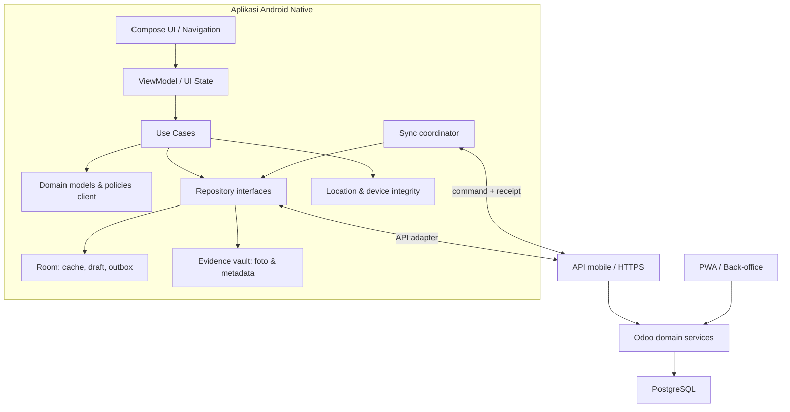

# Blueprint Arsitektur dan Implementasi Native Android

**Versi:** 0.1  
**Tanggal:** 14 November 2026  
**Status:** Rancangan dasar untuk review; belum merupakan keputusan implementasi final  
**Platform:** Android native — Kotlin + Jetpack Compose  
**Cakupan desain:** 62 layar pada prototipe mobile  
**Baseline perangkat:** Redmi 4X (minimum fungsional), POCO M3 (target UX optimal)

> Dokumen ini menjadi acuan engineering untuk workstream Native Android. Dokumen ini tidak mengubah, mengambil alih, atau menghambat pekerjaan PWA/backend yang sedang berlangsung. PWA yang ada dipakai sebagai bukti workflow, kontrak, dan perilaku domain.

## 1. Ringkasan keputusan

| Area | Keputusan dasar |
|---|---|
| Platform | Android native menggunakan Kotlin; UI dengan Jetpack Compose |
| Arsitektur aplikasi | Modular, berlapis, offline-first, state-driven |
| Sumber kebenaran bisnis | Odoo/backend; Android tidak membuat mesin keputusan bisnis kedua |
| Referensi workflow | Implementasi PWA terkini di repository, bukan asumsi dari mockup |
| Cakupan UI | Inventaris 62 layar; urutan implementasi mengikuti workflow dan dependency |
| Design system | Identitas visual, hierarki, token, dan semantik workflow dipertahankan; pola interaksi boleh dinativisasi |
| Perangkat | Redmi 4X wajib menjalankan alur inti; POCO M3 menjadi baseline pengalaman penuh |
| Lokasi | Kalibrasi GPS wajib saat aktivasi pertama; keputusan kelayakan bersifat fail-closed |
| Anti-spoofing | Sub-sistem terpisah dari pengukuran kualitas GPS; bukti dikirim ke backend |
| Offline | Draft dan antrean lokal terenkripsi/terisolasi; receipt server tetap otoritatif |
| Integrasi desain | Figma sebagai workspace kolaborasi dan review, bukan sekadar tempat ekspor gambar |

### 1.1 Tujuan

Membangun aplikasi Android yang menjalankan workflow lapangan FMCG secara native, dengan pengalaman yang lebih responsif dan terintegrasi dengan kemampuan perangkat, tanpa memecah sumber kebenaran transaksi yang sudah ditetapkan pada arsitektur Odoo.

### 1.2 Bukan tujuan tahap ini

- Mengganti atau menulis ulang PWA.
- Mengubah aturan bisnis Odoo, kontrak API, atau model transaksi tanpa koordinasi dengan pemilik backend.
- Memindahkan approval, perhitungan harga/diskon/kredit, stok, posting akuntansi, atau payroll menjadi otoritas client.
- Menyalin 62 layar sebagai 62 implementasi terisolasi tanpa komponen dan state model bersama.
- Menjanjikan kompatibilitas penuh pada semua versi Android/perangkat.
- Menganggap GPS yang akurat otomatis berarti lokasi tidak dipalsukan.

## 2. Landasan repository dan batas kepercayaan

Blueprint ini disusun dengan merujuk pada implementasi dan dokumen berikut di `main` saat penyusunan:

| Sumber | Peran dalam rancangan |
|---|---|
| `docs/SCOPE.md` | Konteks hybrid Odoo + aplikasi lapangan dan keputusan native sebagai arah lanjutan |
| `docs/blueprints/mobile_api_and_pwa_plan.md` | Kontrak batas backend/client, offline queue, auth, evidence, dan pembagian tanggung jawab |
| `pwa/src/App.tsx` | Shell aplikasi, sesi, role, dan workspace yang berjalan |
| `pwa/src/domain/contracts.ts` | Bentuk command, payload, receipt, dan schema domain |
| `pwa/src/domain/visit-validation.ts` | Validasi konteks sesi pagi, outlet/geofence, evidence, urutan kunjungan |
| `pwa/src/domain/outbox.ts` | Lifecycle antrean, validasi sebelum kirim, retry, dan penanganan receipt |
| `pwa/src/storage/store.ts` | Persistensi lokal, isolasi owner, transaksi draft/queue, dan guard |
| `pwa/src/domain/visits.ts` | Workflow check-in, order dalam kunjungan, dan check-out |
| `pwa/src/ui/navigation.ts` | Semantik route, dialog, back stack, dan lapisan transient |
| `pwa/design/tokens.json` dan `pwa/src/ui/tokens.css` | Token desain yang sudah ada di repository |

**Catatan versi:** hasil audit dan dokumen rekonsiliasi desain yang bertanggal sebelumnya adalah snapshot pada tanggal/SHA masing-masing. Jangan menganggap semua status layar atau gap dalam dokumen historis itu sebagai status terkini tanpa memeriksa kode dan PR terbaru.

### 2.1 Aturan otoritas

1. Server/Odoo berwenang memutuskan penerimaan command, status transaksi, harga resmi, diskon, kredit, stok, approval, absensi resmi, dan settlement.
2. Android berwenang atas pengalaman interaksi, validasi format, penyimpanan draft, pengumpulan evidence, pengelolaan antrean, dan penjelasan status lokal.
3. Cache atau data lokal tidak boleh ditampilkan seolah-olah sudah menjadi transaksi resmi.
4. Mode demo/mock harus terpisah tegas dari build produksi; kegagalan API tidak boleh diam-diam mengaktifkan mock.
5. Perangkat tidak boleh mengirim identitas owner/employee yang dapat dipilih bebas oleh pengguna sebagai dasar otorisasi. Identitas harus berasal dari sesi server yang tervalidasi.

## 3. Arsitektur target

### 3.1 Diagram konteks

### 3.2 Lapisan aplikasi

| Lapisan | Tanggung jawab | Larangan |
|---|---|---|
| Presentation | Compose screens, reusable components, navigation, accessibility, UI state rendering | Tidak memanggil API atau database langsung dari composable |
| Application | Use case, orchestration, state transition client, permission coordination | Tidak mengimplementasikan ulang aturan keputusan bisnis server |
| Domain | Entity/value object, command intent, validation format, workflow client, repository contract | Tidak bergantung pada Android framework |
| Data | Repository implementation, Room, API adapter, serialization, mapping, cache | Tidak menampilkan status lokal sebagai status server |
| Device | GPS, camera, media metadata, haptics, integrity signals, lifecycle | Tidak menjadi sumber otoritatif tunggal untuk trust |
| Sync | Outbox, retry, dependency ordering, idempotency, conflict/rejection handling | Tidak mengirim command yang dependency/evidence-nya belum valid |

### 3.3 Modul Gradle yang disarankan

Mulai dengan modularisasi secukupnya; jangan membuat modul per layar.

- `:app` — application entry, DI composition root, navigation graph.
- `:core:designsystem` — token, typography, color, shapes, components, icons.
- `:core:ui` — shared UI patterns, loading/error/empty states, adaptive layout.
- `:core:domain` — shared domain primitives dan repository contracts.
- `:core:data` — repository implementations, serializers, API mapping.
- `:core:database` — Room database, DAO, migrations.
- `:core:network` — HTTP client, auth interceptor, API error mapping.
- `:core:sync` — outbox, scheduler, retry, reconciliation.
- `:core:device` — GPS, camera, media, device qualification, integrity.
- `:feature:auth`, `:feature:attendance`, `:feature:home`, `:feature:sales`, `:feature:delivery`, `:feature:hris`, `:feature:expenses`, `:feature:utilities`.

Pemecahan feature dapat disesuaikan setelah pemetaan 62 layar ke workflow aktual selesai. Hindari modul kosong hanya untuk mengejar struktur ideal.

## 4. Pemetaan workflow dan 62 layar

62 layar adalah cakupan desain, bukan bukti bahwa seluruh transisi atau aturan bisnis sudah terimplementasi. Setiap layar harus ditautkan ke:

- workflow dan aktor/role;
- route masuk dan route keluar;
- command/query yang digunakan;
- prasyarat sesi, snapshot, outlet, transaksi, atau evidence;
- state lokal dan state server;
- perilaku offline;
- status loading, empty, error, rejected, pending, dan success;
- kebutuhan kamera/GPS/permission;
- komponen design system yang dipakai;
- acceptance test.

### 4.1 Kelompok workflow awal

Gunakan pengelompokan prototipe sebagai indeks awal, lalu verifikasi setiap alur terhadap kode PWA terkini:

1. Login dan autentikasi.
2. Attendance, GPS, dan kamera.
3. Home, sesi kerja, dan sinkronisasi pagi.
4. Outlet dan visit.
5. Collection.
6. Sales order.
7. Field cash dan HRIS.
8. Delivery dan proof of delivery.
9. Expense dan trip closing.
10. Utilities dan activity.

### 4.2 Urutan implementasi berbasis dependency

Urutan kerja yang disarankan:

1. Foundation: app shell, design tokens, navigation, auth/session, role/capability.
2. Device readiness: permission, GPS calibration, device qualification.
3. Attendance dan sesi pagi: karena membuka konteks hari kerja.
4. Snapshot dan offline data: outlet/PJP, produk, harga, stok, tagihan, dan capability yang tersedia.
5. Outlet visit: check-in, evidence, active visit, order association, check-out.
6. Sales order: draft, validasi input, quote preview yang diberi label, submit, receipt, status.
7. Collection dan delivery/POD sesuai kesiapan kontrak backend.
8. HRIS, cuti, field cash, expense, trip closing.
9. Activity, history, diagnostics, dan hardening.

Layar yang bergantung pada endpoint/command yang belum tersedia harus memiliki capability gate dan status belum tersedia. Jangan membuat simulasi produksi untuk menutupi dependency.

## 5. Design system dan native UX

### 5.1 Prinsip

- Pertahankan identitas visual, hierarki informasi, istilah domain, dan semantik workflow.
- Adaptasikan pola web menjadi pola Android yang terasa natural, bukan menyalin keterbatasan browser.
- Peningkatan native boleh dilakukan jika menyederhanakan tugas, meningkatkan keterbacaan, mengurangi langkah, atau memperjelas status.
- Peningkatan tidak boleh mengubah arti status, otorisasi, urutan kerja, atau konsekuensi bisnis.
- Haptics, motion, sticky surfaces, bottom sheets, dan gesture harus membantu tugas, bukan dekorasi.

### 5.2 Token baseline repository

Nilai berikut merupakan baseline yang ditemukan pada token PWA; validasi kembali dengan design system final/Figma sebelum dikunci sebagai Android resource:

| Token | Baseline |
|---|---|
| Ink | `#0B1F4D` |
| Muted text | `#52647A` |
| Background | `#F7F9FC` |
| Surface | `#FFFFFF` |
| Primary | `#1B5E8C` |
| Navigation navy | `#001A57` |
| Accent/status | Ikuti semantic token pada `tokens.json` |
| Font | Inter; sediakan fallback sistem |
| Radius | 8, 10, 14, 20 dp sebagai baseline |
| Spacing | Grid 4 dp: 4, 8, 12, 16, 20, 24 |
| Minimum touch target | 44 dp sebagai baseline minimum; target Android aksesibel dapat lebih besar |
| Header | 56 dp baseline; adaptif terhadap inset |
| Bottom navigation | Tinggi mengikuti konten, inset, dan ukuran layar; jangan mengunci tinggi web |

Angka mockup 390×844 adalah referensi komposisi, bukan ukuran perangkat. Semua layar wajib adaptif terhadap lebar, tinggi, density, font scale, display cutout, system bars, keyboard, dan orientasi yang didukung.

### 5.3 Native enhancement

- Haptic ringan untuk konfirmasi tindakan penting; haptic kuat hanya untuk kondisi kritis dan dapat dimatikan bila sesuai.
- Sticky action bar untuk aksi utama pada form panjang, dengan ruang aman untuk keyboard dan system navigation.
- Modal bottom sheet untuk pemilihan/aksi kontekstual yang memang bersifat sementara; gunakan full-screen route untuk tugas panjang.
- Predictive Back dan back stack harus menjaga draft dan tidak membuang data tanpa konfirmasi.
- Camera capture memakai CameraX bila kompatibilitas perangkat memungkinkan; fallback kamera sistem dapat dipertimbangkan untuk perangkat lama.
- Motion memakai animasi pendek, dapat dinonaktifkan/adaptif pada perangkat minimum atau ketika reduced motion diaktifkan.
- Jangan membuat interaksi gesture sebagai satu-satunya cara menjalankan aksi.

## 6. Kompatibilitas perangkat

### 6.1 Dua baseline

| Perangkat | Peran | Target |
|---|---|---|
| Xiaomi Redmi 4X | Minimum fungsional | Login, GPS check, attendance, snapshot, outlet, order/visit, outbox, dan alur inti tetap dapat digunakan tanpa crash atau UI macet |
| POCO M3 | Baseline UX optimal | Pengalaman visual penuh, transisi, kamera, sticky interaction, haptics, dan responsivitas yang direncanakan |

Model perangkat saja tidak cukup untuk menentukan kemampuan. Catat versi Android/API, RAM, ABI, ruang penyimpanan, Google Play Services, status security patch jika tersedia, dan kemampuan sensor aktual.

### 6.2 Kebijakan API dan runtime

- Tetapkan `minSdk` berdasarkan hasil build/test pada Redmi 4X yang benar-benar digunakan. Jangan menebak hanya dari nama model; varian ROM dan OS dapat berbeda.
- Hindari API baru tanpa capability check dan fallback.
- Uji startup, cold start, memory pressure, process death, permission denial, dan pemulihan transaksi.
- Hindari pekerjaan berat di main thread; paging daftar panjang dan batasi ukuran thumbnail.
- Kompresi foto harus menjaga keterbacaan bukti; simpan original/derivative sesuai kebijakan evidence yang disetujui backend.
- Animasi dan haptics boleh dikurangi berdasarkan kemampuan runtime; workflow inti tidak boleh ikut hilang.

## 7. GPS calibration dan device qualification

### 7.1 Dua penilaian terpisah

**Kualitas GPS** menilai apakah perangkat mampu menghasilkan fix yang layak untuk workflow lapangan. **Integritas lokasi/perangkat** menilai apakah sinyal lokasi atau lingkungan aplikasi menunjukkan indikasi manipulasi. Perangkat dapat memiliki GPS akurat tetapi tetap mencurigakan; sebaliknya perangkat tanpa indikasi spoofing dapat memiliki GPS yang buruk.

### 7.2 First-run calibration

Sebelum aktivasi resmi pertama, aplikasi menjalankan proses terarah:

1. Meminta permission lokasi yang benar-benar diperlukan dan menjelaskan alasannya.
2. Memeriksa location services, provider, timestamp, usia fix, dan ketersediaan sensor.
3. Mengumpulkan sampel selama jendela kalibrasi dengan indikator progres dan alasan sampel ditolak.
4. Mengukur distribusi horizontal accuracy, waktu memperoleh fix, kestabilan, kontinuitas timestamp, dan perpindahan saat perangkat diam.
5. Menjalankan pemeriksaan integritas yang didukung versi OS/perangkat.
6. Menghasilkan laporan terstruktur untuk evaluasi backend.
7. Mengizinkan aktivasi hanya jika policy backend mengembalikan status yang memenuhi syarat.

### 7.3 Model skor awal — hipotesis untuk pengujian

Bobot berikut adalah rancangan awal, bukan ambang produksi yang sudah tervalidasi:

| Dimensi | Bobot awal |
|---|---:|
| Akurasi GPS | 30 |
| Waktu memperoleh fix | 15 |
| Stabilitas sampel | 25 |
| Timestamp dan kontinuitas | 10 |
| Integritas perangkat/lokasi | 20 |
| **Total** | **100** |

Kategori awal untuk eksperimen: Qualified 85–100, Conditional 70–84, Unqualified di bawah 70. Hard gate harus mengalahkan skor: mock location yang terkonfirmasi tidak boleh lolos hanya karena nilai total tinggi.

### 7.4 Ambang kandidat untuk diuji pada perangkat nyata

- Median horizontal accuracy ≤ 15 meter.
- Persentil ke-90 accuracy ≤ 30 meter.
- First usable fix ≤ 30 detik; timeout keras eksperimen 120 detik.
- Minimal 8 sampel valid dalam jendela maksimal 180 detik.
- Median displacement saat kondisi statis ≤ 15 meter, dengan evaluasi yang memperhitungkan accuracy dan multipath.
- Timestamp tidak berada di masa depan dan tidak terlalu lama.
- Sinyal tidak menunjukkan mock provider atau anomali integritas yang terkonfirmasi.

Ambang ini harus dikalibrasi dengan pengujian outdoor/indoor, area padat bangunan, cuaca, dan variasi jaringan. Jangan menjadikan satu angka accuracy sebagai bukti tunggal.

### 7.5 Status dan konsekuensi

Gunakan status terstruktur, bukan boolean `gps_ok`:

- `TRUSTED`
- `SUSPICIOUS`
- `MOCK_DETECTED`
- `LOW_ACCURACY`
- `PERMISSION_DENIED`
- `INTEGRITY_UNAVAILABLE`
- `DEVICE_UNQUALIFIED`

Perangkat yang tidak memenuhi syarat tidak boleh diaktivasi untuk pekerjaan lapangan resmi dan tidak boleh didaftarkan sebagai perangkat terpercaya. Android app biasa tidak dapat secara diam-diam menghapus dirinya sendiri atau melakukan rollback instalasi. Implementasi yang realistis adalah memblokir aktivasi/fitur lapangan, menjelaskan penyebab, menyimpan diagnostik yang aman, dan meminta tindakan admin. Uninstall/rollback terkelola hanya mungkin bila organisasi menggunakan MDM/device-owner policy yang sesuai.

### 7.6 Sinyal anti-spoofing

- Gunakan `Location.isMock()` pada API 31+; sediakan pemeriksaan kompatibel untuk OS lama seperti API 25.
- Evaluasi mock provider, developer options bila dapat dideteksi, root/hooking/tampering, app integrity, lokasi usang, timestamp, loncatan posisi yang mustahil, provider, dan kontinuitas.
- Play Integrity dapat menjadi sinyal tambahan untuk perangkat/OS yang didukung, bukan satu-satunya detektor spoofing.
- Jangan menganggap pemeriksaan client tidak dapat dimanipulasi.
- Kirim metadata, versi aplikasi, versi OS/API, timestamp, accuracy, provider, hasil sinyal integritas, dan bukti kalibrasi yang relevan ke backend.
- Backend menjadi otoritas keputusan risiko dan status registrasi perangkat.
- Lakukan requalification ketika OS/config/integrity berubah, perangkat terindikasi anomali, atau policy mengharuskannya.

### 7.7 Hubungan dengan validasi PWA saat ini

PWA sudah melakukan validasi fix kunjungan melalui `assessVisitFix`/ `requireVisitFix`, termasuk schema, future/stale timestamp, jarak dan geofence dengan memperhitungkan accuracy; konteks kunjungan juga diikat ke sesi pagi, business date, snapshot, outlet, serta evidence/ledger. Native harus mempertahankan semantik kontrak tersebut, tetapi tidak menganggapnya sebagai anti-spoofing menyeluruh. Jangan mengubah policy server atau melonggarkan validasi demi kompatibilitas UI.

## 8. Offline-first, penyimpanan, dan sinkronisasi

### 8.1 Prinsip penyimpanan

- Room menjadi penyimpanan terstruktur untuk cache, draft, metadata antrean, dan state lokal.
- File evidence disimpan di area privat aplikasi; jangan menyimpan foto sensitif di galeri publik secara default.
- Data diisolasi berdasarkan identitas owner/session; pergantian akun tidak boleh mencampur cache atau antrean.
- Terapkan enkripsi at-rest untuk data sensitif dan kunci yang dikelola Android Keystore sesuai kemampuan API perangkat.
- Tetapkan retensi, penghapusan, dan batas ukuran cache; jangan menghapus antrean pending tanpa kebijakan pemulihan.

### 8.2 Command lifecycle

Status client yang direkomendasikan:

`draft → queued → sending → accepted | rejected | auth_required`

Tambahkan status lokal yang jelas bila diperlukan seperti `blocked_dependency`, `evidence_hold`, atau `needs_review`, tetapi mapping ke receipt server harus eksplisit. Retry tidak boleh membuat UUID command baru.

### 8.3 Aturan outbox

1. Setiap command memiliki UUID stabil/idempotency key.
2. Penyimpanan command dan perubahan draft terkait harus atomik.
3. Dependency harus dihormati; misalnya check-in harus mendapat receipt/keadaan yang diperlukan sebelum command lanjutan dikirim jika kontrak mengharuskannya.
4. Validasi ulang integritas evidence dan hubungan sumber tepat sebelum submit.
5. Backoff retry harus membatasi frekuensi dan menghormati 408/429/network failure.
6. Error 401 memicu auth recovery; 4xx bisnis yang definitif tidak di-retry tanpa perubahan.
7. Konflik atau penolakan mempertahankan payload untuk review dan tidak menghilangkan bukti.
8. Receipt UUID harus cocok dengan command UUID.
9. UI membedakan tersimpan lokal, menunggu jaringan, terkirim, diterima server, dan ditolak.
10. WorkManager dapat digunakan untuk pekerjaan sinkronisasi yang memenuhi syarat, tetapi foreground execution dan batas background Android harus dipertimbangkan untuk upload evidence besar.

### 8.4 Konflik dan pergantian akun

- Cache, outbox, dan evidence dikunci pada owner/session yang sesuai.
- Saat logout, antrean belum tersinkron tidak boleh otomatis dihapus; tampilkan konsekuensi dan jalankan kebijakan aman.
- Ketika akun berbeda login, antrean lama tetap terisolasi dan tidak boleh dikirim memakai identitas baru.
- Server receipt menjadi bukti final, bukan sekadar respons HTTP 200.

## 9. Autentikasi, keamanan, dan privasi

- Native memerlukan alur autentikasi native yang disepakati backend; jangan memaksa penggunaan cookie browser PWA tanpa rancangan.
- Token disimpan menggunakan Android Keystore/Encrypted storage yang kompatibel; refresh/revocation dan expiry harus diuji.
- TLS wajib; jangan menyimpan secret atau API key statis di APK.
- Terapkan least privilege, capability dari server, dan validasi otorisasi pada setiap operasi.
- Hindari logging token, foto, koordinat presisi, payload pribadi, atau data payroll.
- Evidence hanya diakses melalui jalur terotorisasi dan memiliki metadata provenance yang tidak bisa diedit pengguna biasa.
- Root/integrity signal menjadi risk input, bukan alasan untuk mengumpulkan data perangkat yang tidak relevan.
- Jelaskan permission secara kontekstual; jangan meminta background location jika workflow tidak membutuhkannya.
- Siapkan mekanisme logout/revoke, device unlink, dan penanganan perangkat hilang.

## 10. Kamera, evidence, dan media

- Gunakan abstraksi `EvidenceCapture` agar fitur tidak terikat langsung pada satu library kamera.
- Simpan waktu capture, identitas sesi/kunjungan, lokasi dan accuracy bila tersedia, checksum/hash, ukuran, MIME type, dan versi metadata.
- Bedakan waktu capture perangkat dan waktu penerimaan server.
- Jangan mengubah isi bukti tanpa mencatat transformasi; thumbnail/kompresi harus punya hubungan jelas dengan original.
- Tolak penggunaan ulang evidence ketika kontrak melarangnya.
- Upload dapat di-resume bila backend mendukung chunk/resumable upload; bila tidak, simpan status retry yang jelas.
- Jika permission ditolak atau kamera gagal, tampilkan alasan dan jalur pemulihan yang tidak mengakali policy bukti wajib.

## 11. Figma dan alur kerja desain

Figma menjadi tempat kolaborasi desain dan keputusan, bukan hanya penerima ekspor.

Struktur workspace yang disarankan:

- `00 — Product Map`: inventaris 62 layar, aktor, workflow, dan transisi.
- `01 — Foundations`: warna, typography, spacing, radius, elevation, motion, haptics.
- `02 — Components`: komponen reusable, variants, states, dan aturan penggunaan.
- `03 — Screens`: layar final dan state penting.
- `04 — Native Enhancements`: bottom sheets, sticky action, haptic, motion, camera/GPS patterns.
- `05 — Review & Decisions`: komentar, alternatif, keputusan, dan status persetujuan.

Setiap screen frame sebaiknya menyertakan ID layar stabil, nama workflow, role, state, ukuran adaptif, dan tautan ke acceptance criteria. Komentar desain harus ditutup dengan keputusan yang dapat ditelusuri. Perubahan visual tidak otomatis mengubah aturan bisnis.

## 12. Strategi pengujian

### 12.1 Piramida pengujian

- Unit: domain model, mapping, command serialization, validation format, reducer/state machine.
- Repository: Room, migration, owner isolation, atomic draft/outbox.
- Contract: API schema, error mapping, idempotency, receipt, capability negotiation.
- UI: Compose semantics, accessibility, font scaling, keyboard, back navigation.
- Integration: GPS provider, camera, evidence, WorkManager, process death.
- End-to-end: workflow penuh dengan backend test environment.
- Field test: Redmi 4X dan POCO M3 di kondisi jaringan dan GPS yang berbeda.

### 12.2 Matriks perangkat minimum

Wajib diuji pada kedua perangkat:

- Instalasi bersih, upgrade, permission grant/deny/revoke.
- Login, token expiry, logout, pergantian akun.
- GPS cold start, akurasi rendah, mock signal, lokasi stale/future, kehilangan provider.
- Foto capture, retake, rotasi, file rusak, storage penuh.
- Offline sebelum submit, offline setelah queued, koneksi putus saat sending, retry.
- Process kill/reboot saat antrean pending.
- Font scale besar, keyboard terbuka, layar pendek, display cutout.
- Battery saver, background restriction, dan low memory.
- Duplicate tap, double submit, back navigation, dan resume dari notification.

### 12.3 Kriteria penerimaan minimum

1. Tidak ada transaksi resmi yang dinyatakan sukses sebelum receipt server yang valid diterima.
2. Tidak ada command hilang akibat process death pada lifecycle yang didukung.
3. Tidak ada kontaminasi antrean antar-owner.
4. Workflow inti tetap bisa digunakan pada Redmi 4X dengan motion/haptics dikurangi.
5. Layout tidak mengasumsikan 390×844 dan tetap dapat digunakan pada layar kecil.
6. Device unqualified tidak dapat masuk ke mode kerja lapangan resmi.
7. Mock/demo tidak dapat aktif diam-diam pada build live.
8. Semua 62 layar terpetakan ke workflow, role, state, dependency, dan test sebelum dinyatakan selesai.
9. Perbedaan dari workflow PWA harus didokumentasikan dan disetujui, bukan terjadi karena kelalaian porting.

## 13. Tahapan implementasi dan gerbang keputusan

| Tahap | Hasil | Gerbang keluar |
|---|---|---|
| N0 — Discovery | Audit 62 layar, workflow PWA terkini, API capability, design tokens, perangkat | Setiap layar punya mapping dan dependency |
| N1 — Foundation | Project Kotlin, Gradle, app shell, navigation, design system, CI | Build reproducible, unit/UI test dasar |
| N2 — Identity & device | Native auth, permission, GPS calibration, qualification flow | Redmi 4X dan POCO M3 lolos test matrix |
| N3 — Offline core | Room, owner isolation, outbox, sync coordinator, diagnostics | Recovery/retry/idempotency teruji |
| N4 — Field workflow | Attendance, morning snapshot, visit, evidence | Workflow end-to-end dengan receipt backend |
| N5 — Commerce/logistics | Sales order, collection, delivery/POD, expense | Capability dan command backend tersedia |
| N6 — HRIS & polish | Leave, payslip view, activity, utilities, haptics/motion | Security, accessibility, field acceptance |
| N7 — Release readiness | Signing, versioning, rollout, crash/performance monitoring, MDM policy bila ada | Release checklist disetujui |

Tahap tidak berarti semua backend dependency harus dikerjakan oleh workstream native. Bila endpoint belum tersedia, catat dependency dan siapkan adapter/test double untuk pengembangan lokal tanpa mengaktifkan simulasi pada produksi.

## 14. Risiko utama dan mitigasi

| Risiko | Dampak | Mitigasi |
|---|---|---|
| API/backend belum menyediakan semua command | Layar tidak dapat menyelesaikan workflow resmi | Capability gate, dependency register, mock hanya untuk test |
| Redmi 4X memiliki batas OS/RAM/perangkat | Crash atau UX berat | Uji perangkat fisik sejak N1, fallback API, profil motion adaptif |
| GPS spoofing sulit dipastikan client-side | Aktivitas lapangan palsu | Multi-signal, backend risk decision, audit trail |
| Threshold GPS terlalu ketat/longgar | False reject atau fraud lolos | Kalibrasi lapangan, cohort test, versioned policy |
| Porting 62 layar secara literal | Duplikasi komponen dan state tidak konsisten | Screen map, reusable components, workflow-first delivery |
| Perubahan PWA berlangsung paralel | Kontrak dan workflow bergerak | Baca perubahan terbaru, pin kontrak/commit per integrasi, koordinasi tanpa mengubah branch lain |
| Offline queue kehilangan/duplikasi | Kerugian operasional | Atomic transaction, stable UUID, receipt validation, recovery tests |
| Perbedaan design token | Identitas visual terpecah | Satu sumber token dan review Figma |
| Background restriction Android | Sync tertunda | WorkManager + foreground upload sesuai kebutuhan, status transparan |

## 15. Keputusan yang masih harus dibuktikan sebelum coding produksi

1. Versi Android/API aktual dan varian Redmi 4X yang menjadi perangkat minimum.
2. `minSdk` dan strategi kompatibilitas untuk API lama.
3. API native auth, refresh, revoke, device registration, dan capability bootstrap.
4. Endpoint/command yang benar-benar tersedia pada backend terkini.
5. Skema registrasi perangkat dan payload GPS calibration/integrity.
6. Kebijakan server untuk status Conditional dan requalification.
7. Kebijakan evidence, retensi, enkripsi, upload, dan data lokasi.
8. Finalisasi 62 screen inventory terhadap desain terbaru di Figma.
9. Dukungan MDM atau tidak; tanpa MDM, aplikasi hanya dapat memblokir aktivasi, bukan uninstall otomatis.
10. Baseline performa dan ukuran APK yang dapat diterima pada Redmi 4X.

## 16. Referensi internal

- `docs/SCOPE.md`
- `docs/blueprints/mobile_api_and_pwa_plan.md`
- `pwa/src/App.tsx`
- `pwa/src/domain/contracts.ts`
- `pwa/src/domain/visit-validation.ts`
- `pwa/src/domain/outbox.ts`
- `pwa/src/storage/store.ts`
- `pwa/src/domain/visits.ts`
- `pwa/src/ui/navigation.ts`
- `pwa/design/tokens.json`
- `pwa/src/ui/tokens.css`

---

## Lampiran A — Aturan kerja workstream Native

- Semua commit dan komentar re-review berbahasa Indonesia.
- Setiap commit menambahkan signature paling akhir dengan format:  
  `Task managed by Agent Codex-Mobile Native at {timestamp}`
- Branch menggunakan konvensi repository dan akhiran identitas `Codex-Mobile-Native`.
- Perubahan native dipisah dari branch PWA/backend yang sedang berjalan.
- Perubahan kontrak bersama harus diajukan sebagai dependency/koordinasi, bukan dilakukan sepihak.
- Setiap keputusan yang mengubah workflow, status bisnis, atau policy keamanan harus memiliki catatan keputusan dan persetujuan.
