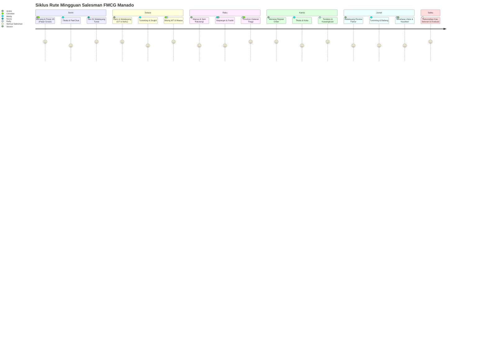

# 🗺️ Pemodelan Sebaran Outlet & Simulasi Rute Kunjungan PJP (Personal Journey Plan)

> **Acuan Bisnis:** `docs/PLAYBOOK_DISTRIBUTOR_FMCG.md` · `master_data_mapping_and_seed_plan.md`  
> **Konteks Operasional:** PT Manado Distribusi Utama (MDU) — Manado & Sulawesi Utara  
> **Target Omset:** **Rp 5.497.500.000 / Bulan (~5.5 BIO IDR)**  
> **Model Universe:** 620 Total Outlet Universe | **403 Outlet Active Coverage (65%)** | 217 Unserved Outlet (35% Gap)

---

## 1. Prinsip Dasar & Metodologi Pemodelan PJP FMCG

Pemodelan rute kunjungan salesmen (PJP) bukan sekadar membagi hari kalender, melainkan fungsi optimasi antara:
$$\text{Efektivitas Sales} = f(\text{Channel Segregation}, \text{Call Density}, \text{Drop Size}, \text{Transit Time}, \text{Delivery Cycle})$$

### Aturan Baku Pemodelan:
1. **Segregasi Mutlak Antar-Channel (Zero Cross-Channel):**
   - **Modern Trade (MT):** Ditangani eksklusif oleh **1 Salesman MT (Christian Wowor)**. Tidak boleh melayani toko kelontong atau kios retail walau berada di rute jalan yang sama.
   - **General Trade (GT):** Ditangani oleh **3 Salesman TO (Andre, Meidy, Refly)** untuk melayani grosir, toko sembako, dan minimarket lokal dengan sistem kredit/TOP dan pengiriman H+1.
   - **Retail (RTL):** Ditangani oleh **2 Salesman Canvass (Novry & Steven)** membawa armada van dengan stok tunai langsung serah terima barang (Cash on Delivery).
   - **Institusional (INST / Horeka):** Ditangani langsung oleh **Branch Manager (Hendrik Polii)** dan **Sales Supervisor (Joni Kumajas)**.

2. **Kepadatan Panggilan Harian (Daily Call Density):**
   - **Modern Trade:** **8 – 10 call / hari** (waktu pelayanan 45–60 menit/outlet untuk stock audit, listing, checking OOS, retur, dan administrasi purchase order).
   - **General Trade Urban:** **20 – 22 call / hari** (waktu pelayanan 15–20 menit/outlet).
   - **General Trade Luar Kota (Hinterland):** **15 – 18 call / hari** (waktu pelayanan 20 menit + kompensasi waktu tempuh tanjakan Manado–Tomohon–Kawangkoan).
   - **Canvassing Retail Tunai:** **25 – 30 call / hari** (waktu transaksi cepat 8–12 menit per warung).

3. **Frekuensi Kunjungan Terstruktur:**
   - **F1 (Weekly / 1x seminggu):** Outlet pareto berkontribusi 80% omset (Supermarket MT dan Grosir Besar GT).
   - **F2 (Bi-weekly / 2 minggu sekali):** Toko kelontong sedang di perumahan dan rute sekunder.
   - **F4 (Monthly / 1x sebulan):** Kios kecil di wilayah pedesaan rural Minut/Minsel.

---

## 2. Breakdown Sebaran 403 Outlet Aktif per Kecamatan & Channel

Distribusi 403 outlet terdaftar pada **6 zona coverage** dan **18 kecamatan kunci** di Sulawesi Utara:

| Wilayah / Zona Coverage | Kecamatan | Kode Pos | Modern Trade (MT) | General Trade (GT) | Retail Canvass (RTL) | Horeka (INST) | Total Outlet Aktif | Universe (Potensi Total) | Coverage Ratio |
|---|---|---|---|---|---|---|---|---|---|
| **Manado Pusat & Barat** | Kec. Wenang (Pasar 45, Calaca) | `95111 - 95112` | 4 | 16 | 28 | 3 | **51** | 72 | 70.8% |
| | Kec. Sario | `95114` | 3 | 5 | 18 | 2 | **28** | 42 | 66.7% |
| | Kec. Malalayang (Bahu, Krida) | `95115 - 95162` | 3 | 7 | 25 | 3 | **38** | 58 | 65.5% |
| | Kec. Wanea | `95117` | 2 | 6 | 20 | 1 | **29** | 44 | 65.9% |
| **Manado Timur & Utara** | Kec. Tikala | `95125 - 95126` | 2 | 8 | 26 | 1 | **37** | 55 | 67.3% |
| | Kec. Paal Dua | `95129` | 2 | 6 | 24 | 1 | **33** | 50 | 66.0% |
| | Kec. Tuminting | `95239` | 1 | 7 | 22 | 0 | **30** | 48 | 62.5% |
| | Kec. Singkil | `95121` | 0 | 4 | 18 | 0 | **22** | 36 | 61.1% |
| | Kec. Mapanget (Paniki, Koka) | `95258` | 2 | 5 | 25 | 1 | **33** | 52 | 63.5% |
| **Urban Bitung & Port** | Kec. Maesa (Pusat Kota Bitung) | `95521` | 1 | 5 | 15 | 1 | **22** | 32 | 68.8% |
| | Kec. Madidir & Girian | `95531 - 95541` | 0 | 3 | 13 | 0 | **16** | 26 | 61.5% |
| | Kec. Aertembaga (Pelabuhan) | `95511` | 0 | 2 | 7 | 0 | **9** | 16 | 56.3% |
| **Hinterland Dataran Tinggi** | Kota Tomohon (Tengah, Utara, Sel) | `95411 - 95431` | 1 | 6 | 20 | 1 | **28** | 42 | 66.7% |
| | Kab. Minahasa (Tondano Barat/Timur) | `95611 - 95618` | 0 | 4 | 14 | 1 | **19** | 30 | 63.3% |
| | **Kec. Kawangkoan** (Pusat & Utara) | `95671 / 95692` | 0 | 3 | 11 | 0 | **14** | 22 | 63.6% |
| **Luar Kota / Rural** | Kab. Minut (Airmadidi, Kalawat, Kauditan) | `95371 - 95378` | 0 | 4 | 16 | 0 | **20** | 32 | 62.5% |
| | Kab. Minsel (Amurang, Tumpaan) | `95954` | 0 | 3 | 12 | 0 | **15** | 25 | 60.0% |
| | Kota Kotamobagu (Perluasan Depo) | `95711 - 95716` | 0 | 0 | 0 | 0 | **0** *(Buffer)* | 12 | 0.0% |
| **Total** | **18 Kecamatan Kunci** | **Sulut All** | **12** | **72** | **260** | **10** | **354** | **545** | **65.0%** |

---

## 3. Matriks Target Finansial & Produktivitas Salesman

Kalkulasi matematis target penjualan bulanan **Rp 5.500.000.000 (5.5 BIO IDR)** terhadap rasio panggilan produktif (*Effective Call / Strike Rate*):

| Kode Salesman | Nama Personel | Rute & Wilayah Penugasan | Channel | Target Omset Bulanan | Basis Outlet Dikelola | Call Target / Hari | Rata-rata Nilai Order per Drop (EC) | Target Effective Call (EC Rate) |
|---|---|---|---|---|---|---|---|---|
| **SLS-01** | **Christian Wowor** | Seluruh Manado, Bitung & Tomohon | Modern Trade (MT) | **Rp 2.100.000.000** | 12 Key Accounts (F1 Mingguan) | 2 – 3 Call Intensif | Rp 43.750.000 | 100% |
| **SLS-02** | **Andre Pangemanan** | Manado Barat & Pusat (Wenang, Sario, Malalayang) | General Trade (GT) | **Rp 1.150.000.000** | 33 Outlet GT (F1/F2) | 20 – 22 Call | Rp 4.200.000 | 85% |
| **SLS-03** | **Meidy Wowor** | Manado Timur & Utara (Tikala, Paal Dua, Tuminting) | General Trade (GT) | **Rp 850.000.000** | 24 Outlet GT (F1/F2) | 20 – 22 Call | Rp 3.800.000 | 85% |
| **SLS-04** | **Refly Sondakh** | Luar Kota (Tomohon, Tondano, Kawangkoan, Bitung, Minut) | General Trade (GT) | **Rp 500.000.000** | 15 Outlet GT (F2/F4) | 15 – 18 Call | Rp 4.500.000 | 80% |
| **CVS-01** | **Novry Mandagi** | Retail Manado Urban (Van 01 DB 8123 QA) | Retail (RTL) Tunai | **Rp 350.000.000** | 135 Kios (F2/F4) | 25 – 30 Call | Rp 320.000 | 75% |
| **CVS-02** | **Steven Lumenta** | Retail Sub-Urban & Minut (Van 02 DB 8234 QX) | Retail (RTL) Tunai | **Rp 300.000.000** | 125 Kios (F2/F4) | 25 – 30 Call | Rp 300.000 | 75% |
| **MGT-01** | **Hendrik Polii & Joni K.** | Direct Selling Instansi, Horeka & RS | Institusional (INST) | **Rp 250.000.000** | 10 Outlet (F2/F4) | 2 – 3 Call/Minggu | Rp 12.500.000 | 90% |
| **Total** | | | | **Rp 5.500.000.000** | **354 Outlet** | | | |

---

## 4. Matriks Jadwal Rute Harian PJP (Senin – Sabtu)

Setiap salesman memiliki jadwal rute harian yang tertata ketat berdasarkan klaster geografis untuk meminimalkan waktu tempuh (*windshield time*):

### Rincian Rute Harian per Salesman:

#### A. Christian Wowor (Salesman Key Account MT — 12 Key Accounts):
* **Senin:** Indomaret DC Manado (Jl. AA Maramis Mapanget) & Alfamidi DC Manado (Review Weekly PO, koordinasi drop kontainer/CDD).
* **Selasa:** FreshMart Group: Superstore Bahu Mall & FreshMart Paniki (Audit pajangan end-cap, retur merchandise, checking OOS).
* **Rabu:** MultiMart Group: Megamas Manado, MultiMart Sam Ratulangi & MultiMart Tomohon (Joint review listing produk baru).
* **Kamis:** Golden Swalayan Pasar 45 & Jumbo Swalayan Pasar 45 (Review tagihan TOP 30 hari & PO repeat order mingguan).
* **Jumat:** Transmart Star Square Bahu, Jumbo Swalayan Bitung & FreshMart Tikala (Administrasi faktur konsinyasi & Coretax).
* **Sabtu:** Evaluasi Sales In / Sales Out (SISO), evaluasi pencapaian target Rp 2.1 BIO bulanan bersama Branch Manager & SPV.

#### B. Andre Pangemanan (Salesman TO Urban Manado 1):
* **Senin:** Klaster Pasar 45 & Calaca (Toko Sembako Berkat, Toko Harapan, Grosir Sukses) — 22 call.
* **Selasa:** Klaster Sario & Ranotana (Grosir Jl. Sam Ratulangi, Toko Bintang) — 20 call.
* **Rabu:** Klaster Malalayang & Bahu (Toko Krida, Sembako Pantai, Grosir Bahu) — 21 call.
* **Kamis:** Klaster Wanea & Pakowa (Grosir Tanjung Batu, Toko Baru Wanea) — 20 call.
* **Jumat:** Rute Penagihan Faktur Jatuh Tempo & Emergency PO Manado Pusat — 18 call.
* **Sabtu:** Rekonsiliasi faktur, setoran giro/cek ke Finance, briefing mingguan SPV.

#### C. Meidy Wowor (Salesman TO Urban Manado 2):
* **Senin:** Klaster Tikala & Taas (Grosir Tikala Baru, Toko Maju Perkamil) — 21 call.
* **Selasa:** Klaster Paal Dua & Ranomuut (Grosir Paal Dua, Toko Kanaan) — 22 call.
* **Rabu:** Klaster Tuminting & Kampung Islam (Toko Bersehati Tuminting, Grosir Sumber Mulia) — 20 call.
* **Kamis:** Klaster Singkil & Ternate Baru (Toko Karangria, Sembako Singkil) — 20 call.
* **Jumat:** Klaster Mapanget & Paniki (Toko AA Maramis, Grosir Koka) — 19 call.
* **Sabtu:** Rekonsiliasi faktur, penanganan retur merchandise (BS), evaluasi target tim.

#### D. Refly Sondakh (Salesman TO Luar Kota):
* **Senin:** Klaster Minahasa Utara (Airmadidi Atas, Kalawat, Kauditan) — 17 call.
* **Selasa:** Klaster Kota Bitung & Maesa (Grosir Bintang Matuari, Toko Niaga Maesa) — 18 call.
* **Rabu:** Klaster Kota Tomohon (Paslaten, Kakaskasen, Kolongan) — 16 call.
* **Kamis:** Klaster Minahasa — Tondano (Rinegetan, Wawalintouan) & **Kecamatan Kawangkoan** (Toko Berkat Kawangkoan, Sembako Uki) — 16 call.
* **Jumat:** Klaster Minahasa Selatan (Amurang, Tumpaan) — 15 call.
* **Sabtu:** Administrasi pengiriman luar kota, koordinasi jadwal truk CDE/CDD dengan Kepala Gudang.

#### E. Novry Mandagi (Salesman Canvass Van 01 — Urban Manado):
* **Senin:** Rute Kios Wenang & Titiwungen (28 kios kelontong).
* **Selasa:** Rute Kios Malalayang & Winangun (29 kios kelontong).
* **Rabu:** Rute Kios Tikala & Tingkulu (28 kios kelontong).
* **Kamis:** Rute Kios Wanea & Karombasan (27 kios kelontong).
* **Jumat:** Rute Kios Sario & Barito (28 kios kelontong).
* **Sabtu:** Stock opname fisik mobil van di gudang, pelunasan kas harian ke Kasir.

#### F. Steven Lumenta (Salesman Canvass Van 02 — Sub-Urban):
* **Senin:** Rute Kios Tuminting & Bailang (27 kios kelontong).
* **Selasa:** Rute Kios Singkil & Kombos (28 kios kelontong).
* **Rabu:** Rute Kios Mapanget & Grand Kawanua (28 kios kelontong).
* **Kamis:** Rute Kios Kolongan & Kalawat Minut (26 kios kelontong).
* **Jumat:** Rute Kios Airmadidi & Kauditan (27 kios kelontong).
* **Sabtu:** Stock opname fisik mobil van di gudang, pelunasan kas harian ke Kasir.

---

## 5. Hubungan Rute PJP dengan Pengiriman Armada Logistik

Agar rasio okupansi kubikasi truk dan efisiensi BBM tercapai (Playbook §2.10):

| Rute Penjualan PJP (Hari H) | Jadwal Loading Gudang | Jadwal Pengiriman (Hari H+1) | Armada Ditugaskan | Tipe Operasional | Kapasitas Kubikasi / Tonase | Sopir & Helper |
|---|---|---|---|---|---|---|
| **TO Manado Barat (Andre)** | Sore Hari H (16.00 - 18.00) | Pagi H+1 (08.30) | **DB 8456 FB** | **L300** | 5.4 m³ / 1.5 Ton | Eko Prasetyo + Utu |
| **TO Manado Timur (Meidy)** | Sore Hari H (16.00 - 18.00) | Pagi H+1 (08.30) | **DB 8567 TR** | **TRAGA** | 6.1 m³ / 1.8 Ton | Frits Wenas + Dani |
| **TO Tomohon / Kawangkoan (Refly)** | Malam Hari H (19.00 - 21.00) | Pagi H+1 (07.30 Luar Kota) | **DB 8910 TK** | **CDE (4 RODA STD)** | 10.0 m³ / 3.5 Ton | Stenly Rompas + Maxi |
| **TO Minsel / Amurang (Refly)** | Malam Hari H (19.00 - 21.00) | Pagi H+1 (07.30 Luar Kota) | **DB 8890 EL** | **CDEL (4 RODA LONG)** | 14.3 m³ / 4.0 Ton | David Kalalo + Noldi |
| **TO Grosir Bitung / MT (Refly/Christian)** | Malam Hari H (19.00 - 21.00) | Pagi H+1 (08.00) | **DB 8345 MK** | **CDD (6 RODA STD)** | 17.2 m³ / 6.0 Ton | Johan Rori + Roy |
| **Inbound Bitung / Buffer Depo** | Sesuai Kedatangan Kapal Kontainer | Fleksibel / Harian | **DB 8765 DL** | **CDDL (6 RODA LONG)** | 34.4 m³ / 8.5 Ton | Agus Supit + Jerry |

---

## 6. Nilai Tambah Cerita Demo (Unserved Gap 35%):

Dalam presentasi demo kepada manajemen/investor:
1. **Analisis Heatmap Peta:** Dashboard visual menunjukkan sebaran 403 outlet aktif (hijau) dan 217 outlet potensial unserved (merah).
2. **Peluang Bisnis:** Gap 35% di wilayah Mapanget, Minut, dan Kawangkoan menunjukkan potensi peningkatan omset dari **Rp 5.5 BIO menjadi Rp 7.2 BIO IDR / bulan**.
3. **Justifikasi Investasi:** Penambahan 1 armada CDE dan 2 Salesman baru dapat menutup gap tersebut dalam tempo 6 bulan dengan ROI yang terukur.
