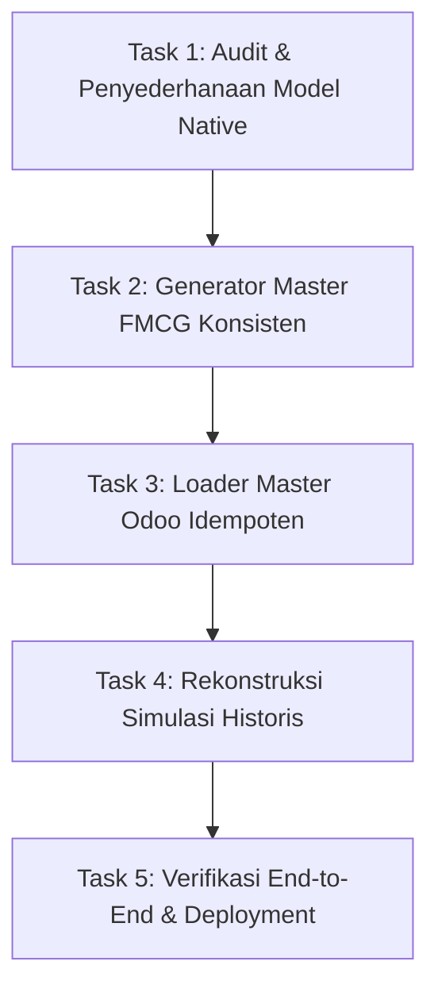

# Dokumen Audit Drift Eksekusi & Rencana Rekonstruksi Dataset Demo FMCG
**Tanggal:** 25 Oktober 2026  
**Penulis:** `antigravity` agent  
**Konteks:** Odoo 19 CE + OCA 19.0 — Distribusi FMCG Manado & Sulawesi Utara (PT Manado Distribusi Utama)  
**Referensi Utama:** Arahan Pemilik Repo (2026-10-25), `docs/reviews/REVIEW_2026-10-24_main-fa68c23.md`, `docs/blueprints/`, `docs/HANDOFF.md`, `agent-log/anti-gravity.log`.

---

## 1. Arahan & Ketentuan Tegas Pemilik Repo (2026-10-25)

1. **Maksimalkan Native Fields Odoo:** Prioritaskan penggunaan field bawaan (*native*) Odoo 19 ketimbang membuat field kustom (*custom fields under id_base/FMCG*). Custom fields hanya diizinkan apabila terbukti ada keterbatasan absolut pada field bawaan setelah pertimbangan matang.
2. **Kalender Hari Kerja Operasional:** Hari kerja operasional distribusi FMCG adalah **Senin sampai dengan Sabtu (6 hari kerja)**. Hari Minggu serta Hari Libur Resmi Nasional dan Cuti Bersama adalah hari libur (non-operasional).
3. **Kausalitas & Rasionalitas Transaksi Historis:** Simulasi transaksi historis (Juli – 24 Oktober 2026) wajib dirangkai secara presisi, logis, dan kausal sesuai narasi bisnis:
   - Dinamika Juli: Baseline 5.5 BIO IDR (puncak belanja sekolah, overstok gudang 10 BIO dari PO Juni 5.7 BIO, keterbatasan visual kapasitas gudang 2x lipat, push order pareto GT & MT dengan diskon hingga 5%, operasional membengkak, net margin 0.9%).
   - Dinamika Agustus: Omset turun -23%, net margin melonggar 2.5%, serapan pasar turun, penambahan coverage outlet aktif +6%, penahanan AP tanpa inbound baru, PO pembelian di week 3 untuk kedatangan September.
   - Dinamika September: Pertumbuhan sehat, omset sedikit turun (-6% s/d -7% dari Agustus), net margin melebar ke 3.7%, coverage outlet bertambah +8%.
   - Dinamika Oktober (MTD s/d 24 Okt): Pertumbuhan pesat mencapai 5.3 BIO IDR, potensi closing net margin 5%, manajemen gudang efisien, perputaran stok FEFO terjaga, PJP dan fulfillment logistik optimal.
   - Integritas Transaksi: Subtotal line item harus sinkron sempurna dengan total header (`qty * fraction * price == line subtotal == invoice header`).
   - Pertumbuhan Outlet Bertahap: Customer baru yang muncul karena ekspansi coverage harus terdistribusi sesuai periodenya (*cohort date*), tidak boleh terdaftar serentak di awal Juli.
4. **Register Master Customer & Koordinat:** Alamat dan koordinat lat/long 354 outlet diarsipkan dalam register resmi di repo (`data/registers/customer_registry_354.json` / `.csv`).
5. **Master Poligon Geospasial Sulawesi Utara:** Menambahkan dataset poligon GeoJSON level Provinsi (71), 15 Kabupaten/Kota, Kecamatan operasional, dan Kelurahan kunci di Sulawesi Utara (`data/geo/`).
6. **Modelling PJP Best Practice:** Memodelkan PJP yang efisien dengan segregasi channel, rasio kunjungan terukur (Daily, Weekly, Bi-weekly, Monthly), dan sinkronisasi rute pengiriman H+1.
7. **Simulasi Finansial & Operasional Lokal (Day-to-Day Ledger):** Menilai seluruh rantai transaksi (PO -> Inbound Stock -> Sales Order -> DO Delivery -> Invoicing AR -> Return -> Collection -> Expenses OPEX -> Payables AP) terlebih dahulu di lingkungan lokal melalui ledger harian presisi dan skrip verifikasi Python (`scripts/ops/verify_ledger.py`) sebelum diinjeksikan ke Odoo.
8. **Dokumentasi & Disiplin Multi-Agen:** Dokumentasikan seluruh perintah, temuan audit, dan rencana aksi ke file terstruktur, rujuk di `docs/HANDOFF.md` dan `agent-log/anti-gravity.log`.
9. **Manajemen Git:** Eksekusi dilakukan bertahap pada cabang tersendiri (`agen/rekonstruksi-seed-audit`), commit terpisah per milestone task, push dan merge diajukan setelah tervalidasi menyeluruh.

---

## 2. Temuan Audit: Titik-Titik Drift Eksekusi Agen Sebelumnya

Berdasarkan investigasi menyeluruh pada riwayat commit, transkrip eksekusi agen `antigravity` sebelumnya, dan perbandingan terhadap ulasan `claude-dev` (`REVIEW_2026-10-24_main-fa68c23.md`), ditemukan anomali dan penyimpangan berikut:

### A. UoM (Unit of Measure) dan Kemasan Multi-Level
- **Kondisi Saat Ini:**
  - Di `scripts/load_fmcg_seed.py` baris 242–243, `uom_id` dan `uom_po_id` untuk seluruh 150 produk di-hardcode ke `uom.product_uom_unit` ("Units").
  - Kategori UoM FMCG (Pcs, Sachet, Botol, Pouch vs Karton, Dus) tidak pernah dibuat di Odoo.
  - Field `inner_qty` dan `carton_qty` hanya berupa integer pasif di `product.template`, tidak berfungsi dalam transaksi penjualan/pembelian Odoo.
  - Dimensi kemasan karton (`carton_length_cm`, `carton_width_cm`, `carton_height_cm`, `carton_volume_cbm`, `carton_weight_kg`) yang digenerate di CSV dibuang saat pemuatan ke Odoo (hanya string nama kemasan yang dibuat).
  - Barcode kemasan `product.packaging` dihapus total di commit `78f484c` karena tabrakan dengan produk, alih-alih merancang barcode karton yang terstandar.

### B. Geografi, Lokasi Toko, & Koordinat Semu
- **Kondisi Saat Ini:**
  - **Mismatch Semantik Konyol di `data/seed/partners_354.csv`:**
    * *Toko Jaya Sejahtera Tomohon* diletakkan di Kecamatan Mapanget, Jl. AA Maramis Paniki, Kota Manado.
    * *Toko Berkat Kawangkoan* diletakkan di Kecamatan Maesa, Kompleks Pasar Tua, Kota Bitung.
    * *Toko Rezeki Tondano* diletakkan di Kecamatan Tomohon Tengah.
    * *Grosir Kauditan Makmur* diletakkan di Kecamatan Kawangkoan, Minahasa.
    *(Terjadi karena generator memasangkan nama toko statis secara modulo buta ke daftar kecamatan).*
  - **Koordinat Jalan Palsu (*Math-Offset Fake*):** Agen sebelumnya mengklaim telah mengalibrasi koordinat jalan darat. Faktanya di `generate_fmcg_seed.py` baris 1298–1301, koordinat hanya titik pusat kecamatan yang digeser dengan rumus modulo matematika semu `(((idx * 7) % 11) - 5) * 0.00035`.
  - **Konsentrasi Retail 260 Kios:** 260 kios retail canvass hanya ditumpuk di 4 kecamatan (Wenang, Malalayang, Mapanget, Airmadidi). 14 kecamatan lainnya kosong. Alamat jalan diseragamkan menjadi `"Lorong Pemukiman RW 0X"`, kode pos di-hardcode `"95100"`.

### C. Pemutusan Relasi Salesman & User Odoo (Broken Foreign Keys)
- **Kondisi Saat Ini:**
  - Di `partners_354.csv`, kode salesman diisi `SLS-01`, `SLS-02`, `CVS-01`, `CVS-02`.
  - Di `employees_24.csv`, kode karyawan diisi `EMP-013` (Christian Wowor - Sales MT), `EMP-014` (Andre Pangemanan - Sales TO), `EMP-017` (Novry Mandagi - Canvass). Tidak ada relasi kode antar-berkas.
  - Loader `scripts/load_fmcg_seed.py` baris 518–524 mencari akun `res.users` dengan username sama dengan kode salesman. Karena agen sebelumnya **hanya membuat data `hr.employee` dan TIDAK MEMBUAT akun `res.users`**, lookup selalu gagal dan fallback ke `admin_user`.
  - Akibatnya: **Seluruh 354 outlet (100%) di Odoo memiliki Salesperson = `Administrator`**.

### D. Halusinasi Konsep "Customer Tier"
- **Kondisi Saat Ini:**
  - Agen sebelumnya mengarang model `id.tier` yang tidak relevan dengan B2B FMCG.
  - Model ini telah dihapus di commit `f22cec8`, namun penghapusannya memicu kerusakan lanjutan pada skrip simulasi historis karena tidak disinkronkan.

### E. Kerusakan Fatal pada Skrip Simulasi Historis
- **Kondisi Saat Ini:**
  - **Crash Fatal Saat Dijalankan:** `python scripts/generate_historical_simulation.py` melempar error `KeyError: 'tier_code'` pada baris 81 karena membaca kolom CSV yang sudah dihapus.
  - **Inkonsistensi Nilai Baris vs Header:** Seluruh 8.513 baris line item di `sales_order_lines_historical.csv` tidak konsisten (`subtotal != qty * price`).
  - **Loader Simulasi Tidak Fungsional:** `load_historical_simulation.py` hanya meload 500 SO, mengalikan kuantitas karton dengan harga satuan eceran (omset Juli tercatat hanya Rp 168 juta dari target Rp 5.834 Miliar), dibungkus `except: pass`, dan tidak membuat DO, faktur, maupun jurnal pembayaran.
  - **Hari Kerja Salah:** Skrip lama menggunakan konfigurasi yang tidak sinkron, dan customer baru tidak bertumbuh bertahap (semua 354 outlet aktif sejak Juli).

---

## 3. Rencana Rekonstruksi & Tahapan Eksekusi

Perbaikan akan dieksekusi secara sistematis melalui cabang `agen/rekonstruksi-seed-audit`:

### Task 1: Audit Model Native & Pembersihan Custom Fields Berlebih
1. **Model Armada (`fleet.vehicle`):** Evaluasi field kargo. Gunakan field bawaan Odoo jika memungkinkan; jika custom field tonase/m³ diperlukan, pastikan terdefinisi bersih dan tidak tumpang tindih.
2. **Model Produk & UoM (`uom.uom`, `product.packaging`):**
   - Bangun kategori UoM resmi FMCG: Satuan Dasar (Pcs/Sachet/Botol/Pouch) dan Satuan Pembelian (Karton/Dus).
   - Setel konversi rasio native Odoo sehingga 1 Karton = X Pcs.
   - Konfigurasi `product.packaging` untuk menyerap dimensi karton riil (L/W/H, CBM, Kg).
3. **Model Partner & User (`res.partner`, `res.users`, `hr.employee`):**
   - Sinkronkan kode salesman: buat akun `res.users` untuk peran Sales TO, Sales Canvass, dan Sales MT, lalu tautkan ke `hr.employee` dan outlet binaannya di `res.partner.user_id`.

### Task 2: Master Dataset FMCG, Customer Register, Geo Polygons, & PJP Model
1. **Master Poligon Geospasial Sulawesi Utara (`data/geo/`):**
   - Menyediakan GeoJSON valid untuk batas Provinsi Sulut (71), 15 Kabupaten/Kota lengkap tanpa sampling, 18 kecamatan operasional, dan kelurahan pusat bisnis.
2. **Register Master Customer & Koordinat (`data/registers/customer_registry_354.json` & `.csv`):**
   - Eliminasi mismatch geografis (Toko Tomohon tepat di Tomohon, Kawangkoan di Minahasa, Bitung di Bitung).
   - Sebar 260 kios secara proporsional ke 18 kecamatan di Sulut dengan jalan, kode pos, dan koordinat terikat daratan koridor jalan.
   - Tetapkan tanggal aktif (*cohort date*) pembukaan toko (Juli: 50% = 177 outlet, Agustus: +6% = 21 outlet, Sept: +8% = 28 outlet, Okt: 128 outlet s/d 354).
3. **Modelling PJP Best Practice (`data/registers/pjp_schedule_354.json` & `.csv`):**
   - Frekuensi panggilan rasional: F1 (Weekly) untuk 12 MT & 25 GT besar; F2 (Bi-weekly) untuk GT sedang & retail utama; F4 (Monthly) untuk rural.
   - Segregasi channel per salesman dan keterkaitan jadwal delivery H+1 oleh armada logistik.
4. **Dataset Master Produk FMCG (`data/seed/products_150.csv`):**
   - Dimensi fisik lengkap Pcs dan Karton (L/W/H, CBM, Kg) dan rasio konversi unit dinamis.

### Task 3: Pembaruan Loader Master Odoo (`load_fmcg_seed.py`)
1. Setup UoM resmi dan packaging produk lengkap dengan dimensi karton.
2. Setup user sales dan mapping otomatis ke partner outlet.
3. Pastikan loader berjalan idempoten, tanpa exception pasif, dan melaporkan ringkasan validasi yang jujur.

### Task 4: Rekonstruksi Penuh Simulasi Historis Transaksi & Ledger Lokal
1. **Local Day-to-Day Financial & Operational Ledger (`data/registers/historical_ledger_day_to_day.json`):**
   - Menilai secara lokal seluruh siklus harian (1 Juli s/d 24 Oktober 2026): Inbound PO -> Warehouse Stock -> Sales Order -> DO Delivery -> Invoicing AR -> Return -> Collection -> OPEX Expenses -> AP Payables.
   - Skrip verifikasi mandiri: `scripts/ops/verify_ledger.py` untuk mengaudit seluruh invarian finansial harian (Gross, Diskon, COGS, Net Margin, Kas, Piutang, Hutang, Okupansi Gudang).
2. **Skrip Generator Simulasi Odoo (`generate_historical_simulation.py`):**
   - Menghapus dependensi `tier_code` (perbaiki crash).
   - Menerapkan kalender kerja operasional **Senin s/d Sabtu (6 hari kerja)**.
   - Sinkronisasi matematika 100%: `subtotal_line = qty * unit_price` dan `sum(subtotal) == header`.
   - Menyelaraskan dinamika narasi: Juli 5.5 BIO (overstok 10 BIO), Agustus drop 23%, September margin 3.7%, Oktober 5.3 BIO MTD.

### Task 5: Validasi, Pengujian, & Penyusunan PR
1. Jalankan `python scripts/ops/verify_ledger.py` untuk membuktikan integritas ledger lokal.
2. Jalankan `ruff check .` dan `python scripts/check_manifests.py`.
3. Validasi generator dan pastikan seluruh CSV seed ter-generate tanpa peringatan/galat.
4. Catat di `agent-log/anti-gravity.log` dan `docs/HANDOFF.md`.
5. Ajukan PR untuk ditinjau dan di-merge oleh pemilik repo.

